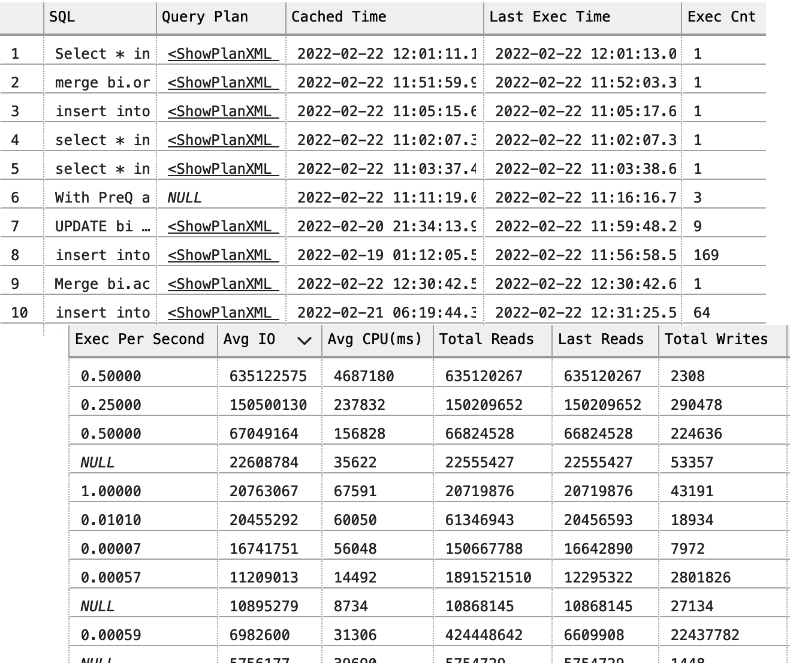
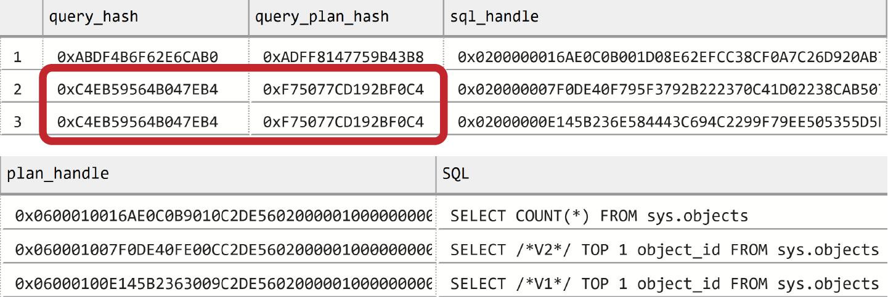
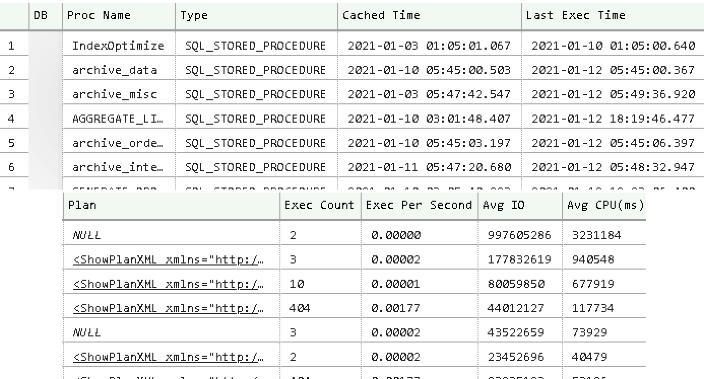
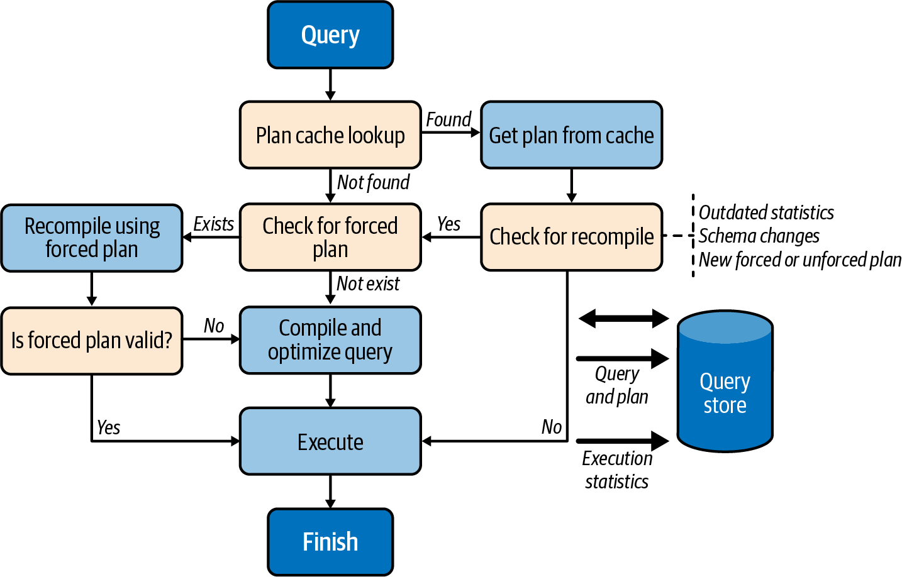
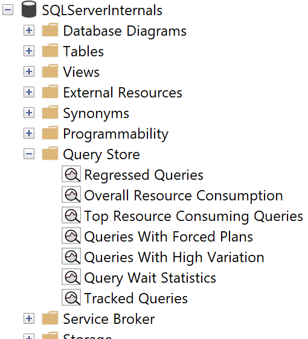
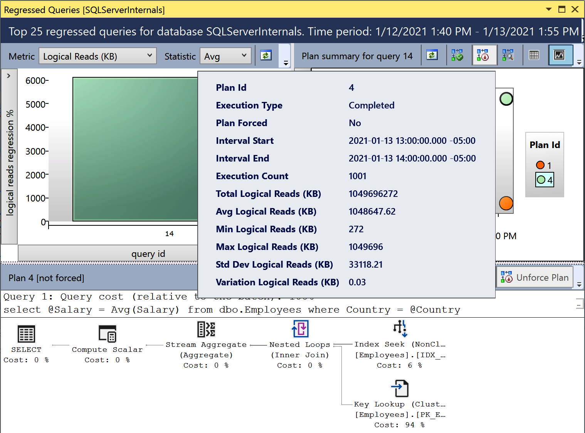
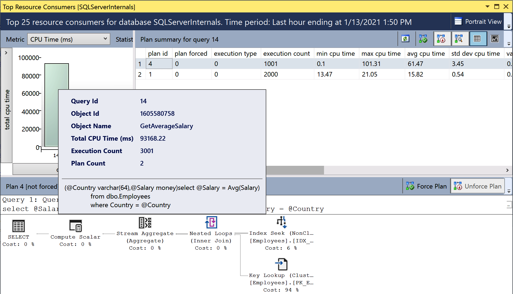
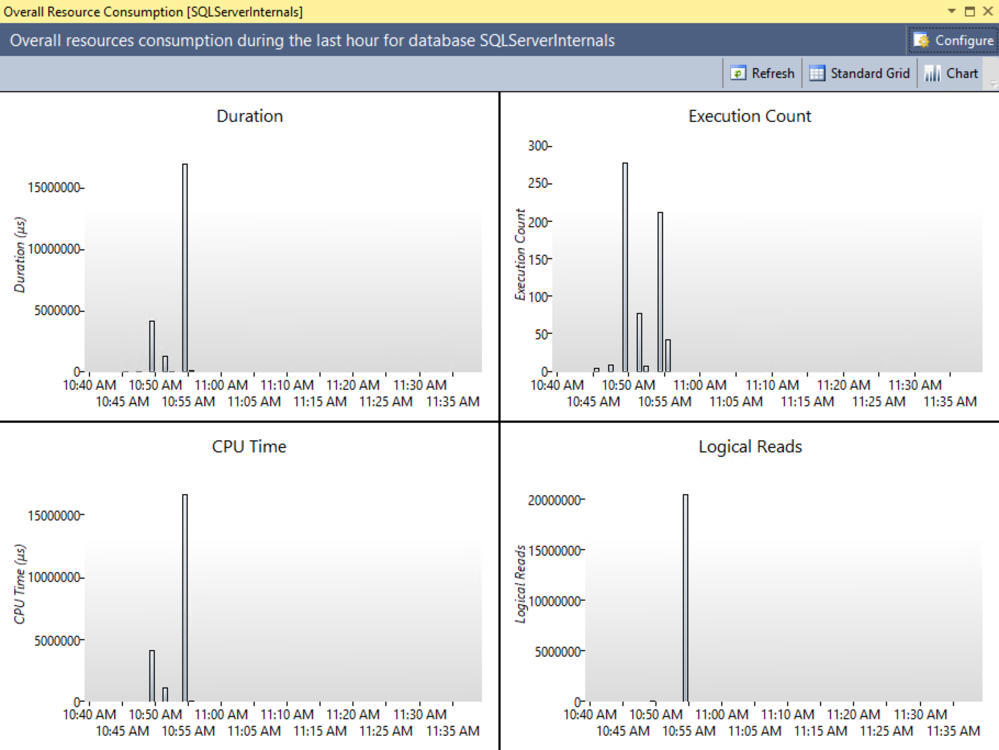
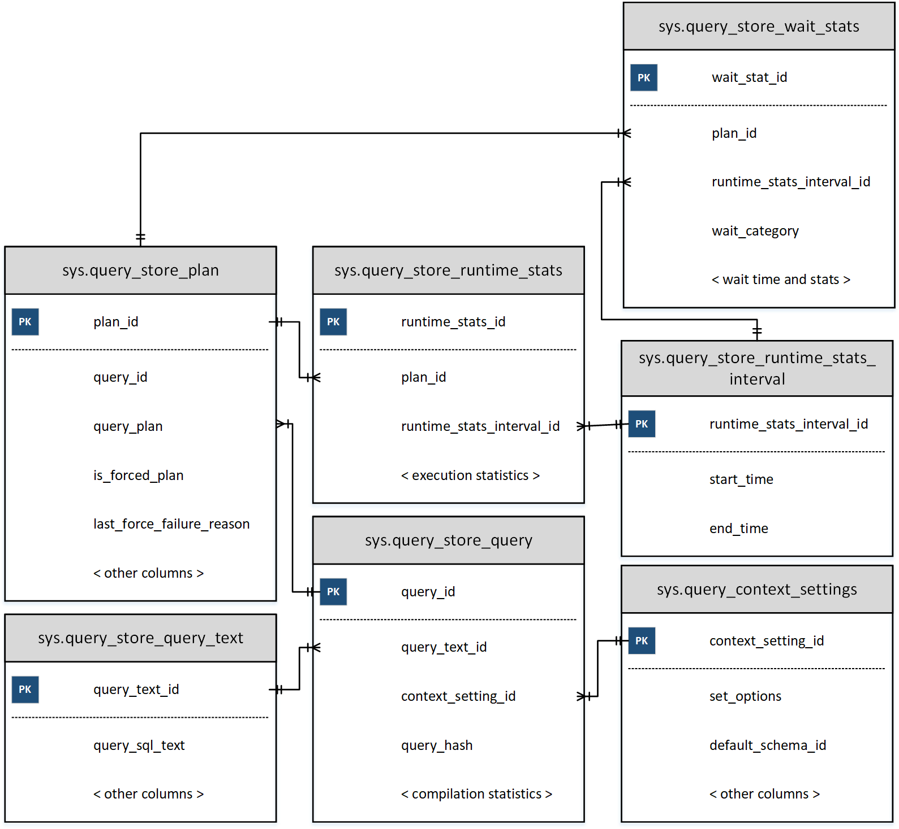

# Chapter 4

## Inefficient Queries

Source: [SQL.Server.Advanced.Troubleshooting.and.Performance.Tuning-2022-4.pdf](./SQL.Server.Advanced.Troubleshooting.and.Performance.Tuning-2022-4.pdf), printed pages 69–103.

Inefficient queries exist in every system. They impact performance in many ways, most notably by increasing I/O load, CPU usage, and blocking. It is essential to detect and optimize them.

This guide discusses inefficient queries and their potential impact on your system, and provides guidelines for detecting them, starting with an approach that uses plan cache–based execution statistics. It also covers Extended Events, SQL Traces, and the Query Store, and ends with a few thoughts on third-party monitoring tools. For background on scheduling and resource bottlenecks, see [SQL Server Execution Model and Wait Statistics](./SQL.SERVER.EXECUTION.MODEL.WAIT.STATISTICS.md).

### The Impact of Inefficient Queries

Most systems have opportunities to benefit from query optimization.

Not every company prioritizes query optimization, though. It’s a time-consuming and tedious process, and in many cases it’s cheaper, given the benefits of speeding up development and time to market, to throw hardware at the problem than to invest hours in performance tuning.

At some point, however, that approach leads to scalability issues. Poorly optimized queries impact systems from many angles, but perhaps the most obvious is disk performance. If the I/O subsystem cannot keep up with the load of large scans, the performance of your entire system will suffer.

You can mask this problem to a degree by adding more memory to the server. This increases the size of the buffer pool and allows SQL Server to cache more data, reducing physical I/O. As the amount of data in the system grows over time, however, this approach may become impractical or even impossible—especially in non-Enterprise editions of SQL Server that restrict the maximum buffer pool size.

Another effect to watch for is that nonoptimized queries burn CPU on the servers. The more data you process, the more CPU resources you consume. A server might spend just a few microseconds per logical read and in-memory data-page scan, but that quickly adds up as the number of reads increases.

Again, you can mask this by adding more CPUs to the server. (Note, however, that you need to pay for additional licenses and also would have limits on the maximum number of CPUs in non-Enterprise editions.) Moreover, adding CPUs may not always solve the problem, as nonoptimized queries will still contribute to blocking. While there are ways to reduce blocking without performing query tuning, this can change system behavior and has performance implications.

The bottom line is this: when you troubleshoot a system, always analyze whether queries are poorly optimized. Once you’ve done that, estimate the impact of those inefficient queries.

While query optimization always benefits a system, it is not always simple, nor does it always provide the best ROI for your efforts. Nevertheless, more often than not, you will at least need to tune some queries.

High disk throughput, blocking, or high CPU load are reasons to prioritize query tuning. Other issues may take priority if data is cached in the buffer pool and CPU load is acceptable. Consider data growth, though: active data may eventually outgrow the buffer pool, causing a sudden and serious performance impact.

Fortunately, query optimization does not require an all-or-nothing approach! You can achieve dramatic performance improvements by optimizing just a handful of frequently executed queries. Let’s look at a few methods for detecting them.

### Plan Cache–Based Execution Statistics

In most cases, SQL Server caches and reuses execution plans for queries. For each plan in the cache, it also maintains execution statistics, including the number of times the query ran, the cumulative CPU time, and the I/O load. You can use this information to quickly pinpoint the most resource-intensive queries for optimization.

Analyzing plan cache–based execution statistics is not the most comprehensive detection technique; it has quite a few limitations. Nevertheless, it is very easy to use, and in many cases it is *good enough*. It works in all versions of SQL Server and it is always present in the system. You don’t need to set up any additional monitoring to collect the data.

You can get execution statistics using the sys.dm_exec_query_stats view, as shown in Listing 4-1. This query is a bit simplistic, but it demonstrates the view in action and shows you the list of metrics exposed in the view. Listing 4-3 extends it by aggregating statistics for similar queries. Depending on your SQL Server version and patching level, some of the columns in these scripts may not be supported. Remove them when this is the case.

The code provides you the execution plans of the queries. There are two functions that allow you to obtain them:

`sys.dm_exec_query_plan`

This function returns the execution plan of the entire execution batch in XML format. Due to internal limitations of the function, the size of the resultant XML cannot exceed 2 MB, and the function may return NULL for the complex plans.

`sys.dm_exec_text_query_plan`

This function, used in Listing 4-1, returns a text representation of the execution plan. You can obtain it for the entire batch or for a specific statement from the batch by providing the statement’s offset as a parameter to the function.

Listing 4-1 converts plans to XML representation using the TRY_CONVERT function, which returns NULL if the size of XML exceeds 2 MB. You can remove the TRY_CONVERT function if you need to deal with large plans or if you run the code in SQL Server 2005 through 2008R2.

*Listing 4-1. Using the sys.dm_exec_query_stats view*

```sql
;WITH Queries
AS
(
    SELECT TOP 50
       qs.creation_time AS [Cached Time]
       ,qs.last_execution_time AS [Last Exec Time]
       ,qs.execution_count AS [Exec Cnt]
       ,CONVERT(DECIMAL(10,5),
            IIF
            (
                DATEDIFF(SECOND,qs.creation_time, qs.last_execution_time) = 0
                ,NULL
                ,1.0 * qs.execution_count /
                    DATEDIFF(SECOND,qs.creation_time, qs.last_execution_time)
            )
        ) AS [Exec Per Second]
        ,(qs.total_logical_reads + qs.total_logical_writes) /
            qs.execution_count AS [Avg IO]
        ,(qs.total_worker_time / qs.execution_count / 1000)
            AS [Avg CPU(ms)]
        ,qs.total_logical_reads AS [Total Reads]
        ,qs.last_logical_reads AS [Last Reads]
        ,qs.total_logical_writes AS [Total Writes]
        ,qs.last_logical_writes AS [Last Writes]
        ,qs.total_worker_time / 1000 AS [Total Worker Time]
        ,qs.last_worker_time / 1000 AS [Last Worker Time]
        ,qs.total_elapsed_time / 1000 AS [Total Elapsed Time]
        ,qs.last_elapsed_time / 1000 AS [Last Elapsed Time]
        ,qs.total_rows AS [Total Rows]
        ,qs.last_rows AS [Last Rows]
        ,qs.total_rows / qs.execution_count AS [Avg Rows]
        ,qs.total_physical_reads AS [Total Physical Reads]
        ,qs.last_physical_reads AS [Last Physical Reads]
        ,qs.total_physical_reads / qs.execution_count
            AS [Avg Physical Reads]
        ,qs.total_grant_kb AS [Total Grant KB]
        ,qs.last_grant_kb AS [Last Grant KB]
        ,(qs.total_grant_kb / qs.execution_count)
            AS [Avg Grant KB]
        ,qs.total_used_grant_kb AS [Total Used Grant KB]
        ,qs.last_used_grant_kb AS [Last Used Grant KB]
        ,(qs.total_used_grant_kb / qs.execution_count)
            AS [Avg Used Grant KB]
        ,qs.total_ideal_grant_kb AS [Total Ideal Grant KB]
        ,qs.last_ideal_grant_kb AS [Last Ideal Grant KB]
        ,(qs.total_ideal_grant_kb / qs.execution_count)
            AS [Avg Ideal Grant KB]
        ,qs.total_columnstore_segment_reads
            AS [Total CSI Segments Read]
        ,qs.last_columnstore_segment_reads
            AS [Last CSI Segments Read]
        ,(qs.total_columnstore_segment_reads / qs.execution_count)
            AS [AVG CSI Segments Read]
        ,qs.max_dop AS [Max DOP]
        ,qs.total_spills AS [Total Spills]
        ,qs.last_spills AS [Last Spills]
        ,(qs.total_spills / qs.execution_count) AS [Avg Spills]
        ,qs.statement_start_offset
        ,qs.statement_end_offset
        ,qs.plan_handle
        ,qs.sql_handle
    FROM
        sys.dm_exec_query_stats qs WITH (NOLOCK)
    ORDER BY
        [Avg IO] DESC
)
SELECT
    SUBSTRING(qt.text, (qs.statement_start_offset/2)+1,
    ((
        CASE qs.statement_end_offset
            WHEN -1 THEN DATALENGTH(qt.text)
            ELSE qs.statement_end_offset
        END - qs.statement_start_offset)/2)+1) AS SQL
    ,TRY_CONVERT(xml,qp.query_plan) AS [Query Plan]
    ,qs.*
FROM
    Queries qs
        OUTER APPLY sys.dm_exec_sql_text(qs.sql_handle) qt
        OUTER APPLY
            sys.dm_exec_text_query_plan
            (
                qs.plan_handle
                ,qs.statement_start_offset
                ,qs.statement_end_offset
            ) qp
OPTION (RECOMPILE, MAXDOP 1);
```

You can sort data differently based on your tuning goals: by I/O when you need to reduce disk load, by CPU on CPU-bound systems, and so on.

Figure 4-1 shows partial output of the query from one of the servers. As you can see, it is easy to choose queries to optimize based on the frequency of query executions and resource consumption data in the output.

The execution plans you get in the output do not include actual execution metrics. In this respect, they are similar to estimated execution plans. You’ll need to take this into consideration during optimization.

This problem can be addressed in SQL Server 2019 and later, and in Azure SQL Databases where you can enable collection of the last *actual* execution plan for the statement in the databases with compatibility level 150. You also need to enable the LAST_QUERY_PLAN_STATS database option. As with any data collection, enabling this option would introduce overhead in the system; however, this overhead is relatively small.

You can access the last actual execution plan through the sys.dm_exec_query_plan_stats function. You can replace the sys.dm_exec_text_query_plan function with the new function in the code examples here—they will continue to work.

There are several other important limitations to remember. First and foremost, you won’t see any data for the queries that do not have execution plans cached. You may miss some infrequently executed queries with plans evicted from the cache. Usually, this is not a problem; infrequently executed queries rarely need to be optimized at the beginning of tuning.



*Figure 4-1. Partial output from the sys.dm_exec_query_stats view*

There is another possibility, however. SQL Server won’t cache execution plans if you are using a statement-level recompile with ad-hoc statements or executing stored procedures with a RECOMPILE clause. You need to capture those queries using the [Query Store](#query-store) or [Extended Events](#extended-events-and-sql-traces).

If you are using a statement-level recompile in stored procedures or other T-SQL modules, SQL Server will cache the execution plan of the statement. The plan, however, is not going to be reused, and execution statistics will have the data only from the single (last) execution.

The second problem is related to how long plans stay cached. This varies by plan, which may skew the results when you sort data by *total* metrics. For example, a query with lower *average* CPU time may show a higher *total* number of executions and CPU time than a query with higher *average* CPU time, depending on the time when both plans were cached.

You can use either of these metrics, but neither approach is perfect. When you sort data by *average* values, you may see infrequently executed queries at the top of the list. Think about resource-intensive nightly jobs as an example. On the other hand, sorting by *total* values may omit the queries with the plans that had been recently cached.

You can look at the creation_time and last_execution_time columns, which show the last time when plans were cached and executed, respectively. Compare data sorted by both *total* and *average* metrics, taking the frequency of executions (the total and the average number of executions per second) into consideration. Combine the findings from both outputs before deciding what to optimize.

The final problem is more complicated: it is possible to get multiple results for the same or similar queries. This can happen with ad-hoc workloads, with clients that have different SET settings in their sessions, when users run the same queries with slightly different formatting, and in many other cases. This may also occur in databases with compatibility level 160 (SQL Server 2022) due to the parameter-sensitive plan optimization feature.

Fortunately, you can address that problem by using two columns, query_hash and query_plan_hash, both exposed in the sys.dm_exec_query_stats view. The same values in those columns would indicate similar queries and execution plans. You can use those columns to aggregate data.

> The DBCC FREEPROCCACHE statement clears the plan cache to reduce the size of the output in the demo. Do not run the code from Listing 4-2 on production servers!

For a simple example, Listing 4-2 runs three queries and then examines the content of the plan cache. The first two queries are the same—they just have different formatting. The third one is different.

*Listing 4-2. The query_hash and query_plan_hash queries in action*

```sql
DBCC FREEPROCCACHE -- Do not run in production!
GO
SELECT /*V1*/ TOP 1 object_id FROM sys.objects WHERE object_id = 1;
GO
SELECT /*V2*/ TOP 1 object_id
FROM sys.objects
WHERE object_id = 1;
GO
SELECT COUNT(*) FROM sys.objects
GO
SELECT
    qs.query_hash, qs.query_plan_hash, qs.sql_handle, qs.plan_handle,
    SUBSTRING(qt.text, (qs.statement_start_offset/2)+1,
    ((
        CASE qs.statement_end_offset
            WHEN -1 THEN DATALENGTH(qt.text)
            ELSE qs.statement_end_offset
        END - qs.statement_start_offset)/2)+1
    ) as SQL
FROM
    sys.dm_exec_query_stats qs
        CROSS APPLY sys.dm_exec_sql_text(qs.sql_handle) qt
ORDER BY query_hash
OPTION (MAXDOP 1, RECOMPILE);
```

You can see the results in Figure 4-2. There are three execution plans in the output. The last two rows have the same query_hash and query_plan_hash values and different sql_handle and plan_handle values.



*Figure 4-2. Multiple plans with the same query_hash and query_plan_hash values*

Listing 4-3 provides a more sophisticated version of the script from Listing 4-1 by aggregating statistics from similar queries. The statement and execution plans are picked up randomly from the first query in each group, so factor that into your analysis.

*Listing 4-3. Using the sys.dm_exec_query_stats view with query_hash aggregation*

```sql
;WITH Data
AS
(
    SELECT TOP 50
        qs.query_hash
        ,COUNT(*) as [Plan Count]
        ,MIN(qs.creation_time) AS [Cached Time]
        ,MAX(qs.last_execution_time) AS [Last Exec Time]
        ,SUM(qs.execution_count) AS [Exec Cnt]
        ,SUM(qs.total_logical_reads) AS [Total Reads]
        ,SUM(qs.total_logical_writes) AS [Total Writes]
        ,SUM(qs.total_worker_time / 1000) AS [Total Worker Time]
        ,SUM(qs.total_elapsed_time / 1000) AS [Total Elapsed Time]
        ,SUM(qs.total_rows) AS [Total Rows]
        ,SUM(qs.total_physical_reads) AS [Total Physical Reads]
        ,SUM(qs.total_grant_kb) AS [Total Grant KB]
        ,SUM(qs.total_used_grant_kb) AS [Total Used Grant KB]
        ,SUM(qs.total_ideal_grant_kb) AS [Total Ideal Grant KB]
        ,SUM(qs.total_columnstore_segment_reads)
            AS [Total CSI Segments Read]
        ,MAX(qs.max_dop) AS [Max DOP]
        ,SUM(qs.total_spills) AS [Total Spills]
    FROM
        sys.dm_exec_query_stats qs WITH (NOLOCK)
    GROUP BY
        qs.query_hash
    ORDER BY
        SUM((qs.total_logical_reads + qs.total_logical_writes) /
            qs.execution_count) DESC
)
SELECT
    d.[Cached Time]
    ,d.[Last Exec Time]
    ,d.[Plan Count]
    ,sql_plan.SQL
    ,sql_plan.[Query Plan]
    ,d.[Exec Cnt]
    ,CONVERT(DECIMAL(10,5),
        IIF(datediff(second,d.[Cached Time], d.[Last Exec Time]) = 0,
            NULL,
            1.0 * d.[Exec Cnt] /
                datediff(second,d.[Cached Time], d.[Last Exec Time])
        )
    ) AS [Exec Per Second]
    ,(d.[Total Reads] + d.[Total Writes]) / d.[Exec Cnt] AS [Avg IO]
    ,(d.[Total Worker Time] / d.[Exec Cnt] / 1000) AS [Avg CPU(ms)]
    ,d.[Total Reads]
    ,d.[Total Writes]
    ,d.[Total Worker Time]
    ,d.[Total Elapsed Time]
    ,d.[Total Rows]
    ,d.[Total Rows] / d.[Exec Cnt] AS [Avg Rows]
    ,d.[Total Physical Reads]
    ,d.[Total Physical Reads] / d.[Exec Cnt] AS [Avg Physical Reads]
    ,d.[Total Grant KB]
    ,d.[Total Grant KB] / d.[Exec Cnt] AS [Avg Grant KB]
    ,d.[Total Used Grant KB]
    ,d.[Total Used Grant KB] / d.[Exec Cnt] AS [Avg Used Grant KB]
    ,d.[Total Ideal Grant KB]
    ,d.[Total Ideal Grant KB] / d.[Exec Cnt] AS [Avg Ideal Grant KB]
    ,d.[Total CSI Segments Read]
    ,d.[Total CSI Segments Read] / d.[Exec Cnt] AS [AVG CSI Segments Read]
    ,d.[Max DOP]
    ,d.[Total Spills]
    ,d.[Total Spills] / d.[Exec Cnt] AS [Avg Spills]
FROM
    Data d
        CROSS APPLY
        (
            SELECT TOP 1
                SUBSTRING(qt.text, (qs.statement_start_offset/2)+1,
                ((
                    CASE qs.statement_end_offset
                        WHEN -1 THEN DATALENGTH(qt.text)
                        ELSE qs.statement_end_offset
                    END - qs.statement_start_offset)/2)+1
                ) AS SQL
                ,TRY_CONVERT(XML,qp.query_plan) AS [Query Plan]
            FROM
                sys.dm_exec_query_stats qs
                    OUTER APPLY sys.dm_exec_sql_text(qs.sql_handle) qt
                    OUTER APPLY sys.dm_exec_text_query_plan
                    (
                        qs.plan_handle
                        ,qs.statement_start_offset
                        ,qs.statement_end_offset
                    ) qp
            WHERE
                qs.query_hash = d.query_hash AND ISNULL(qt.text,'') <> ''
        ) sql_plan
ORDER BY
     [Avg IO] DESC
OPTION (RECOMPILE, MAXDOP 1);
```

Starting with SQL Server 2008, you can get execution statistics for stored procedures through the sys.dm_exec_procedure_stats view. You can use the code from Listing 4-4 to do this. As with the sys.dm_exec_query_stats view, you can sort data by various execution metrics, depending on your optimization strategy. It is worth noting that the execution statistics include the metrics from dynamic SQL and other nested modules (stored procedures, functions, triggers) called from the stored procedures.

*Listing 4-4. Using the sys.dm_exec_procedure_stats view*

```sql
SELECT TOP 50
    IIF (ps.database_id = 32767,
         'mssqlsystemresource',
         DB_NAME(ps.database_id)
    ) AS [DB]
    ,OBJECT_NAME(
         ps.object_id,
         IIF(ps.database_id = 32767, 1, ps.database_id)
    ) AS [Proc Name]
    ,ps.type_desc AS [Type]
    ,ps.cached_time AS [Cached Time]
    ,ps.last_execution_time AS [Last Exec Time]
    ,qp.query_plan AS [Plan]
    ,ps.execution_count AS [Exec Count]
    ,CONVERT(DECIMAL(10,5),
        IIF(datediff(second,ps.cached_time, ps.last_execution_time) = 0,
            NULL,
            1.0 * ps.execution_count /
                datediff(second,ps.cached_time, ps.last_execution_time)
        )
    ) AS [Exec Per Second]
    ,(ps.total_logical_reads + ps.total_logical_writes) /
        ps.execution_count AS [Avg IO]
    ,(ps.total_worker_time / ps.execution_count / 1000)
        AS [Avg CPU(ms)]
    ,ps.total_logical_reads AS [Total Reads]
    ,ps.last_logical_reads AS [Last Reads]
    ,ps.total_logical_writes AS [Total Writes]
    ,ps.last_logical_writes AS [Last Writes]
    ,ps.total_worker_time / 1000 AS [Total Worker Time]
    ,ps.last_worker_time / 1000 AS [Last Worker Time]
    ,ps.total_elapsed_time / 1000 AS [Total Elapsed Time]
    ,ps.last_elapsed_time / 1000 AS [Last Elapsed Time]
    ,ps.total_physical_reads AS [Total Physical Reads]
    ,ps.last_physical_reads AS [Last Physical Reads]
    ,ps.total_physical_reads / ps.execution_count AS [Avg Physical Reads]
    ,ps.total_spills AS [Total Spills]
    ,ps.last_spills AS [Last Spills]
    ,(ps.total_spills / ps.execution_count) AS [Avg Spills]
FROM
    sys.dm_exec_procedure_stats ps WITH (NOLOCK)
        CROSS APPLY sys.dm_exec_query_plan(ps.plan_handle) qp
ORDER BY
     [Avg IO] DESC
OPTION (RECOMPILE, MAXDOP 1);
```

Figure 4-3 shows partial output of the code. As you can see in the output, you can get execution plans for the stored procedures. Internally, the execution plans of stored procedures and other T-SQL modules are just collections of each statement’s individual plan. In some cases—for example, when the size of the execution plan exceeds 2 MB—the script would not include a plan in the output.



*Figure 4-3. Partial output of the sys.dm_exec_procedure_stats view*

Listing 4-5 helps address this. You can use it to get cached execution plans and their metrics for individual statements from T-SQL modules. You need to specify the name of the module in the WHERE clause of the statement when you run the script.

*Listing 4-5. Getting the execution plan and statistics for stored procedure statements*

```sql
SELECT
    qs.creation_time AS [Cached Time]
    ,qs.last_execution_time AS [Last Exec Time]
    ,SUBSTRING(qt.text, (qs.statement_start_offset/2)+1,
    ((
        CASE qs.statement_end_offset
            WHEN -1 THEN DATALENGTH(qt.text)
            ELSE qs.statement_end_offset
        END - qs.statement_start_offset)/2)+1) AS SQL
    ,TRY_CONVERT(XML,qp.query_plan) AS [Query Plan]
    ,CONVERT(DECIMAL(10,5),
        IIF(datediff(second,qs.creation_time, qs.last_execution_time) = 0,
            NULL,
            1.0 * qs.execution_count /
                datediff(second,qs.creation_time, qs.last_execution_time)
        )
    ) AS [Exec Per Second]
    ,(qs.total_logical_reads + qs.total_logical_writes) /
        qs.execution_count AS [Avg IO]
    ,(qs.total_worker_time / qs.execution_count / 1000)
        AS [Avg CPU(ms)]
    ,qs.total_logical_reads AS [Total Reads]
    ,qs.last_logical_reads AS [Last Reads]
    ,qs.total_logical_writes AS [Total Writes]
    ,qs.last_logical_writes AS [Last Writes]
    ,qs.total_worker_time / 1000 AS [Total Worker Time]
    ,qs.last_worker_time / 1000 AS [Last Worker Time]
    ,qs.total_elapsed_time / 1000 AS [Total Elapsed Time]
    ,qs.last_elapsed_time / 1000 AS [Last Elapsed Time]
    ,qs.total_rows AS [Total Rows]
    ,qs.last_rows AS [Last Rows]
    ,qs.total_rows / qs.execution_count AS [Avg Rows]
    ,qs.total_physical_reads AS [Total Physical Reads]
    ,qs.last_physical_reads AS [Last Physical Reads]
    ,qs.total_physical_reads / qs.execution_count
        AS [Avg Physical Reads]
    ,qs.total_grant_kb AS [Total Grant KB]
    ,qs.last_grant_kb AS [Last Grant KB]
    ,(qs.total_grant_kb / qs.execution_count)
        AS [Avg Grant KB]
    ,qs.total_used_grant_kb AS [Total Used Grant KB]
    ,qs.last_used_grant_kb AS [Last Used Grant KB]
    ,(qs.total_used_grant_kb / qs.execution_count)
        AS [Avg Used Grant KB]
    ,qs.total_ideal_grant_kb AS [Total Ideal Grant KB]
    ,qs.last_ideal_grant_kb AS [Last Ideal Grant KB]
    ,(qs.total_ideal_grant_kb / qs.execution_count)
        AS [Avg Ideal Grant KB]
    ,qs.total_columnstore_segment_reads
        AS [Total CSI Segments Read]
    ,qs.last_columnstore_segment_reads
        AS [Last CSI Segments Read]
    ,(qs.total_columnstore_segment_reads / qs.execution_count)
        AS [AVG CSI Segments Read]
    ,qs.max_dop AS [Max DOP]
    ,qs.total_spills AS [Total Spills]
    ,qs.last_spills AS [Last Spills]
    ,(qs.total_spills / qs.execution_count) AS [Avg Spills]
FROM
    sys.dm_exec_query_stats qs WITH (NOLOCK)
        OUTER APPLY sys.dm_exec_sql_text(qs.sql_handle) qt
        OUTER APPLY sys.dm_exec_text_query_plan
        (
            qs.plan_handle
            ,qs.statement_start_offset
            ,qs.statement_end_offset
        ) qp
WHERE
    OBJECT_NAME(qt.objectid, qt.dbid) = <SP Name> -- Add SP Name here
ORDER BY
    qs.statement_start_offset, qs.statement_end_offset
OPTION (RECOMPILE, MAXDOP 1);
```

Starting with SQL Server 2016, you can get execution statistics for triggers and scalar user-defined functions, using sys.dm_exec_trigger_stats and sys.dm_exec_function_stats views, respectively. You can use the same code as in Listing 4-4; just replace the DMV name there.

Finally, it is worth mentioning that SQL Server may cache thousands of execution plans. Moreover, the functions to obtain query plans and SQL statements are resource intensive; thus, the examples use the MAXDOP 1 query hint to reduce the overhead. In some cases, it may be beneficial to save the content of the plan cache to a separate database using SELECT INTO statements and analyze the data on nonproduction servers.

Troubleshooting based on plan cache–based execution statistics has several limitations, and you may miss some queries. Nevertheless, it is a great starting point. Most importantly, the data is collected automatically, and you can access it immediately, without setting up additional monitoring tools.

### Extended Events and SQL Traces

SQL Traces and Extended Events (xEvents) allow you to capture various events in a system for analysis and troubleshooting in real time. You can also use them to capture long-running and expensive queries, including those that don’t cache execution plans and are therefore missed by the sys.dm_exec_query_stats view.

Do *not* use SQL Traces and xEvents for this purpose unless it is *absolutely necessary*. Capturing executed statements is an expensive operation that may introduce significant performance overhead in busy systems.

It does not matter how much data you collect. You can exclude most statements from the output by filtering out queries with low resource consumption. But SQL Server will still have to capture *all* statements to evaluate, filter, and discard unnecessary events.

Don’t collect unnecessary information in events you are collecting or in xEvent actions you are capturing. Some actions—for example, callstack—are expensive and lead to a serious performance hit when enabled. When possible, use xEvents instead of SQL Traces. They are lighter and introduce less overhead in the system.

Table 4-1 shows several Extended and SQL Trace events that can be used to detect inefficient queries. Each of them, except sqlserver.attention, has a corresponding event that fires at the beginning of the execution. Sometimes you need to capture them to correlate workloads from multiple sessions.

*Table 4-1. Extended and SQL Trace events to detect inefficient queries*

| xEvent | SQL Trace event | Comments |
| --- | --- | --- |
| sqlserver.sql_statement_completed | SQL:StmtCompleted | Fired when the statement finishes the execution. |
| sqlserver.sp_statement_completed | SP:StmtCompleted | Fired when the SQL statement within the T-SQL module completes the execution. |
| sqlserver.rpc_completed | RPC:Completed | Fired when a remote procedure call (RPC) completes. RPCs are parameterized SQL requests, such as calls of stored procedures or parameterized batches, sent from applications. Many client libraries will run queries via sp_executesql calls, which can be captured by that event. |
| sqlserver.module_end | SP:Completed | Fired when the T-SQL module completes the execution. |
| sqlserver.sql_batch_completed | SQL:BatchCompleted | Fired when the SQL batch completes the execution. |
| sqlserver.attention | Error:Attention | Occur when the client cancels a query execution, either due to a timeout or explicitly (e.g., using the red cancel button in SSMS). |

Your choice of what events to capture depends on the system workload, the data access tier’s design, and your troubleshooting strategy. For example, the events sqlserver.sql_statement_completed and sqlserver.sp_statement_completed allow you to detect inefficient ad-hoc and T-SQL module queries. Alternatively, you can capture inefficient batches and stored procedures by using the sqlserver.rpc_completed and sqlserver.sql_batch_completed events, reducing overhead.

The same applies to choosing xEvent actions to capture. For example, you might ignore user and client application information if you don’t need it during troubleshooting. Alternatively, you could decide to collect query_hash and query_plan_hash actions and use them to identify the cumulative impact of similar queries and execution plans.

There are two useful approaches to capturing inefficient queries. For a relatively static workload that a small sample can represent, run a session for a few minutes and capture results into the ring_buffer target. Alternatively, run an xEvent session for a few hours using event_file as the target.

Listing 4-6 shows the latter approach of saving data to the *C:\ExtEvents* folder (change it in your system). It captures statements that consume more than 5,000 ms of CPU time or produce more than 50,000 logical reads or writes. The code in Listing 4-6 and Listing 4-7 will work in SQL Server 2012 and later; it may require modifications in SQL Server 2008, which works differently with the file target and lacks query_hash and query_plan_hash actions.

As a word of caution, this session introduces overhead. How much overhead you have will depend on the workload and the amount of data you are capturing. Do not keep this session active unless you are troubleshooting performance issues. Furthermore, tune the cpu_time, logical_reads, and writes threshold values to your workload, and avoid capturing an excessive number of queries.

Similarly, define a list of xEvents actions based on your troubleshooting strategy. For example, there is no need to collect plan_handle if you are going to perform the analysis on another server and would be unable to obtain execution plans from the plan cache.

*Listing 4-6. Capturing CPU- and I/O-intensive queries*

```sql
CREATE EVENT SESSION [Expensive Queries]
ON SERVER
ADD EVENT sqlserver.sql_statement_completed
(
    ACTION
    (
        sqlserver.client_app_name
        ,sqlserver.client_hostname
        ,sqlserver.database_id
        ,sqlserver.plan_handle
        ,sqlserver.query_hash
        ,sqlserver.query_plan_hash
        ,sqlserver.sql_text
        ,sqlserver.username
    )
    WHERE
    (
        (
            cpu_time >= 5000000 or -- Time in microseconds
            logical_reads >= 50000 or
            writes >= 50000
        ) AND
        sqlserver.is_system = 0
    )
)
,ADD EVENT sqlserver.sp_statement_completed
(
    ACTION
    (
        sqlserver.client_app_name
        ,sqlserver.client_hostname
        ,sqlserver.database_id
        ,sqlserver.plan_handle
        ,sqlserver.query_hash
        ,sqlserver.query_plan_hash
        ,sqlserver.sql_text
        ,sqlserver.username
    )
    WHERE
    (
        (
            cpu_time >= 5000000 or -- Time in microseconds
            logical_reads >= 50000 or
            writes >= 50000
        ) AND
        sqlserver.is_system = 0
    )
)
ADD TARGET package0.event_file
(
    SET FILENAME = 'C:\ExtEvents\Expensive Queries.xel'
)
WITH
(
    event_retention_mode=allow_single_event_loss
    ,max_dispatch_latency=30 seconds
);
```

Listing 4-7 provides the code to parse the collected data. As a first step, it loads the collected events into a temporary table using the sys.fn_xe_file_target_read_file function. The asterisk at the end of the filename tells SQL Server to load all rollover files from the xEvent session.

Second, the code parses the collected events, saving the results to another temporary table. You may need to adjust the code in the EventInfo CTE based on the xEvent fields and actions you need for troubleshooting. Do not parse unnecessary information—shredding XML is an expensive and time-consuming operation.

Finally, if you run this code on SQL Server 2016 or earlier versions, you need to modify it and obtain the time of the event from the event_data XML. In SQL Server 2017, the sys.fn_xe_file_target_read_file function returns this as part of the output.

*Listing 4-7. Parsing collected xEvent data*

```sql
CREATE TABLE #EventData
(
  event_data XML NOT NULL,
  file_name NVARCHAR(260) NOT NULL,
  file_offset BIGINT NOT NULL,
  timestamp_utc datetime2(7) NOT NULL -- SQL Server 2017+
);
INSERT INTO #EventData(event_data, file_name, file_offset, timestamp_utc)
  SELECT CONVERT(XML,event_data), file_name, file_offset, timestamp_utc
  FROM sys.fn_xe_file_target_read_file
    ('c:\extevents\Expensive Queries*.xel',NULL,NULL,NULL);
;WITH EventInfo([Event],[Event Time],[DB],[Statement],[SQL],[User Name]
  ,[Client],[App],[CPU Time],[Duration],[Logical Reads]
  ,[Physical Reads],[Writes],[Rows],[Query Hash],[Plan Hash]
  ,[PlanHandle],[Stmt Offset],[Stmt Offset End],File_Name,File_Offset)
AS
(
  SELECT
    event_data.value('/event[1]/@name','SYSNAME') AS [Event]
    ,timestamp_utc AS [Event Time] -- SQL Server 2017+
    /*,event_data.value('/event[1]/@timestamp','DATETIME')
        AS [Event Time] -- Prior SQL Server 2017 */
    ,event_data.value
       ('((/event[1]/action[@name="database_id"]/value/text())[1])'
         ,'INT') AS [DB]
    ,event_data.value
       ('((/event[1]/data[@name="statement"]/value/text())[1])'
         ,'NVARCHAR(MAX)') AS [Statement]
    ,event_data.value
       ('((/event[1]/action[@name="sql_text"]/value/text())[1])'
         ,'NVARCHAR(MAX)') AS [SQL]
    ,event_data.value
       ('((/event[1]/action[@name="username"]/value/text())[1])'
         ,'NVARCHAR(255)') AS [User Name]
    ,event_data.value
       ('((/event[1]/action[@name="client_hostname"]/value/text())[1])'
         ,'NVARCHAR(255)') AS [Client]
    ,event_data.value
       ('((/event[1]/action[@name="client_app_name"]/value/text())[1])'
         ,'NVARCHAR(255)') AS [App]
    ,event_data.value
       ('((/event[1]/data[@name="cpu_time"]/value/text())[1])'
         ,'BIGINT') AS [CPU Time]
    ,event_data.value
       ('((/event[1]/data[@name="duration"]/value/text())[1])'
         ,'BIGINT') AS [Duration]
    ,event_data.value
       ('((/event[1]/data[@name="logical_reads"]/value/text())[1])'
         ,'INT') AS [Logical Reads]
    ,event_data.value
       ('((/event[1]/data[@name="physical_reads"]/value/text())[1])'
         ,'INT') AS [Physical Reads]
    ,event_data.value
       ('((/event[1]/data[@name="writes"]/value/text())[1])'
         ,'INT') AS [Writes]
    ,event_data.value
       ('((/event[1]/data[@name="row_count"]/value/text())[1])'
         ,'INT') AS [Rows]
    ,event_data.value(
       'xs:hexBinary(((/event[1]/action[@name="query_hash"]/value/text())[1]))'
         ,'BINARY(8)') AS [Query Hash]
    ,event_data.value(
      'xs:hexBinary(((/event[1]/action[@name="query_plan_hash"]/value/text())[1]))'
         ,'BINARY(8)') AS [Plan Hash]
    ,event_data.value(
      'xs:hexBinary(((/event[1]/action[@name="plan_handle"]/value/text())[1]))'
         ,'VARBINARY(64)') AS [PlanHandle]
    ,event_data.value
      ('((/event[1]/data[@name="offset"]/value/text())[1])'
         ,'INT') AS [Stmt Offset]
    ,event_data.value
       ('((/event[1]/data[@name="offset_end"]/value/text())[1])'
         ,'INT') AS [Stmt Offset End]
    ,file_name
    ,file_offset
  FROM
    #EventData
)
SELECT
  ei.*
  ,TRY_CONVERT(XML,qp.Query_Plan) AS [Plan]
INTO #Queries
FROM
  EventInfo ei
    OUTER APPLY
      sys.dm_exec_text_query_plan
      (
        ei.PlanHandle
        ,ei.[Stmt Offset]
        ,ei.[Stmt Offset End]
      ) qp
OPTION (MAXDOP 1, RECOMPILE);
```

Now you can work with raw data from the #Queries table, detecting the most inefficient queries for optimization. In many cases, it is also beneficial to aggregate the data based on a statement, query hash, or plan hash, analyzing the cumulative impact of the queries.

When capturing a workload into the ring_buffer target, keep an important limitation in mind: the sys.dm_xe_session_targets view, which provides the collected data from the target, can only output 4 MB of XML. This may lead to a situation when you don’t see some collected events.

Again: *beware of the overhead that xEvents and SQL Traces introduce in systems*. Do *not* create and run those sessions permanently. In many cases, you can get enough troubleshooting data by enabling the session or trace for just a few minutes.

### Query Store

Both [plan cache–based execution statistics](#plan-cachebased-execution-statistics) and [Extended Events and SQL Traces](#extended-events-and-sql-traces) have limitations. Plan cache–based data may miss some queries; SQL Traces and xEvents require you to perform complex analysis of the output and may have significant performance overhead in busy systems.

The Query Store, introduced in SQL Server 2016, helps address those limitations. You can think of it as something like the flight data recorders (or “black boxes”) in airplane cockpits, but for SQL Server. When the Query Store is enabled, SQL Server captures and persists the runtime statistics and execution plans of the queries in the database. It shows how the execution plans perform and how they evolve over time. Finally, it allows you to force specific execution plans to queries to address parameter-sniffing issues.

> The Query Store is disabled by default in the on-premises version of SQL Server up to SQL Server 2019. It is enabled by default in Azure SQL Databases, Azure SQL Managed Instances, and new databases created in SQL Server 2022.

The Query Store is fully integrated into the query processing pipeline, as illustrated by the high-level diagram in Figure 4-4.

When a query needs to be executed, SQL Server looks up the execution plan from the plan cache. If it finds a plan, SQL Server checks if the query needs to be recompiled (due to statistics updates or other factors), if a new forced plan has been created, and if an old forced plan has been dropped from the Query Store.



*Figure 4-4. Query processing pipeline*

During compilation, SQL Server checks if the query has a forced plan available. When this happens, the query essentially gets compiled with the forced plan, much like when the USE PLAN hint is used. If the resultant plan is valid, it is stored in the plan cache for reuse.

If the forced plan is no longer valid (e.g., when a user drops an index referenced in the forced plan), SQL Server does not fail the query. Instead, it compiles the query again without the forced plan and without caching it afterward. The Query Store, on the other hand, persists both plans, marking the forced plan as invalid. All of that happens transparently to the applications.

In SQL Server 2022 and SQL Azure Database, the Query Store allows you to add query-level hints using the sp_query_store_set_hints stored procedure. With Query Store hints, SQL Server will compile and execute queries as if you were providing the hints using the OPTION query clause. This gives you additional flexibility during query tuning without the need to change the applications.

Despite its tight integration with the query processing pipeline and various internal optimizations, the Query Store still adds overhead to the system. Just how much overhead depends on the following two main factors:

*Number of compilations in the system*

The more compilations SQL Server performs, the more load the Query Store must handle. In particular, the Query Store may not work very well in systems that have a very heavy, ad-hoc, nonparameterized workload.

*Data collection settings*

The Query Store’s configurations allow you to specify if you want to capture all queries or just expensive ones, along with aggregation intervals and data retention settings. If you collect more data and/or use smaller aggregation intervals, you’ll have more overhead.

Pay specific attention to the QUERY_CAPTURE_MODE setting, which controls what queries are captured. With QUERY_CAPTURE_MODE=ALL (the default in SQL Server 2016 and 2017), the Query Store captures all queries in the system. This can have an impact, especially on an ad-hoc workload.

With QUERY_CAPTURE_MODE=AUTO (the default in SQL Server 2019 and later), the Query Store does not capture small or infrequently executed queries. This is the best option in most cases.

Finally, starting with SQL Server 2019, you can set QUERY_CAPTURE_MODE=CUSTOM and customize criteria when queries are captured even further.

When properly configured, the overhead introduced by the Query Store is usually relatively small. However, it may be significant in some cases. In an example reported by Dmitri Korotkevitch, a process consisted of a very large number of small ad-hoc queries. Capturing all queries with QUERY_CAPTURE_MODE=ALL collected almost 10 GB of Query Store data. The process took 8 hours to complete with the Query Store enabled, compared to 2.5 hours without it.

Nevertheless, consider enabling the Query Store if your system can handle the overhead. For example, some features from the Intelligent Query Processing (IQP) family rely on the Query Store and will benefit from it. It also simplifies query tuning and may save you many hours of work when enabled.

> Monitor `QDS*` waits when you enable the Query Store. Excessive `QDS*` waits may be a sign of higher Query Store overhead in the system. Ignore QDS_PERSIST_TASK_MAIN_LOOP_SLEEP and QDS_ASYNC_QUEUE waits; they are benign.

There are two important trace flags that you should consider enabling if you are using the Query Store:

`T7745`

To reduce overhead, SQL Server caches some Query Store data in memory periodically, flushing it to the database. The flush interval is controlled by the DATA_FLUSH_INTERVAL_SECONDS setting, which dictates how much Query Store data you can lose in the event of a SQL Server crash. In normal circumstances, however, SQL Server would save in-memory Query Store data during SQL Server shutdown or failover.

This behavior may prolong shutdown and failover times in busy systems. You can disable this with trace flag T7745 as the loss of a small amount of telemetry is usually acceptable.

T7752 *(SQL Server 2016 and 2017)*

SQL Server loads some Query Store data into memory on database startup, keeping the database unavailable during that time. With large Query Stores, this may prolong SQL Server restart or failover time and impact the user experience.

The trace flag T7752 forces SQL Server to load Query Store data asynchronously, allowing queries to execute in parallel. The telemetry will not be collected during the load; however, it is usually an acceptable price to pay for faster startup.

You can analyze the impact of a synchronous Query Store load by looking at the wait time for the QDS_LOADDB wait type. This wait occurs only at database startup, so you need to query the sys.dm_os_wait_stats view and filter the output by wait type to get the number.

As a general rule, do not create a very large Query Store. Also, consider monitoring Query Store size, especially in very busy systems. In some cases, SQL Server may not be able to clean up data quickly enough, especially if you are using the QUERY_CAPTURE_MODE=ALL collection mode.

Finally, apply the latest SQL Server updates, especially if you are using SQL Server 2016 and 2017. Multiple Query Store scalability enhancements and bug fixes were published after the initial release of the feature.

You can work with the Query Store in two ways: through the graphics UI in SSMS or by querying dynamic management views directly. Let’s look at the UI first.

#### Query Store SSMS Reports

After you enable the Query Store in the database, you’ll see a *Query Store* folder in the *Object Explorer* (Figure 4-5). The number of reports in the folder will depend on the versions of SQL Server and SSMS in your system. The rest of this section will walk you through the seven reports shown in Figure 4-5.



*Figure 4-5. Query Store reports in SSMS*

##### Regressed Queries

This report, shown in Figure 4-6, shows queries whose performance has regressed over time. You can configure the time frame and regression criteria (such as disk operations, CPU consumption, and number of executions) for analysis.

Choose the query in the graph in the upper-left portion of the report. The upper-right portion of the report illustrates collected execution plans for the selected query. You can click on the dots, which represent different execution plans, and see the plans at the bottom. You can also compare different execution plans.



*Figure 4-6. Regressed Queries report*

The *Force Plan* button allows you to force a selected plan for the query. It calls the sys.sp_query_store_force_plan stored procedure internally. Similarly, the *Unforce Plan* button removes a forced plan by calling the sys.sp_query_store_unforce_plan stored procedure.

The Regressed Queries report is a great tool for troubleshooting issues related to parameter sniffing and fixing them quickly by forcing specific execution plans.

##### Top Resource Consuming Queries

This report (Figure 4-7) allows you to detect the most resource-intensive queries in the system. While it works similarly to the data provided by the sys.dm_exec_query_stats view, it does not depend on the plan cache. You can customize the metrics used for data sorting and the time interval.



*Figure 4-7. Top Resource Consuming Queries report*

##### Overall Resource Consumption

This report shows the workload’s statistics and resource usage over the specified time intervals. It allows you to detect and analyze spikes in resource usage and drill down to the queries that introduce such spikes. Figure 4-8 shows the output of the report.



*Figure 4-8. Overall Resource Consumption report*

##### Queries With High Variation

This report allows you to pinpoint queries with high performance variation. You can use it to detect anomalies in the workload, along with possible performance regressions.

##### Queries With Forced Plans

This report shows you the queries that have an execution plan forced in the system.

##### Query Wait Statistics

This report allows you to detect queries with high waits. The data is grouped by several categories (such as CPU, disk, and blocking), depending on the wait type. You can see details on wait mapping in the Microsoft documentation.

##### Tracked Queries

Finally, the Tracked Queries report allows you to monitor execution plans and statistics for individual queries. It provides similar information to the Regressed Queries and Top Resource Consuming Queries reports, at the scope of individual queries.

These reports will give you a large amount of data for analysis. However, in some cases, you’ll want to use T-SQL and work with the Query Store data directly. Let’s look at how you can accomplish this.

#### Working with Query Store DMVs

The Query Store dynamic management views are highly normalized, as shown in Figure 4-9. Execution statistics are tracked for each execution plan and grouped by collection intervals, which are defined by the INTERVAL_LENGTH_MINUTES setting. The default interval of 60 minutes is acceptable in most cases.

As you can guess, the smaller the intervals you use, the more data will be collected and persisted in the Query Store. The same applies to the system workload: an excessive number of ad-hoc queries may balloon the Query Store’s size. Keep this in mind when you configure the Query Store in your system.



*Figure 4-9. Query Store DMVs*

You can logically separate DMVs into two categories: plan store and runtime statistics. Plan store DMVs include the following views:

`sys.query_store_query`

The sys.query_store_query view provides information about queries and their compilation statistics, as well as the time of the last execution.

`sys.query_store_query_text`

The sys.query_store_query_text view shows information about the query text.

`sys.query_context_setting`

The sys.query_context_setting view contains information about context settings associated with the query. It includes SET options, default schema for the session, language, and other attributes. SQL Server may generate and cache separate execution plans for the same query when those settings are different.

`sys.query_store_plan`

The sys.query_store_plan view provides information about query execution plans. The is_forced_plan column indicates whether the plan is forced. The last_force_failure_reason tells you why a forced plan was not applied to the query.

As you can see, each query can have multiple entries in the sys.query_store_query and sys.query_store_plan views. This will vary based on your session context options, recompilations, and other factors.

Three other views represent runtime statistics:

`sys.query_store_runtime_stats_interval`

The sys.query_store_runtime_stats_interval view contains information about statistics collection intervals.

`sys.query_store_runtime_stats`

The sys.query_store_runtime_stats view references the sys.query_store_plan view and contains information about runtime statistics for a specific plan during a particular sys.query_store_runtime_stats_interval interval. It provides information about execution count, CPU time and call durations, logical and physical I/O statistics, transaction log usage, degree of parallelism, memory grant size, and a few other useful metrics.

`sys.query_store_wait_stats`

Starting with SQL Server 2017, you can get information about query waits with the sys.query_store_wait_stats view. The data is collected for each plan and time interval and grouped by several wait categories, including CPU, memory, and blocking.

Let’s look at a few scenarios for working with Query Store data.

Listing 4-8 provides code that returns information about the system’s 50 most I/O-intensive queries. Because the Query Store persists execution statistics over time intervals, you’ll need to aggregate data from multiple sys.query_store_runtime_stats rows. The output will include data for all intervals that ended within the last 24 hours, grouped by queries and their execution plans.

It’s worth noting that the Query Store date/time information uses the data type datetimeoffset. Keep this in mind when you filter the data.

*Listing 4-8. Getting information about expensive queries from the Query Store*

```sql
SELECT TOP 50
  q.query_id, qt.query_sql_text, qp.plan_id, qp.query_plan
  ,SUM(rs.count_executions) AS [Execution Cnt]
  ,CONVERT(INT,SUM(rs.count_executions *
    (rs.avg_logical_io_reads + avg_logical_io_writes)) /
      SUM(rs.count_executions)) AS [Avg IO]
  ,CONVERT(INT,SUM(rs.count_executions *
    (rs.avg_logical_io_reads + avg_logical_io_writes))) AS [Total IO]
  ,CONVERT(INT,SUM(rs.count_executions * rs.avg_cpu_time) /
    SUM(rs.count_executions)) AS [Avg CPU]
  ,CONVERT(INT,SUM(rs.count_executions * rs.avg_cpu_time)) AS [Total CPU]
  ,CONVERT(INT,SUM(rs.count_executions * rs.avg_duration) /
    SUM(rs.count_executions)) AS [Avg Duration]
  ,CONVERT(INT,SUM(rs.count_executions * rs.avg_duration))
    AS [Total Duration]
  ,CONVERT(INT,SUM(rs.count_executions * rs.avg_physical_io_reads) /
    SUM(rs.count_executions)) AS [Avg Physical Reads]
  ,CONVERT(INT,SUM(rs.count_executions * rs.avg_physical_io_reads))
    AS [Total Physical Reads]
  ,CONVERT(INT,SUM(rs.count_executions * rs.avg_query_max_used_memory) /
    SUM(rs.count_executions)) AS [Avg Memory Grant Pages]
  ,CONVERT(INT,SUM(rs.count_executions * rs.avg_query_max_used_memory))
    AS [Total Memory Grant Pages]
  ,CONVERT(INT,SUM(rs.count_executions * rs.avg_rowcount) /
    SUM(rs.count_executions)) AS [Avg Rows]
  ,CONVERT(INT,SUM(rs.count_executions * rs.avg_rowcount)) AS [Total Rows]
  ,CONVERT(INT,SUM(rs.count_executions * rs.avg_dop) /
    SUM(rs.count_executions)) AS [Avg DOP]
  ,CONVERT(INT,SUM(rs.count_executions * rs.avg_dop)) AS [Total DOP]
FROM
  sys.query_store_query q WITH (NOLOCK)
    JOIN sys.query_store_plan qp WITH (NOLOCK) ON
      q.query_id = qp.query_id
    JOIN sys.query_store_query_text qt WITH (NOLOCK) ON
      q.query_text_id = qt.query_text_id
    JOIN sys.query_store_runtime_stats rs WITH (NOLOCK) ON
      qp.plan_id = rs.plan_id
    JOIN sys.query_store_runtime_stats_interval rsi WITH (NOLOCK) ON
      rs.runtime_stats_interval_id = rsi.runtime_stats_interval_id
WHERE
  rsi.end_time >= DATEADD(DAY,-1,SYSDATETIMEOFFSET())
GROUP BY
  q.query_id, qt.query_sql_text, qp.plan_id, qp.query_plan
ORDER BY
  [Avg IO] DESC
OPTION (MAXDOP 1, RECOMPILE);
```

Obviously, you can sort data by different criteria than average I/O. You can also add predicates to the WHERE and/or HAVING clause of the query to narrow down the results. For example, you can filter by *DOP* columns if you want to detect queries that use parallelism in an OLTP environment and fine-tune the *Cost Threshold for Parallelism* setting.

Another example is for detecting queries that balloon the plan cache. The code in Listing 4-9 provides information about queries that generate multiple execution plans due to different context settings. The two most common reasons for this are sessions that use different SET options and queries that reference objects without schema names.

*Listing 4-9. Queries with different context settings*

```sql
SELECT
    q.query_id, qt.query_sql_text
    ,COUNT(DISTINCT q.context_settings_id) AS [Context Setting Cnt]
    ,COUNT(DISTINCT qp.plan_id) AS [Plan Count]
FROM
    sys.query_store_query q WITH (NOLOCK)
        JOIN sys.query_store_query_text qt WITH (NOLOCK) ON
            q.query_text_id = qt.query_text_id
        JOIN sys.query_store_plan qp WITH (NOLOCK) ON
            q.query_id = qp.query_id
GROUP BY
    q.query_id, qt.query_sql_text
HAVING
    COUNT(DISTINCT q.context_settings_id) > 1
ORDER BY
    COUNT(DISTINCT q.context_settings_id)
OPTION (MAXDOP 1, RECOMPILE);
```

Listing 4-10 shows you how to find similar queries based on the query_hash value (SQL in the output represents one randomly selected query from the group). Usually, those queries belong to a nonparameterized ad-hoc workload in the system. You can parameterize those queries in the code. If that’s not possible, consider using forced parameterization.

*Listing 4-10. Detecting queries with duplicated query_hash values*

```sql
;WITH Queries(query_hash, [Query Count], [Exec Count], qtid)
AS
(
    SELECT TOP 100
        q.query_hash
        ,COUNT(DISTINCT q.query_id)
        ,SUM(rs.count_executions)
        ,MIN(q.query_text_id)
    FROM
        sys.query_store_query q WITH (NOLOCK)
            JOIN sys.query_store_plan qp WITH (NOLOCK) ON
                q.query_id = qp.query_id
            JOIN sys.query_store_runtime_stats rs WITH (NOLOCK) ON
                qp.plan_id = rs.plan_id
    GROUP BY
        q.query_hash
    HAVING
        COUNT(DISTINCT q.query_id) > 1
)
SELECT
    q.query_hash
    ,qt.query_sql_text AS [Sample SQL]
    ,q.[Query Count]
    ,q.[Exec Count]
FROM
    Queries q CROSS APPLY
    (
        SELECT TOP 1 qt.query_sql_text
        FROM sys.query_store_query_text qt WITH (NOLOCK)
        WHERE qt.query_text_id = q.qtid
    ) qt
ORDER BY
    [Query Count] DESC, [Exec Count] DESC
OPTION(MAXDOP 1, RECOMPILE);
```

As you can see, the possibilities are endless. Use the Query Store if you can afford its overhead in your system.

Finally, the DBCC CLONEDATABASE command allows you to generate a schema-only clone of the database and use it to investigate performance problems. By default, a clone will include Query Store data. You can restore it and perform an analysis on another server to reduce overhead in production.

### Third-Party Tools

As you’ve now seen, SQL Server provides a very rich and extensive set of tools to locate inefficient queries. Nevertheless, you may also benefit from monitoring tools developed by other vendors. Most will provide you with a list of the most resource-intensive queries for analysis and optimization. Many will also give you the baseline, which you can use to analyze trends and detect regressed queries.

The following considerations can help you choose and use monitoring tools.

The key to using any tool is to understand it. Research how it works and analyze its limitations and what data it may miss. For example, if a tool gets data by polling the sys.dm_exec_requests view on a schedule, it may miss a big portion of small but frequently executed queries that run in between polls. Alternatively, if a tool determines inefficient queries by session waits, the results will greatly depend on your system’s workload, the amount of data cached in the buffer pool, and many other factors.

Depending on your specific needs, these limitations might be acceptable. Remember the Pareto Principle: you do not need to optimize all inefficient queries in the system to achieve a desired (or acceptable) return on investment. Nevertheless, you may benefit from a holistic view and from multiple perspectives. For example, it is very easy to cross-check a tool’s list of inefficient queries against the plan cache–based execution statistics for a more complete list.

There is another important reason to understand your tool, though: estimating the amount of overhead it could introduce. Some DMVs are very expensive to run. For example, if a tool calls the sys.dm_exec_query_plan function during each sys.dm_exec_requests poll, it may lead to a measurable increase in overhead in busy systems. It is also not uncommon for tools to create traces and xEvent sessions without your knowledge.

Do not blindly trust whitepapers and vendors when they state that a tool is harmless. Its impact may vary in different systems. It is always better to test the overhead with your workload, baselining the system with and without the tool. Keep in mind that the overhead is not always static and may increase as the workload changes.

Finally, consider the security implications of your choice of tools. Many tools allow you to build custom monitors that execute queries on the server, opening the door to malicious activity. Do not grant unnecessary permissions to the tool’s login, and control who has access to manage the tool.

In the end, choose the approach that best allows you to pinpoint inefficient queries and that works best with your system. Remember that query optimization will help in any system.

### Summary

Inefficient queries impact SQL Server’s performance and can overload the disk subsystem. Even in systems that have enough memory to cache data in the buffer pool, those queries burn CPU, increase blocking, and affect the customer experience.

SQL Server keeps track of execution metrics for each cached plan and exposes them through the sys.dm_exec_query_stats view. You can also get execution statistics for stored procedures, triggers, and user-defined scalar functions with the sys.dm_exec_procedure_stats, sys.dm_exec_trigger_stats, and sys.dm_exec_function_stats views, respectively.

Your plan cache–based execution statistics will not track runtime execution metrics in execution plans, nor will they include queries that do not have plans cached. Make sure to factor this into your analysis and query-tuning process.

You can capture inefficient queries in real time with Extended Events and SQL Traces. Both approaches introduce overhead, especially in busy systems. They also provide raw data, which you’ll need to process and aggregate for further analysis.

In SQL Server 2016 and later, you can utilize the Query Store. This is a great tool that does not depend on the plan cache and allows you to quickly pinpoint plan regressions. The Query Store adds some overhead; this may be acceptable in many cases, but monitor it when you enable the feature.

Finally, you can use third-party monitoring tools to find inefficient queries. Remember to research how a tool works and understand its limitations and overhead.

Use [Wait Statistics](./SQL.SERVER.EXECUTION.MODEL.WAIT.STATISTICS.md#wait-statistics) alongside these query metrics to prioritize tuning work.

#### Troubleshooting Checklist

- [ ] Get the list of inefficient queries from the sys.dm_exec_query_stats view. Sort the data according to your troubleshooting strategy (CPU, I/O, and so forth).

- [ ] Detect the most expensive stored procedures with the sys.dm_exec_procedure_stats view.

- [ ] Consider enabling the Query Store in your system and analyzing the data you collect. (This may or may not be feasible if you already use external monitoring tools.)

- [ ] Enable trace flags T7745 and 7752 to improve SQL Server shutdown and startup performance when you use the Query Store.

- [ ] Analyze data from third-party monitoring tools and cross-check it with SQL Server data.

- [ ] Analyze the overhead that inefficient queries introduce in the system. Correlate the queries’ resource consumption with wait statistics and server load.

- [ ] Optimize queries if you determine this is needed.
