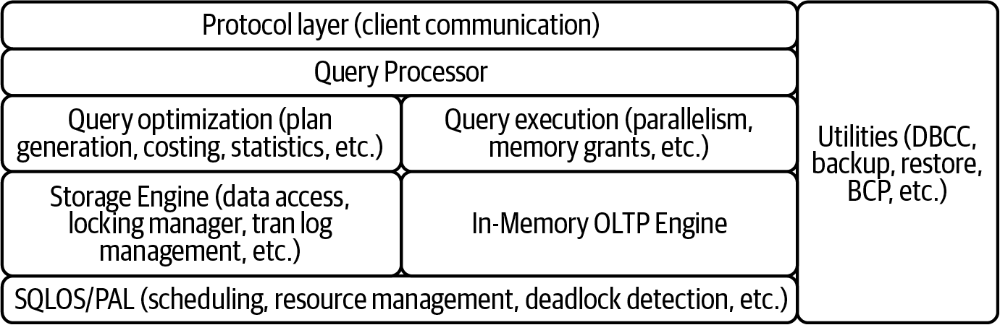
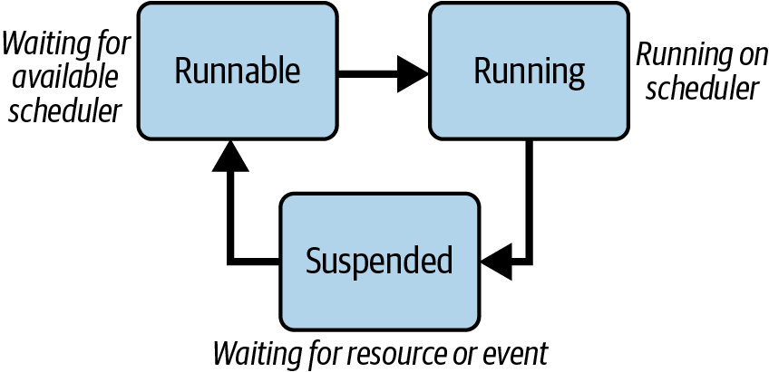
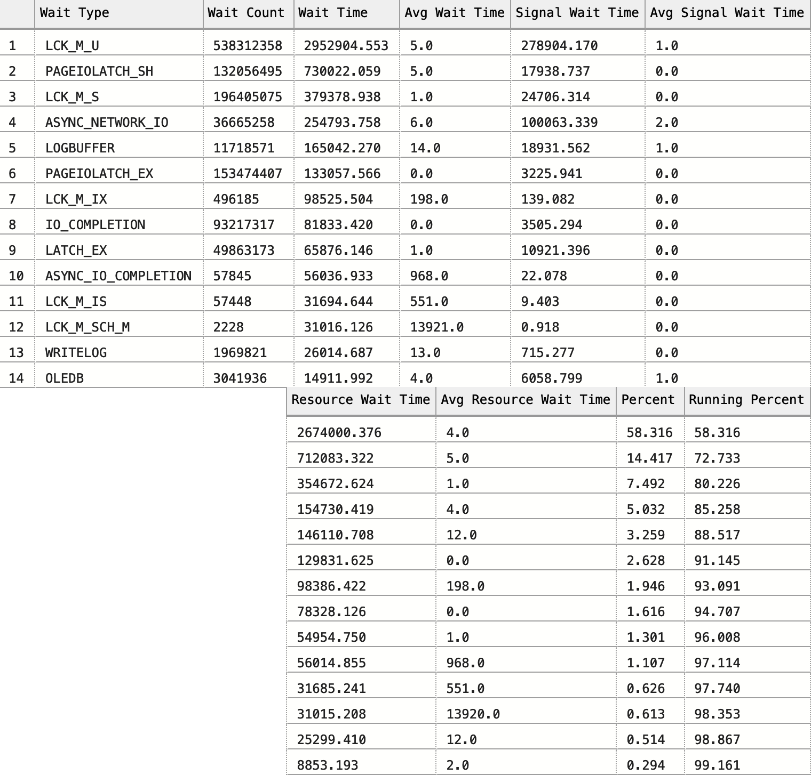
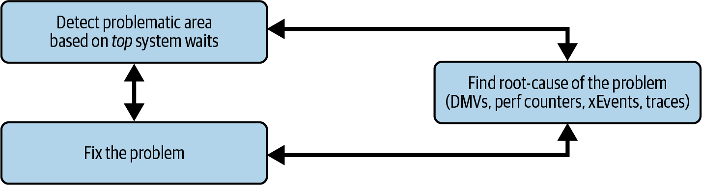
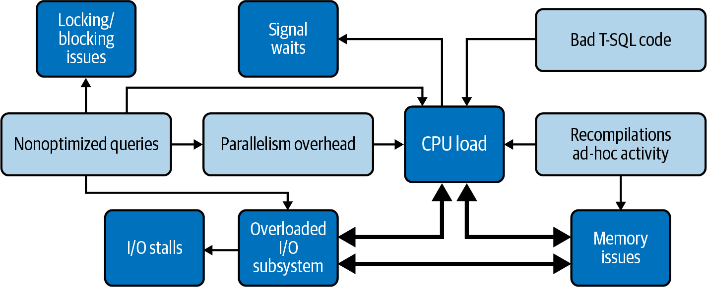
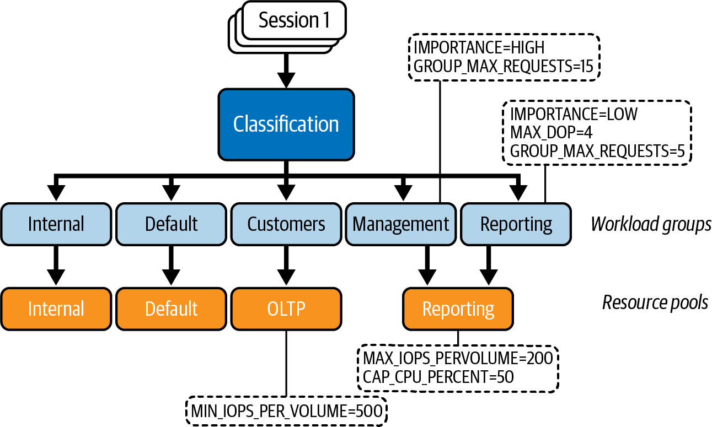

# Chapter 2

## SQL Server Execution Model and Wait Statistics

Source: [SQL.Server.Advanced.Troubleshooting.and.Performance.Tuning-2022-2.pdf](./SQL.Server.Advanced.Troubleshooting.and.Performance.Tuning-2022-2.pdf), printed pages 27–44.

It is impossible to troubleshoot SQL Server instances without understanding its execution model. You need to know how SQL Server runs tasks and manages resources if you want to detect bottlenecks in the system.

This guide covers SQL Server’s architecture and execution model, the Wait Statistics troubleshooting technique, and dynamic management views used during troubleshooting. It concludes with Resource Governor, which you can configure to segregate different workloads in the system.

### SQL Server: High-Level Architecture

As you know, SQL Server is a very complex product that consists of dozens of components and subsystems. It is impossible to cover all of them here, but in this section, you’ll get a high-level overview. Figure 2-1 groups these components and subsystems into several categories. Let’s talk about them.

The *Protocol layer* handles communication between SQL Server and client applications. It uses an internal format called *Tabular Data Stream* (TDS) to transmit data using network protocols such as TCP/IP or Named Pipes. If a client application and SQL Server are running on the same machine, you can use another protocol called *Shared Memory*.



*Figure 2-1. Major SQL Server components*

> It is worth checking what protocols are enabled when you troubleshoot client connectivity issues. Some SQL Server editions—for example, Express and Developer—disable TCP/IP and Name Pipes by default. They do not accept remote client connections until you enable network protocols in the SQL Server Configuration Manager utility.

The *Query Processor layer* is responsible for query optimization and execution. It parses, optimizes, and manages compiled plans for the queries, and orchestrates all aspects of query execution.

The *Storage Engine* is responsible for data access and management in SQL Server. It works with the data on disk, manages transaction logs, and handles transactions, locking, and concurrency along with a few other functions.

The *In-Memory OLTP Engine* supports In-Memory OLTP in SQL Server. It works with memory-optimized tables and is responsible for data management and access to those tables, native compilation, data persistence, and all other aspects of the technology.

There are layers of abstraction between the components. For example, *Query Interop* (not shown in Figure 2-1) allows the Query Processor to work with row-based and memory-optimized tables, transparently routing requests either to storage or to In-Memory OLTP engines.

The most critical abstraction layer is *SQL Server Operating System* (SQLOS), which isolates other SQL Server components from the operating systems and deals with scheduling, resource management and monitoring, exception handling, and many other aspects of SQL Server behavior. For example, when any SQL Server component needs to allocate memory, it does not call OS API functions directly: it requests memory from SQLOS. This allows SQL Server granular control over execution and internal resource usage without relying on the OS.

Finally, since the introduction of Linux support in SQL Server 2017, there is another component called *Platform Abstraction Layer* (PAL), which serves as a proxy between SQLOS and operating systems. Except for a few performance-critical use cases, SQLOS does not call the OS API directly, relying instead on PAL. This architecture allows SQL Server’s code to remain almost identical in Windows and Linux, which significantly speeds up development and product improvements.

From a troubleshooting standpoint, you’ll see very little difference between SQL Server on Windows and on Linux. Obviously, you’ll use different techniques when analyzing the SQL Server ecosystem and OS configuration. However, both platforms behave the same when you start to analyze issues *inside* SQL Server, so the troubleshooting approach here applies to both.

Let’s look at SQLOS in more detail.

### SQLOS and the Execution Model

Database servers are expected to handle a large number of user requests, and SQL Server is no exception. On a very high level, SQL Server assigns those requests to separate threads, executing the requests simultaneously. Except in cases when the server is idle, the number of active threads exceeds the number of CPUs in the system, and efficient scheduling is the key to good server performance.

Early versions of SQL Server relied on Windows scheduling. Unfortunately, Windows (and Linux) are general-purpose OSes, which means they use *preemptive scheduling*. They allocate a time interval, or *time quantum*, to a thread to run, then switch to other threads when it expires. This is an expensive operation that requires switching between user and kernel modes, negatively affecting system performance.

In SQL Server 7.0, Microsoft introduced the first version of User Mode Scheduler (UMS), which is a thin layer between Windows and SQL Server that was primarily responsible for scheduling. It used *cooperative scheduling*, with SQL Server threads coded to voluntarily yield every 4 ms, allowing other threads to execute. This approach significantly reduced expensive context switching in the system.

> Some SQL Server processes, such as extended stored procedures, CLR routines, external languages, and a few others, may still run in preemptive scheduling mode.

Microsoft continued to make improvements in UMS in SQL Server 2000, and in SQL Server 2005 redesigned it to the much more robust SQLOS. In later versions of SQL Server, SQLOS is responsible for scheduling, memory and I/O management, exception handling, CLR and external language hosting, and quite a few other functions.

When you start an SQL Server process, SQLOS creates a set of schedulers that manage workload across CPUs. The number of schedulers matches the number of logical CPUs in the system, with an additional scheduler created for a Dedicated Admin Connection (DAC). For example, if you have two quad-core physical CPUs with hyper-threading enabled, SQL Server will create 17 schedulers in the system. For practical purposes, you can think of the schedulers as the CPUs; these terms are used interchangeably here.

> The DAC is your *last-resort* troubleshooting connection. It allows you to access SQL Server if it becomes unresponsive and does not accept normal connections.

Each scheduler will be in an ONLINE or OFFLINE state, depending on its affinity mask setting and core-based licensing model. The schedulers usually do not migrate between CPUs; however, migration is possible, especially under heavy load. Nevertheless, in most cases this behavior does not affect the troubleshooting process.

The schedulers are responsible for managing the set of worker threads, sometimes called *workers*. The maximum number of workers in a system is specified by the *Max Worker Thread* configuration option. The default value of zero indicates that SQL Server calculates the maximum number of worker threads based on the number of schedulers in the system. In most cases, you do not need to change this default value—in fact, don’t change it unless you know *exactly* what you are doing.

Each time there is a task to execute, it is assigned to an idle worker. When there are no idle workers, the scheduler creates a new one. It also destroys idle workers after 15 minutes of inactivity or in case of memory pressure. Each worker uses 512 KB of RAM in 32-bit and 2 MB of RAM in 64-bit SQL Server for the thread stack. You can think of *workers* as being the logical representation of OS threads and *tasks* as the unit of work those threads handle.

Workers do not move between schedulers; tasks do not move between workers. SQLOS, however, can create child tasks and assign them to different workers; for example, in the case of parallel execution plans. This may explain situations when some schedulers are running under heavier loads than others—some workers could end up with more expensive tasks from time to time.

By default, SQL Server assigns tasks to workers going through NUMA nodes in round-robin fashion, without considering the number of schedulers in the NUMA nodes. Uneven distribution of schedulers across NUMA nodes will lead to unbalanced work distribution between schedulers.

In most cases, troubleshooting focuses on tasks. There is an exception, however: when a task is in the PENDING state, which means it is waiting for an available worker after the task has been created. This is completely normal, and workers are usually assigned to tasks very quickly. However, it can also indicate a very dangerous condition when the system does not have enough workers to handle the requests.

Besides PENDING, a task may be in five other possible states:

`RUNNING`

The task is currently executing on the scheduler.

`RUNNABLE`

The task is waiting for the scheduler to be executed.

`SUSPENDED`

The task is waiting for an external event or resource.

`SPINLOOP`

The task is processing a spinlock. *Spinlocks* are synchronization objects that protect some internal objects. SQL Server may use them when it expects access to the object will be granted very quickly, avoiding context switching for the workers.

`DONE`

The task is complete.

The first three states are the most important and common. Each scheduler has, at most, one task in the RUNNING state. In addition, it has two different queues—one for RUNNABLE tasks and one for SUSPENDED tasks. When the RUNNING task needs some resources—a data page from a disk, for example—it submits an I/O request and changes the state to SUSPENDED. It stays in the SUSPENDED queue until the request is fulfilled and the page has been read. After that, when it is ready to resume execution, the task is moved to the RUNNABLE queue.

Perhaps the closest real-life analogy to this process is a grocery store checkout line. Think of cashiers as schedulers and customers as tasks in the RUNNABLE queue. A customer who is currently checking out is similar to a task in the RUNNING state.

If an item is missing a UPC code, a cashier sends a store worker to do a price check. The cashier suspends the checkout process for the current customer, asking them to step aside (to the SUSPENDED queue). When the worker comes back with the price information, the customer moves to the end of the checkout line (the end of the RUNNABLE queue).

Of course, SQL Server’s execution is much more efficient than a real-life store, where customers must wait patiently in line for the price check to complete. (A customer at the end of the RUNNABLE queue would probably wish for such efficiency!)

### Wait Statistics

With the exception of initialization and cleanup, a task spends its time switching between RUNNING, SUSPENDED, and RUNNABLE states, as shown in Figure 2-2. The total execution time will include time in the RUNNING state, when the task is actually executed; time in the RUNNABLE state, when the task is waiting for the scheduler (CPU) to execute; and time in the SUSPENDED state, when the task is waiting for resources.



*Figure 2-2. Task lifecycle*

In a nutshell, the goal of any performance tuning process is to improve system throughput by reducing query execution times. You can achieve this by reducing the time that query tasks spend in any of those states.

You can decrease query RUNNING time by upgrading your hardware and moving to faster CPUs or by reducing the amount of work tasks must perform with query optimization. You can shrink RUNNABLE time by adding more CPU resources or reducing the load on the system. However, in most cases, you will get the most benefit by focusing on the time that tasks spend in SUSPENDED state while waiting for resources.

SQL Server tracks the cumulative time tasks spend in SUSPENDED state for different types of waits. You can see this data through the sys.dm_os_wait_stats view to get a quick sense of the main bottlenecks in your system and further fine-tune your troubleshooting strategy.

The code in Listing 2-1 shows the wait types that take the most time in your system. (It filters out some benign wait types, mainly related to internal SQL Server processes that spend most of the time waiting.) The data is collected from the time of the last SQL Server restart, or since you last cleared it with the DBCC SQLPERF('sys.dm_os_wait_stats', CLEAR) command. Each new SQL Server version introduces new wait types. Some are useful for troubleshooting; others are benign and will need to be filtered out.[^1]

*Listing 2-1. Getting top wait types in the system (SQL Server 2012 and later)*

```sql
;WITH Waits
AS
(
  SELECT
    wait_type, wait_time_ms, waiting_tasks_count,signal_wait_time_ms
    ,wait_time_ms - signal_wait_time_ms AS resource_wait_time_ms
    ,100. * wait_time_ms / SUM(wait_time_ms) OVER() AS Pct
    ,100. * SUM(wait_time_ms) OVER(ORDER BY wait_time_ms DESC) /
        NULLIF(SUM(wait_time_ms) OVER(), 0) AS RunningPct
    ,ROW_NUMBER() OVER(ORDER BY wait_time_ms DESC) AS RowNum
  FROM sys.dm_os_wait_stats WITH (NOLOCK)
  WHERE
    wait_type NOT IN /* Filtering out nonessential system waits */
    (N'BROKER_EVENTHANDLER',N'BROKER_RECEIVE_WAITFOR',N'BROKER_TASK_STOP'
    ,N'BROKER_TO_FLUSH',N'BROKER_TRANSMITTER',N'CHECKPOINT_QUEUE',N'CHKPT'
    ,N'CLR_SEMAPHORE',N'CLR_AUTO_EVENT',N'CLR_MANUAL_EVENT'
    ,N'DBMIRROR_DBM_EVENT',N'DBMIRROR_EVENTS_QUEUE',N'DBMIRROR_WORKER_QUEUE'
    ,N'DBMIRRORING_CMD',N'DIRTY_PAGE_POLL',N'DISPATCHER_QUEUE_SEMAPHORE'
    ,N'EXECSYNC',N'FSAGENT',N'FT_IFTS_SCHEDULER_IDLE_WAIT',N'FT_IFTSHC_MUTEX'
    ,N'HADR_CLUSAPI_CALL',N'HADR_FILESTREAM_IOMGR_IOCOMPLETION'
    ,N'HADR_LOGCAPTURE_WAIT',N'HADR_NOTIFICATION_DEQUEUE'
    ,N'HADR_TIMER_TASK',N'HADR_WORK_QUEUE',N'KSOURCE_WAKEUP',N'LAZYWRITER_SLEEP'
    ,N'LOGMGR_QUEUE',N'ONDEMAND_TASK_QUEUE'
    ,N'PARALLEL_REDO_WORKER_WAIT_WORK',N'PARALLEL_REDO_DRAIN_WORKER'
    ,N'PARALLEL_REDO_LOG_CACHE',N'PARALLEL_REDO_TRAN_LIST'
    ,N'PARALLEL_REDO_WORKER_SYNC',N'PREEMPTIVE_SP_SERVER_DIAGNOSTICS'
    ,N'PREEMPTIVE_OS_LIBRARYOPS',N'PREEMPTIVE_OS_COMOPS', N'PREEMPTIVE_OS_PIPEOPS'
    ,N'PREEMPTIVE_OS_GENERICOPS',N'PREEMPTIVE_OS_VERIFYTRUST'
    ,N'PREEMPTIVE_OS_FILEOPS',N'PREEMPTIVE_OS_DEVICEOPS'
    ,N'PREEMPTIVE_OS_QUERYREGISTRY',N'PREEMPTIVE_XE_CALLBACKEXECUTE'
    ,N'PREEMPTIVE_XE_DISPATCHER',N'PREEMPTIVE_XE_GETTARGETSTATE'
    ,N'PREEMPTIVE_XE_SESSIONCOMMIT',N'PREEMPTIVE_XE_TARGETINIT'
    ,N'PREEMPTIVE_XE_TARGETFINALIZE',N'PWAIT_ALL_COMPONENTS_INITIALIZED'
    ,N'PWAIT_DIRECTLOGCONSUMER_GETNEXT',N'PWAIT_EXTENSIBILITY_CLEANUP_TASK'
    ,N'QDS_PERSIST_TASK_MAIN_LOOP_SLEEP',N'QDS_ASYNC_QUEUE'
    ,N'QDS_CLEANUP_STALE_QUERIES_TASK_MAIN_LOOP_SLEEP'
    ,N'REQUEST_FOR_DEADLOCK_SEARCH',N'RESOURCE_QUEUE',N'SERVER_IDLE_CHECK'
    ,N'SLEEP_BPOOL_FLUSH',N'SLEEP_DBSTARTUP',N'SLEEP_DCOMSTARTUP'
    ,N'SLEEP_MASTERDBREADY',N'SLEEP_MASTERMDREADY',N'SLEEP_MASTERUPGRADED'
    ,N'SLEEP_MSDBSTARTUP',N'SLEEP_SYSTEMTASK',N'SLEEP_TASK'
    ,N'SLEEP_TEMPDBSTARTUP',N'SNI_HTTP_ACCEPT',N'SOS_WORK_DISPATCHER'
    ,N'SP_SERVER_DIAGNOSTICS_SLEEP',N'SQLTRACE_BUFFER_FLUSH'
    ,N'SQLTRACE_INCREMENTAL_FLUSH_SLEEP',N'SQLTRACE_WAIT_ENTRIES'
    ,N'STARTUP_DEPENDENCY_MANAGER',N'WAIT_FOR_RESULTS'
    ,N'WAITFOR',N'WAITFOR_TASKSHUTDOWN',N'WAIT_XTP_HOST_WAIT'
    ,N'WAIT_XTP_OFFLINE_CKPT_NEW_LOG',N'WAIT_XTP_CKPT_CLOSE',N'WAIT_XTP_RECOVERY'
    ,N'XE_BUFFERMGR_ALLPROCESSED_EVENT',N'XE_DISPATCHER_JOIN',N'XE_DISPATCHER_WAIT'
    ,N'XE_LIVE_TARGET_TVF',N'XE_TIMER_EVENT')
)
SELECT
  w1.wait_type AS [Wait Type]
  ,w1.waiting_tasks_count AS [Wait Count]
  ,CONVERT(DECIMAL(12,3), w1.wait_time_ms / 1000.0) AS [Wait Time]
  ,CONVERT(DECIMAL(12,1), w1.wait_time_ms / w1.waiting_tasks_count)
        AS [Avg Wait Time]
  ,CONVERT(DECIMAL(12,3), w1.signal_wait_time_ms / 1000.0)
        AS [Signal Wait Time]
  ,CONVERT(DECIMAL(12,1), w1.signal_wait_time_ms / w1.waiting_tasks_count)
        AS [Avg Signal Wait Time]
  ,CONVERT(DECIMAL(12,3), w1.resource_wait_time_ms / 1000.0)
        AS [Resource Wait Time]
  ,CONVERT(DECIMAL(12,1), w1.resource_wait_time_ms / w1.waiting_tasks_count)
        AS [Avg Resource Wait Time]
  ,CONVERT(DECIMAL(6,3), w1.Pct)
        AS [Percent]
  ,CONVERT(DECIMAL(6,3), w1.RunningPct)
        AS [Running Percent]
FROM
    Waits w1
WHERE
    w1.RunningPct <= 99 OR w1.RowNum = 1
ORDER BY
    w1. RunningPct
OPTION (RECOMPILE, MAXDOP 1);
```

Figure 2-3 shows the output of this code from one of the production servers, early in the troubleshooting process. The majority of the waits in the system relate to blocking (`LCK*`) and I/O (`PAGEIOLATCH*`). This makes it much easier to decide where to focus troubleshooting efforts.

This troubleshooting approach is called *Wait Statistics Analysis*. It’s one of the most frequently used troubleshooting and performance tuning techniques in SQL Server. Figure 2-4 illustrates a typical troubleshooting cycle using Wait Statistics Analysis.

First, you identify the main bottleneck in the system by analyzing the top waits. Next, you confirm that this is the main bottleneck using other tools and techniques and pinpoint the root cause of the problem. Finally, you fix the problem and repeat the cycle.



*Figure 2-3. Example of sys.dm_os_wait_stats output*



*Figure 2-4. Typical Wait Statistics Analysis troubleshooting cycle*

> This process may never end. While there are always opportunities to make things better, at some point further improvements become impractical. Remember the Pareto Principle—you will get 80% of improvements by spending 20% of your time—and don’t waste time on nonessential tuning.

This looks very easy in theory; unfortunately, it is more complicated in real life. Many issues are related to each other, which can hide the real causes of bottlenecks. To choose a very common example: excessive disk waits are often triggered not by bad I/O performance, but by poorly optimized queries that constantly flush the buffer pool and overload the disk subsystem.

Figure 2-5 shows some of the high-level dependencies you might run into. This diagram is by no means exhaustive, but it illustrates the danger of tunnel vision during troubleshooting.



*Figure 2-5. Dependencies and issues*

Before interpreting a list of common waits, understand the dependencies between components so you can distinguish symptoms from root causes.

The following sections cover dynamic management views related to SQLOS and the SQL Server execution model. For query-focused troubleshooting, see [Inefficient Queries](./INEFFICIENT.QUERIES.md).

### Execution Model–Related Dynamic Management Views

SQL Server comes with a very large number of dynamic management views. For details on all of them, consult the Microsoft documentation. This section focuses on a small subset useful during troubleshooting.

#### sys.dm_os_wait_stats

As described in [Wait Statistics](#wait-statistics), the sys.dm_os_wait_stats view provides information about waits in the system. It tells you how many times the wait occurs (waiting_task_count) along with cumulative times for resource waits (resource_wait_time_ms) and signal waits (signal_wait_time_ms). The resource wait time indicates how long a task was in the SUSPENDED queue as it waited for the resource. The signal wait time indicates how long the CPU was in the RUNNABLE queue after the resource wait time was over.

For example, let’s say a task is requested to read a data page from disk. The I/O request might take 6 ms; then, the task might wait another millisecond to resume the execution. If you view the wait data for this, you’ll see 6 ms of resource waits, 1 ms of signal waits, and 7 ms of total wait time.

Listing 2-2 shows how to compare cumulative signal and resource waits in the system.

*Listing 2-2. Signal versus resource waits*

```sql
SELECT
    SUM(signal_wait_time_ms) AS [Signal Wait Time (ms)]
    ,CONVERT(DECIMAL(7,4), 100.0 * SUM (signal_wait_time_ms) /
        SUM(wait_time_ms)) AS [% Signal waits]
    ,SUM(wait_time_ms - signal_wait_time_ms) AS [Resource Wait Time (ms)]
    ,CONVERT (DECIMAL(7,4), 100.0 * sum(wait_time_ms - signal_wait_time_ms) /
        SUM(wait_time_ms)) AS [% Resource waits]
FROM
    sys.dm_os_wait_stats WITH (NOLOCK);
```

In most cases, signal waits should not exceed 10% to 15% of the total wait time. A higher number may indicate a CPU bottleneck, with tasks spending a lot of time in the RUNNABLE queue. Do not jump to the conclusion that you need to add more CPUs, though—it may be entirely possible to address the problem with performance tuning.

Pay attention to how often waits occur. Sometimes you’ll see waits with a low waiting_task_count and high total wait time. Depending on the situation, you may or may not want to analyze these tasks, especially during the initial phase of troubleshooting. Such waits are often triggered by production incidents or other atypical conditions.

Finally, make sure you are working with representative data. Statistics are collected from the time of the last SQL Server restart, and the workload on the server may change over time.

One approach is to clear the waits a few days before starting troubleshooting. It’s safe to use the DBCC SQLPERF('sys.dm_os_wait_stats', CLEAR) command in production, but it may affect data collection in some third-party monitoring tools.

As another option, you can collect two separate snapshots of wait statistics and calculate the delta between them.

#### sys.dm_exec_session_wait_stats

Starting with SQL Server 2016, you can look at waits on the session level, using the sys.dm_exec_session_wait_stats view. This is extremely useful when you need to troubleshoot the performance of long-running queries or slow stored procedures in the system. This view will show you the waits that occurred during execution and will help you pinpoint bottlenecks and areas to research.

The columns and data in this view are similar to those in sys.dm_os_wait_stats; you can easily adjust scripts to work in both scenarios. Remember that data in sys.dm_exec_session_wait_stats clears when a session opens and when the pooled connection resets.

You may notice that the data is not always updated for currently running statements. You need to wait until a query completes for the data to become available.

#### sys.dm_os_waiting_tasks

The sys.dm_os_waiting_tasks view shows a list of tasks that are *currently* waiting in the SUSPENDED queue. This view is handy when the server is overloaded or unresponsive and you want to understand why sessions were suspended. It is also very helpful when you troubleshoot concurrency issues and active blocking in the system, because it shows the session ID of the blocker for the task.

The most useful columns in this view are as follows:

`session_id`

ID of the waiting session.

`wait_type`

Type of wait the session is waiting for.

`wait_duration_ms`

The duration of the wait.

`blocking_session_id`

The session blocking the current task. This column is extremely useful when you troubleshoot active blocking in the system.

`resource_address`

Information on the resource the task is waiting for.

You may have more than one row per session in the output when you deal with parallel execution plans.

#### sys.dm_exec_requests

The sys.dm_exec_requests view provides detailed information on each request that is executing on the server. This gives you a great at-a-glance snapshot of what is happening now and allows you to pinpoint most CPU- or I/O-intensive queries *currently* running in the system.

This view will return information for both user and system sessions. You can filter out most system sessions by using the WHERE session_id > 50 predicate, although you may have some system sessions with an id greater than 50 nowadays. You can also filter out system processes by joining the data with the sys.dm_exec_sessions view and using the is_user_process column there.

The most useful columns in this view are as follows:

`session_id`

The ID for the session. Unlike with sys.dm_os_waiting_tasks, you get a single row in the output per session, unless you are using Multiple Active Result Sets (MARS) in your system.

`start_time`

The time when the request started.

`total_elapsed_time`

The request’s duration.

`status`

The current request status (RUNNING, RUNNABLE, SUSPENDED, SLEEPING). A SLEEPING status indicates an idle connection.

wait_type, wait_time, wait_resource, blocking_session_id

Appear if the request is currently suspended. Like sys.dm_os_waiting_tasks, the blocking_session_id column is very useful when you are troubleshooting active blocking in the system.

cpu_time, logical_reads, reads, writes, granted_query_memory, dop

Provide you with execution metrics.

sql_handle, plan_handle

Allow you to obtain the statement and its execution plan.

Listing 2-3 shows the code that returns information about currently running CPU-intensive requests, along with connection information. This code requires SQL Server 2016 to run; you can remove the ep.dop column in older versions. Also, remove the TRY_CONVERT function if you run it on SQL Server versions earlier than 2012.

*Listing 2-3. Using the sys.dm_exec_requests view*

```sql
SELECT
    er.session_id
    ,er.request_id
    ,DB_NAME(er.database_id) as [database]
    ,er.start_time
    ,CONVERT(DECIMAL(21,3),er.total_elapsed_time / 1000.) AS [duration]
    ,er.cpu_time
    ,SUBSTRING(
        qt.text,
        (er.statement_start_offset / 2) + 1,
            ((CASE er.statement_end_offset
                WHEN -1 THEN DATALENGTH(qt.text)
                ELSE er.statement_end_offset
            END - er.statement_start_offset) / 2) + 1
    ) AS [statement]
    ,er.status
    ,er.wait_type
    ,er.wait_time
    ,er.wait_resource
    ,er.blocking_session_id
    ,er.last_wait_type
    ,er.reads
    ,er.logical_reads
    ,er.writes
    ,er.granted_query_memory
    ,er.dop
    ,er.row_count
    ,er.percent_complete
    ,es.login_time
    ,es.original_login_name
    ,es.host_name
    ,es.program_name
    ,c.client_net_address
    ,ib.event_info AS [buffer]
    ,qt.text AS [sql]
    ,TRY_CONVERT(XML,p.query_plan) as [query_plan]
FROM
    sys.dm_exec_requests er WITH (NOLOCK)
        OUTER APPLY sys.dm_exec_input_buffer
            (er.session_id, er.request_id) ib
        OUTER APPLY sys.dm_exec_sql_text(er.sql_handle) qt
        OUTER APPLY
            sys.dm_exec_text_query_plan
            (
                er.plan_handle
                ,er.statement_start_offset
                ,er.statement_end_offset
            ) p
        LEFT JOIN sys.dm_exec_connections c WITH (NOLOCK) ON
            er.session_id = c.session_id
        LEFT JOIN sys.dm_exec_sessions es WITH (NOLOCK) ON
            er.session_id = es.session_id
WHERE
    er.status <> 'background' AND er.session_id > 50
ORDER BY
    er.cpu_time desc
OPTION (RECOMPILE, MAXDOP 1);
```

> Getting a query execution plan with the sys.dm_exec_text_query_plan function is expensive. Comment it out if your server is running under heavy CPU load.

#### sys.dm_os_schedulers

The sys.dm_os_schedulers view provides information about schedulers in the system. You can use it to get information about schedulers’ distribution across NUMA nodes, and to analyze metrics from individual schedulers.

Listing 2-4 shows how to inspect the distribution of schedulers across NUMA nodes. Check the count of online schedulers in each NUMA node to see if the CPU affinity has been set correctly.

*Listing 2-4. NUMA node scheduler statistics*

```sql
SELECT
    parent_node_id AS [NUMA Node]
    ,COUNT(*) AS [Schedulers]
    ,SUM(IIF(status = N'VISIBLE ONLINE',1,0)) AS [Online Schedulers]
    ,SUM(IIF(status = N'VISIBLE OFFLINE',1,0)) AS [Offline Schedulers]
    ,SUM(current_tasks_count) AS [Current Tasks]
    ,SUM(runnable_tasks_count) AS [Runnable Tasks]
FROM
    sys.dm_os_schedulers WITH (NOLOCK)
WHERE
    status IN (N'VISIBLE ONLINE',N'VISIBLE OFFLINE')
GROUP BY
    parent_node_id
OPTION (RECOMPILE, MAXDOP 1);
```

The current_tasks_count and runnable_tasks_count columns provide the number of tasks in the RUNNING and RUNNABLE queues in each node. A large runnable_tasks_count number may indicate a CPU bottleneck. Remember, however, that the numbers show what is happening in the system *now* and may not be representative over time. It is better to see cumulative information; for example, the percentage of signal waits (see Listing 2-2) or CPU load over time.

Many other columns in the view provide scheduler-specific statistics, such as status, number of workers and tasks in various states, number of context switches, CPU consumption, and a few others. Check the documentation for more details.

### Resource Governor Overview

*Resource Governor* is an Enterprise Edition feature that allows you to segregate and throttle different workloads on the server. Remember to check whether Resource Governor is configured in the system you are troubleshooting, as an incorrect configuration can seriously impact server throughput.

When enabled, Resource Governor separates the sessions between different *workload groups* by calling the *classifier function* at the time of the session’s login. The classifier function is a simple user-defined function that enables you to use various connection properties (login name, application name, client IP address, etc.) to choose between workload groups.

Each workload group has several parameters, such as MAXDOP, the maximum allowed CPU time for the request, and the maximum number of simultaneous requests allowed in the group. They are also associated with a resource pool, where you can customize resource usage.

The SQL Server documentation refers to *resource pools* as “the virtual SQL Server instances inside of an SQL Server instance.” This analogy has limits because resource pools do not provide enough isolation from each other. However, you can control and limit CPU bandwidth and affinity, along with query memory grants.

Starting with SQL Server 2014, you can also control disk throughput by limiting resource pool IOPS. You cannot, however, control buffer pool usage. It is shared across all pools.

There are two system workload groups and resource pools: *internal* and *default*. As you can guess, the first handles internal workload. The second is responsible for all nonclassified workload. You can change the parameters of the *default* workload group without creating other user-defined workload groups and pools.

Figure 2-6 shows a Resource Governor configuration for an example scenario in which you want to separate OLTP and reporting workloads. This will reduce the impact of reporting queries on critical OLTP transactions, preventing them from saturating CPU and I/O.



*Figure 2-6. Example Resource Governor configuration*

Resource Governor is useful, but it is not the easiest feature to configure and maintain. You need to do some planning and math when you want to configure resource throttling across multiple busy resource pools.

You also need to reevaluate the settings over time, because hardware and workload requirements may change. In a case described by Dmitri Korotkevitch, a major disk subsystem upgrade did not improve system performance because a MAX_IOPS_PER_VOLUME setting in the resource pool throttled I/O.

In conclusion, Resource Governor is good in use cases where you need to segregate different workloads in a single database on a standalone server or an instance that uses Failover Clustering. It is also useful for reducing the impact of database maintenance. For example, you can limit CPU resources utilized by backup compression or I/O load from index maintenance by running them in a separate resource pool from user sessions.

Consider different technologies when you need to segregate a different workload in the Always On Availability Groups setup. The readable secondaries may provide better scalability in the long term. Also, when you need to segregate workloads from multiple databases running on a single SQL Server instance, it’s usually better to split the databases across multiple instances, and potentially virtualize them.

### Summary

SQLOS is the vital subsystem responsible for scheduling and resource management in SQL Server. At startup, it creates schedulers—one per logical CPU—and allocates the pool of worker threads to each scheduler to manage. User and system tasks are assigned to the worker threads, which perform the actual work.

SQL Server uses cooperative scheduling, with workers voluntarily yielding every 4 ms. The tasks constantly migrate through the RUNNING, SUSPENDED, and RUNNABLE states while they are running on the CPU or waiting for the CPU and resources. SQL Server tracks the different types of waits and provides that information in the sys.dm_os_wait_tasks view. You can analyze the most common waits and identify bottlenecks in the system with the troubleshooting process called Wait Statistics.

Be careful when analyzing waits; don’t jump to immediate conclusions. Many performance issues may be related and can mask each other. You’ll need to identify and confirm the root cause of the problem as part of your analysis.

Continue with [Inefficient Queries](./INEFFICIENT.QUERIES.md) to identify queries that contribute to resource bottlenecks.

#### Troubleshooting Checklist

- [ ] Look at the waits in the system. Make sure the wait statistics are representative.

- [ ] Analyze percentages of signal and resource waits.

- [ ] Validate the Resource Governor configuration when present.

- [ ] Triage the waits, looking for bottlenecks.

[^1]: The code in Listing 2-1 is good for versions up to SQL Server 2019. To exclude other wait types in future versions, see Microsoft’s documentation.
