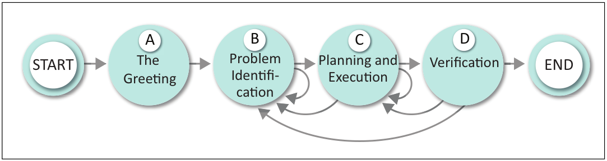
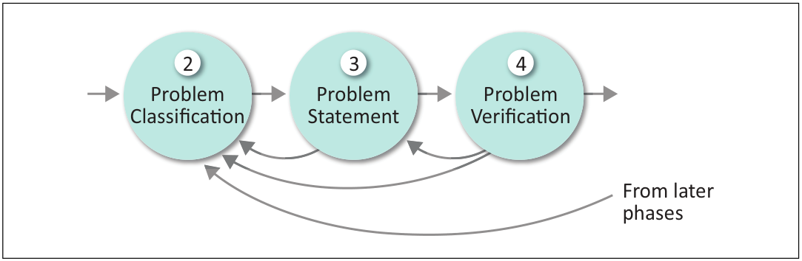
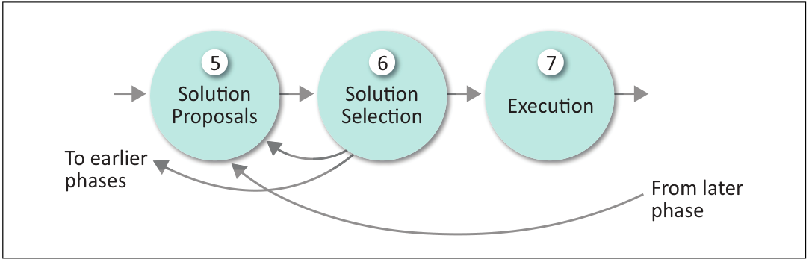
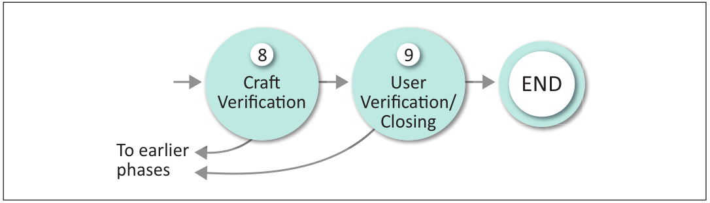

# Chapter 28

## Handling an Incident Report

Source: [The.Practice.of.System.and.Network.Administration-Vol.I-2017-28.pdf](./The.Practice.of.System.and.Network.Administration-Vol.I-2017-28.pdf), PDF pages 1–23.

The case studies and first-person accounts below reflect the source authors’ experience, as published in 2017.

This document is about handling incident reports. In a broad sense, requests from customers are either a service request, an incident report, or a complaint. We can further explain this distinction by way of examples: A service request is someone requesting a new PC. An incident report is when someone reports that his or her PC isn’t working and needs to be fixed. A complaint is when someone reports that he or she is unhappy waiting so long for the PC to be fixed.

Handling an incident report can be difficult. We must interview the person to understand the problem, identify the issue, and follow through until the issue is resolved.

It may surprise you to learn that this process is similar to the sales process. Sales involves understanding a person’s needs, proposing solutions, and working with the customer to provide a solution. We can learn a lot from the history of modern sales.

At the close of World War II, the United States found itself with a huge excess of manufacturing capacity. As a result, companies started producing hundreds of new products, giving households and businesses unprecedented choices. Thousands of returning service people found jobs selling these new products. All these factors combined to produce a new era for the U.S. economy.

Along with the new choices came greater competition. Companies found that it was no longer sufficient merely to have a large sales force; a *good* sales force was needed. They started to ask what makes high-performing salespeople different from the others.

Industry encouraged business schools to increase their study of the sales process. Research showed that the better salespeople—whether or not they realized it—used a specific, structured method involving specific phases or steps. Mediocre salespeople deviated from these phases in varying ways or performed certain phases badly. The low performers had little or no consistency in their methods.

The methods, now identified, could be taught. Thus, sales skills went from an intuitive process to a formal process with well-defined parts. Previous sales training had consisted mostly of explaining the product’s features and qualities. Subsequently, training included exploration of the selling process itself.

This deconstruction of the process into individual steps permitted further examination and therefore further improvement. Each step could be studied, measured, taught, practiced, and so on. Focus was improved because a single step could be studied in isolation. Also, the entire flow of steps could be studied, in a holistic approach.

More than likely, if anyone explained the structured process to the highperforming salespeople, it would sound strange. To them, it came naturally. To the beginners, however, this framework gave structure to a process they were learning. After they mastered it, they could modify or customize it for their situation. Without first learning one structured system, it is difficult to get to the place where you need to be to invent your own.

In the 1990s, system administration began a similar journey. Previously, it was a craft or an art practiced by few people. With the explosive growth of corporate computing and intranet/Internet applications, the demand for SAs similarly skyrocketed. A flood of new SAs arrived to meet this need. The quality of their work varied. Training often took the form of teaching particular product features. Other training methods included exploring manuals and documentation, trial by fire, and training by social and professional institutions.

System administration needed to mature in ways similar to how the sales process matured. The late 1990s saw an increase in the academic study of system administration (Burgess 2000). In fact, the source authors drew inspiration from that same need to provide training founded on non-platform-specific themes, principles, and theoretical models rather than on specific details about particular technologies, vendors, and products (Limoncelli, Hogan & Chalup 2017).

### 28.1 Process Overview

SAs spend much of their time responding to support requests from customers. In this document, we present a structured process defining how customer requests are gathered, evaluated, fixed, and verified. This process is based on a paper by Tom (Limoncelli 1999). Responding to customer requests is a more specific task than the general issues that surround running a helpdesk.

Customer requests are the trouble tickets, calls, problem reports, or whatever your site calls them. These requests may take the form “I can’t print,” “The network is slow,” or “A program that compiled yesterday won’t compile anymore.”

SAs perform many tasks, but often customers see only the parts that involve responding to their requests, not all the back-office work. (They shouldn’t have to see it.) Therefore, how well you respond to customer requests is critical to maintaining your organization’s reputation.

The method for processing these customer requests has nine steps, which can be grouped into four phases:

- Phase A: The Greeting (“Hello!”)
  - Step 1: The Greeting
- Phase B: Problem Identification (“What’s wrong?”)
  - Step 2: Problem Classification
  - Step 3: Problem Statement
  - Step 4: Problem Verification
- Phase C: Planning and Execution (“Fix it.”)
  - Step 5: Solution Proposals
  - Step 6: Solution Selection
  - Step 7: Execution
- Phase D: Verification (“Verify it.”)
  - Step 8: Craft Verification
  - Step 9: Customer Verification/Closing

This method gives structure to what is, for newer SAs, a more haphazard process. It helps SAs solve problems more efficiently by keeping them focused and helps them avoid mistakes. It introduces a common set of terminology that, when used by the entire SA team, increases the ability to communicate within the group.

This tool does not bestow any additional technical expertise on the people using it, but it may help the junior people gain insight into how the senior SAs approach problem solving. Creativity, experience, the right resources and tools, and personal and external management are still important.

If customers understand this model, they can become more skilled in getting the help they desire. They will be prepared with the right information and can nudge the SA through the process, if necessary. As Figure 28.1 shows, the phases deal with

A. Reporting the problem

B. Identifying the problem C. Planning and executing a solution D. Verifying that the problem resolution is complete

*Figure 28.1: General flow of problem solving*

Sometimes of these steps may be iterated as required. For example, during step 4 (problem verification), the SA may realize that the issue has been misclassified and that it is necessary to return to step 2 (problem classification). This kind of a-ha moment can happen at any step and requires returning to a previous step.

##### Trouble-Tracking Software

We cannot overemphasize the importance of using a software package to track problem reports. In the 1980s and early 1990s, SAs rarely used software to track such requests. Today, however, installing such software is profoundly transformational, affecting your ability to manage your time and to deliver consistent results to customers. If you find a site that has no trouble-tracking software, simply install whatever you were comfortable with at a previous site or software that has an Internet mailing list of active supporters.

### 28.2 Phase A—Step 1: The Greeting

Phase A has only one deceptively simple step: Issues are solicited from the customers (Figure 28.2). This step includes everything related to how the customer’s request is solicited—from someone saying, “How may I help you?” on the phone to a web site that collects problem reports. Step 1 should welcome the customer to the system and start the process on a positive, friendly, helpful note.

The person or system that responds to the requests is called a **greeter.** Greeters may be people in a physical helpdesk, on the phone, or accessible via email or other instant technology; a phone-response system; or even a web form that takes the data. Multiple ways to collect reports are needed for easy and reliable access, ensuring that the customer can report the problem.

Sometimes, problems are reported by automated means rather than by humans. For example, network-monitoring tools, such as Nagios, Big Brother,

*Figure 28.2: Phase A: Hello!*

Bosun, HP OpenView, and Tivoli, can notify SAs that a problem is occurring. The greeting process is the same, although some of the steps may be expedited by the tool.

Every site and every customer is different. The appropriate way to report issues is different for every part of every organization. Is the customer local or remote? Is the customer experienced or new? Is the technology being supported complicated or simple? These questions can help when you select which greeters to use.

##### Finding Greeters

How do customers know how to find help? Advertise the available greeters by signs in hallways, newsletters, stickers on computers or phones, and even banner advertisements on internal web pages. The best place is where customers’ eyes are already looking: on a sticker on their PC, in an error message, and so on.

Although this list certainly isn’t complete, greeters typically include email, phone, walk-up helpdesk, visiting the SA’s office, submission via web, submission via custom application, and report by automated monitoring system.

### 28.3 Phase B: Problem Identification

Phase B is focused on classifying the problem and recording and verifying it (Figure 28.3).

*Figure 28.3: Phase B: What’s wrong?*

#### 28.3.1 Step 2: Problem Classification

In step 2, the request is classified to determine who should handle it. This **classifier** role may be performed by a human or may be automated. For example, at a walk-up helpdesk, staff might listen to the problem description to determine its classification. A phone-response system might ask the user to press 1 for PC problems, 2 for network problems, and so on. If certain SAs help certain customer groups, their requests may be automatically forwarded, based on the requester’s email address, a manually entered employee ID number, or the phone caller’s caller ID information.

When the process is manual, a human must be responsible for classifying the problem from the description or asking the customer more questions. A formal decision tree may be used to determine the right classification. Formal processes and decision trees are used to improve results in other fields. For example, a hospital found that a patient’s odds of surviving a heart attack improved when guesswork was eliminated by giving the doctors a formal process to follow (Gladwell 2007).

SAs need to ask more questions when they aren’t as familiar with the customer’s environment. This is often the case at the helpdesks of e-commerce sites or extremely large corporate helpdesks.

No matter how the classification is performed, the customer should be told how the request is classified, creating a feedback loop that can detect mistakes. For example, if a classifier tells a customer, “This sounds like a printing problem; I’m assigning this issue to someone from our printer support group,” the customer stays involved in the process. The customer might also point out that the problem is more pervasive than simply printing, leading to a different classification.

If a phone-response system is used, the customer has classified the request already. However, a customer may not be the best person to make this decision. The next person who speaks with the customer should be prepared to validate the customer’s choice in a way that is not insulting. If the customer has misclassified the request, this error should be remedied in a polite manner. The best way to do so is to give the customer the correct phone number to call or button to press, and then the SA should transfer the call to the right number. Some companies do one or the other, but doing both is better.

When asking a customer to classify the problem, the choices presented must be carefully constructed and revised over time. You should gather statistics to detect mismatches between customers’ perceptions of what the classifications mean and what you intended them to mean, or at least you should monitor for customer complaints.

##### Marketing-Driven Customer Support

Phone menus should use terminology that the customers expect to hear. A large network equipment manufacturer once had its phone menu based on the marketing terminology that segmented its product lines rather than on the technical terminology that most of its customers used. This caused no end of confusion because the marketing terminology had little basis in reality from the typical technician’s point of view. It was particularly confusing for customers of any company that was acquired by this company, because the acquired company’s products were reclassified into marketing terms unfamiliar to the acquired company’s customers.

Many requests may be transferred or eliminated at this stage. A customer requesting a new feature should be transferred to the appropriate group that handles requests for features. If the request is outside the domain of work done by the support group, the customer might be referred to another department. If the request is against policy and therefore must be denied, the issue may be escalated to management if the customer disagrees with the decision. For this reason, it is important to have a well-defined scope of service and a process for requesting new services.

Classifying problems can get complex. At very large sites, you are more likely to find yourself acting on behalf of your customer, coordinating between departments or even the helpdesks of different departments! Complicated problems that involve network, application, and server issues can require the helpdesk attendant to juggle conversations with three or more organizations. Navigating such a twisty maze of passages for the customer is a valuable service you can provide.

#### 28.3.2 Step 3: Problem Statement

In step 3, the customer states the problem in full detail, and the **recorder** takes this information down. Often, the recorder is also the classifier. The skill required by the recorder in this step is the ability to listen and to ask the right questions to draw out the necessary information from the customer. The recorder extracts the relevant details and records them.

A problem statement describes the problem being reported and records enough clues to reproduce and fix the problem. A bad problem statement is vague or incomplete. A good problem statement is complete and identifies all hardware and software involved, as well as their locations, the last time they worked, and so on. Sometimes, not all that information is appropriate or available.

An example of a good problem statement is this: “PC talpc.example.com (a PC running Windows 7) located in room 301 cannot print from MS Word 2010 to printer ‘rainbow,’ the color printer located in room 314. It worked fine yesterday. It can print to other printers. The customer does not know whether other computers are having this problem.”

Certain classes of problems can be completely stated in simple ways. Internet routing problems can best be reported by listing two IP addresses that cannot ping each other but can communicate to other hosts; including a traceroute from each host to the other, if possible, helps considerably in pinpointing the problem.

More information is usually better than less. However, customers may be annoyed when required to provide information that is obviously superfluous, such as which OS they are using when the issue is a smoking monitor. Yet we continually see web-based trouble-reporting systems requiring that no fields be left blank.

It is unreasonable to expect problem statements from customers to be complete. Customers require assistance. The problem statement cited earlier comes from a real example in which a customer sent an SA email that simply stated, “Help! I can’t print.” That is about as ambiguous and incomplete as a request can be. A reply was sent asking, “To which printer? Which PC? Which application?”

The customer’s reply included a statement of frustration. “I need to print these slides by 3 PM. I’m flying to a conference!” At that point, the SA abandoned email and used the telephone. This permitted a faster back-and-forth between the customer and the classifier. No matter the medium, it is important that this dialogue take place and that the final result be reported to the customer.

Sometimes, the recorder can perform a fast loop through the next steps to accelerate the process. The recorder might find out whether the device is plugged in, whether the person has checked the manual, and so on. However, such questions as “Is it plugged in?” and “Have you checked the manual?” make customers defensive. They have only two possible answers, and only one of them is clearly right. Avoid making customers feel compelled to lie. Instead, ask which outlet it’s plugged into; ask for confirmation, while you’re on the phone, that the cable is firmly seated at both ends. Tell the customer that you’ve checked the manual and that, for future reference, the answer is on page 9, if the problem comes up again.

You also should make sure to never make the customer feel like an idiot. Hearing that a helpdesk attendant informed a customer that “an eight-year-old would understand” what he is explaining is cringe-worthy. Instead, reassure customers that they’ll get better at using computers as they gain experience.

##### Helping the Customer Save Face

Finding ways to let customers save face can be very beneficial. An SA in London once took a call from a person who was in a panic about not being able to print his monthly reports on a printer used almost exclusively for this purpose. After a series of tests, the SA found that the printer was unplugged. He explained to the customer that the cleaning staff must have unplugged the printer when needing an outlet for the vacuum.

A month later, the same person called the SA with the same problem and pointed out that this time, he had checked to make sure that the printer was plugged in. Investigation showed that it had been turned off at the switch. The customer felt so embarrassed that he’d missed such obvious faults both times that he bought the SA a beer. After that, the problem never occurred again.

By not criticizing the person and by keeping him in the loop about what the problem was, the customer learned to solve his own problems, the two colleagues remained on friendly terms, and the SA got a free beer.

Flexibility is important. In the previous example, the customer indicated that there was an urgent need to have the slides printed prior to a flight. Here, it might be appropriate to suggest using a different printer that is known to be working rather than fixing the problem right now. This accelerates the process, which is important for an urgent problem.

Large sites often have different people recording requests and executing them. This added handoff introduces a challenge because the recorder may not have the direct experience required to know exactly what to record. In that case, it is prudent to have preplanned sets of data to gather for various situations. For example, if the customer is reporting a network problem, the problem statement must include an IP address, the room number of the machine that is not working, and which particular thing the person is trying to do over the network that is not working. If the problem relates to printing, the SA should record the name of the printer, the computer being used, and the application generating the print job.

It can be useful if your trouble-ticket software records different information, depending on how the problem has been classified.

#### 28.3.3 Step 4: Problem Verification

In step 4, the SA takes on the **reproducer** role and tries to duplicate the problem. If the problem cannot be reproduced, perhaps it is not being properly communicated, and the SA must return to step 3. If the problem is intermittent, this process becomes more complicated but not impossible to follow.

Nothing gives you a better understanding of the problem than seeing it in action. This is the single most important reason for doing problem verification, yet naive SAs skip it all the time. If you do not verify the problem, you may work on it for hours before realizing that you aren’t even working on the right issue. Often, the customer’s description is misleading. A customer who doesn’t have the technical knowledge to accurately describe the problem can send you on a wild goose chase. Just think about all the times you’ve tried to help someone over the phone, failed, and then visited the person. One look at the person’s screen and you say, “Oh! That’s a totally different problem!” And a few keystrokes later, the problem is fixed. What happened was that you weren’t able to reproduce the problem locally, so you couldn’t see the whole problem and therefore couldn’t figure out the real solution.

It is critical that the method used to reproduce the problem be recorded for later repetition in step 8. Encapsulating the test in a script or a batch file will make verification easier. One of the benefits of command-driven systems, such as Unix, is the ease with which such a sequence of steps can be automated. GUIs make this phase more difficult when there is no way to automate or encapsulate the test.

The scope of the verification procedure must not be too narrowly focused or too wide or misdirected. If the tests are too narrow, the entire problem may not be fixed. If the tests are too wide, the SA may waste time chasing non-issues.

It is possible that the focus is misdirected. Another, unrelated problem in the environment may be discovered while trying to repeat the customer’s reported problem. Some problems can exist in an environment without being reported or without affecting users. It can be frustrating for both the SA and the customer if many unrelated problems are discovered and fixed along the way to resolving an issue. If an unrelated problem that is not in the critical path is discovered, it should be recorded so that it can be fixed in the future. However, determining whether it is in the critical path is difficult, so fixing it may be valuable. Alternatively, it may be a distraction or may change the system enough to make debugging difficult.

Sometimes, direct verification is not possible or even required. If a customer reports that a printer is broken, the verifier may not have to reproduce the problem by attempting to print something. It may be good enough to verify that new print jobs are queuing and not being printed. Such superficial verification is fine in that situation.

At other times, exact duplication *is* required. The verifier might fail to reproduce the problem on his or her own desktop PC and may need to duplicate the problem on the customer’s PC. Once the problem is reproduced in the customer’s environment, it can be useful to try to duplicate it elsewhere to determine whether the problem is local or global. When supporting a complicated product, you must have a lab of equipment ready to reproduce reported problems.

##### Verification at E-commerce Sites

E-commerce sites have a particularly difficult time duplicating the customer’s environment. Although Java and other systems promise that you can “write once, run anywhere,” the reality is that you must be able to duplicate the customer’s environment for a variety of web browsers, web browser versions, and even firewalls.

One company needed to test access to its site with and without a firewall. The company’s QA effort had a PC that was live on the Internet for such testing. Because the PC was unprotected, it was isolated physically from other machines, and the OS was reloaded regularly.

### 28.4 Phase C: Planning and Execution

In Phase C, the problem is fixed. Doing so involves planning possible solutions, selecting one, and executing it (Figure 28.4).

#### 28.4.1 Step 5: Solution Proposals

Step 5 is the point at which the subject-matter expert (SME) enumerates possible solutions. Depending on the problem, this list may be long or short. For some problems, the solution may be obvious, with only one proposed solution. At other times, many solutions are possible. Often, verifying the problem in the previous step helps to identify possible solutions.

The “best” solution varies, depending on the context. At a financial institution, the helpdesk’s solution to a client-side NFS problem might be to reboot. That step could be faster than trying to fix the problem, and it gets the customer up and running quickly. In contrast, in a research environment, it would make sense to try to find the source of the problem, perhaps by unmounting and remounting the NFS mount that reported the problem.

*Figure 28.4: Phase C: Fix it.*

##### Case Study: Radical Print Solutions

In our earlier printing example, because the customer indicated that he needed to leave for the airport soon, it might have been appropriate to suggest alternative solutions, such as recommending a different printer known to be working. If the customer is an executive flying from New Jersey to Japan with a stopover in San Jose, it might be reasonable to transfer the file to an office in San Jose, where it could be printed while the customer is in flight. A clerk could hand the printout to the executive while he waits for his connecting flight at the San Jose airport. Tom witnessed such a solution being used. The printer, in this case, was a very expensive plotter. Only one such plotter was available at each company location.

Some solutions are more expensive than others. Any solution that requires a desk-side visit is generally going to be more expensive than one that can be handled without such a visit. Understanding this cost difference can be useful in making purchasing decisions. Lack of remote-support capability affects the total cost of ownership of a product. Both commercial and noncommercial tools are available that add remote support to many products.

An SA who does not know any possible solutions should escalate the issue to other, more experienced SAs.

#### 28.4.2 Step 6: Solution Selection

Once the possible solutions have been enumerated, one of them is selected to be attempted first—or next, if we are looping through these steps. This role is also performed by the SME.

Selecting the best solution tends to be either extremely easy or extremely difficult. However, solutions often cannot and should not be applied simultaneously, so possible solutions must be prioritized.

The customer should be included in this prioritization. Customers have a better understanding of their own time pressures. A customer who is a commodities trader will be much more sensitive to downtime during the trading day than, say, a technical writer or even a developer, provided that he or she is not on deadline. If solution A fixes the problem forever but requires downtime and solution B is a short-term fix, the customer should be consulted as to whether A or B is “right” for the situation. The SME is responsible for explaining the possibilities, but the SA should appreciate the priorities, based on the environment. There may be predetermined service goals for downtime during the day. SAs on Wall Street know that downtime during the day can cost millions of dollars, so short-term fixes may be selected and a long-term solution scheduled for the next maintenance window. In a research environment, the rules about downtime are more relaxed, and the longterm solution may be selected immediately. Some sites centralize their helpdesks to a bizarre extreme that results in SAs no longer knowing into which category their customers fall. This is rarely a good thing.

When dealing with more experienced customers, it can be a good idea to let them participate in this phase. They may have useful feedback. In the case of inexperienced customers, it can be intimidating or confusing to hear all these details. It may even unnecessarily scare them. For example, listing every possibility from a simple configuration error to a dead hard disk may cause the customer to panic and is a generally bad idea, especially when the problem turns out to be a simple typo in CONFIG.SYS.

Even though customers may be inexperienced, they should be encouraged to participate in determining and choosing the solution. This can help educate them so that future problem reports can flow more smoothly and even enable them to solve their own problems. It can also give customers a sense of ownership—the warm fuzzy feeling of being part of the team/company, not simply “users.” This approach can help break down the us-versus-them mentality common in industry today.

#### 28.4.3 Step 7: Execution

The solution is attempted in step 7. The skill, accuracy, and speed at which this step is completed depend on the skill and experience of the person executing the solution.

The term **craft worker** refers to the SA, operator, or laborer who performs the technical tasks involved. This term comes from other industries, such as telecommunications, in which one person may receive the order and plan the provisioning of the service, but the craft workers run the cables, connect circuits, and so on, to provide the service. In a computer network environment, the network architect might be responsible for planning the products and procedures used to give service to customers, but when a new Ethernet interface needs to be added to a router, the craft worker installs the card and configures it.

Sometimes, the customer becomes the craft worker. This scenario is particularly common when the customer is remote and using a system with little or no remote control. In that case, the success or failure of this step is shared with the customer. A dialogue is required between the SA and the customer to make the solution work. Has the customer executed the solution properly? If not, is the customer causing more harm than good?

Adjust the dialogue based on the skill of the customer. It can be insulting to spell out each command, space, and special character to an expert customer. It can be intimidating to a novice customer if the SA rattles off a complex sequence of commands. Asking, “What did it say when you typed that?” is better than “Did it work?” in these situations. Be careful, however, not to assume too much; some customers are good at sounding as though they are more experienced than they are.

This kind of communication is not an innate skill, but rather must be learned. Training is available to hone SAs’ skills in this area. Workshops that focus on this area often have titles that include buzzwords such as active listening, interpersonal communication, interpersonal effectiveness, or simply advanced communication.

At this point, it is tempting to think that we have finished. However, we haven’t finished until the work has been checked and the customer is satisfied. That brings us to the final phase.

### 28.5 Phase D: Verification

At this point, the problem *should* have been remedied, but we need to verify that. Phase D isn’t over until the customer agrees that the problem has been fixed (Figure 28.5).

*Figure 28.5: Phase D: Verify it.*

#### 28.5.1 Step 8: Craft Verification

In step 8, the craft worker who executed step 7 verifies that the actions taken to fix the problem were successful. If the process used to reproduce the problem in step 4 is not recorded properly or not repeated exactly, the verification will not happen correctly. If the problem still exists, return to step 5 or, possibly, an earlier step.

##### The Unix diff Program

The Unix command diff can be useful in this situation; this program displays the difference between two text files. Capture the output generated when the problem is reproduced. As attempts are made to fix the problem, run the program again, capturing the output to a new file. Run diff against the two captures to see whether there is any difference. Alternatively, you might copy the output that demonstrates the problem to a new file and edit it to be the way it should on a working system. (You might have a working system to generate sample “good” output.) The diff program can then be used to compare the current output with the corrected output. You’ll know you’ve made the right changes when diff claims that the files are the same. Some systems do not generate output that is well suited to diff, but Perl and other tools can pare down the output to make it more palatable to diff.

#### 28.5.2 Step 9: Customer Verification/Closing

The final step is for the customer to verify that the issue has been resolved. If the issue hasn’t been resolved, the job isn’t done. This role is performed by the customer.

Presumably, if the craft worker verified that the solution worked (step 8), this step should not be needed. However, customers often report at this point that the problem still exists. This is such a critical problem that it must be a separate step.

Customer verification reveals mistakes made in previous phases. Perhaps the customer did not properly express the problem, the SA did not understand the customer, or the SA did not properly record the problem—all communication problems. Errors may have crept into the planning phase. The problem that was verified in step 4 may have been a different problem that also exists, or the method that verified the problem may have been incomplete. The solution may not have fixed the entire problem or may have simply made the problem intermittent.

In either case, if the customer does not feel that the problem has been fixed, there are many possible actions. Obviously, step 4 should be repeated to find a more accurate method to reproduce the problem. However, at this point, it may be appropriate to return to other steps. For example, the problem could be reclassified (step 2), or restated (step 3), or escalated to more experienced SAs (step 5). If all else fails, you may have to escalate the problem to management.

It is important to note that the verification step isn’t used to verify that the customer is happy, but rather that the customer’s request has been satisfied. Customer satisfaction is a metric to be measured elsewhere.

Once customer verification is complete, the issue is closed.

### 28.6 Perils of Skipping a Step

Each step is important. If any step in this process is performed badly, the process can break down. Many SAs skip a step, either because of lack of training or because of an honest mistake. Many stereotypes about bad SAs are the result of SAs skipping a particular step. We’ve assigned Seinfeldesque names to each of these stereotypes and list possible ways of improving the SAs process:

- **The Ogre:** Grumpy, caustic SAs are trying to scare customers away from step 1 and are preventing the greeting from happening. *Suggestion*: Management must set expectations for friendliness. The scope of responsibility must be a written policy communicated to both SAs and customers.
- **The Mis-delegator:** If you’ve called a large company’s technical support line and the person who answered the phone refused to direct your call to the proper department (step 2), you know what it’s like to deal with a misdelegator. *Suggestion*: Design a formal decision tree indicating which issues are delegated where.
- **The Assumer:** SAs who skip step 3 simply assume that they understand what the problem is when they really don’t. *Suggestion*: Coach the person on active listening; if that fails, send the person to a class on the topic.
- **The Non-verifier:** An SA who skips problem verification (step 4) is usually busy fixing the wrong problem. One day, Tom was panicked by the news that “the network is down.” In reality, a nontechnical customer couldn’t read his email and reported the potential problem. This claim hadn’t been verified by the newly hired SA, who hadn’t yet learned that certain novice customers report all problems that way. The customer’s email client was misconfigured. *Suggestion*: Teach SAs to replicate problems, especially before escalating them. Remind them that it isn’t nice to panic Tom.
- **The Wrong Fixer:** Inexperienced SAs sometimes are not creative or are too creative in proposing and selecting solutions (steps 5 and 6). But skipping these steps entirely results in a different issue. After being taught how to use an Ethernet monitor (a network sniffer), an inexperienced but enthusiastic SA was found dragging out the sniffer no matter which problem was being reported. He was a Wrong Fixer. *Suggestion*: Provide mentoring or training. Increase the breadth of solutions with which the SA is familiar.
- **The Executioner:** Incompetent SAs sometimes cause more harm than good when they execute solutions incorrectly. It is quite embarrassing to apply a fix to the wrong machine; however, it happens. *Suggestion*: Train the SA to check what has been typed before pressing ENTER or clicking OK. It can be vital to include the hostname in your shell prompt.
- **The Hit-and-Run SA:** This SA walks into a customer’s office, types a couple of keystrokes, and waves goodbye while walking out the door and saying, “That should fix it.” The customers are frustrated to discover that the problem was not fixed. In all fairness, what was typed really should have fixed the problem, but it didn’t. *Suggestion*: Management needs to set expectations on verification.

- **The Closer:** Some SAs are obsessed with “closing the ticket.” Often, however, SAs are judged on how quickly they close tickets. In that case, the SAs are pressured to skip the final step. We borrow this name from the term used to describe high-pressure salespeople focused on “closing the deal.” *Suggestion*: Management should not measure performance based on how quickly issues are resolved but on a mixture of metrics that drive the preferred behavior. Metrics should not include time waiting for customers when calculating how long it took to complete the request. Tracking systems should permit a request to be put into a customer wait state while customers complete actions, and that time should be subtracted from the time-to-completion metrics.

##### Team of One

The solo SA can still benefit from using this model to make sure that customers have a well-defined way to report problems; that problems are recorded and verified; that solutions are proposed, selected, and executed; and that both the SA and the customer have verified that the problem has been resolved. When an organization has a single SA, problems with specific applications can be escalated to that vendor’s support lines.

### 28.7 Optimizing Customer Care

Once the basic process is understood, there are ways to improve it. On the micro level, you can look into improving each step; on the macro level, you can look at how the steps fit together.

#### 28.7.1 Model-Based Training

Internal training should be based on this model so that the SA staff members consistently use it. After the initial training, more experienced staff should mentor newer SAs to help them retain what they have learned. Certain steps can be helped by specific kinds of training.

Improvements can be made by focusing on each step. In fact, entire books could be written on each step. This has happened in other professions that have similar models, such as nursing, sales, and so on.

A lack of training hurts the process. For example, an ill-defined delineation of responsibilities makes it difficult for a classifier to delegate the issue to the right person. Inexperienced recorders may not gather the right information in step 3, which makes further steps difficult and may require contacting the customer unnecessarily. A written chart of who is responsible for what, as well as a list of standard information to be collected for each classification, will reduce these problems.

#### 28.7.2 Holistic Improvement

In addition to focusing on improving each step, you may focus on improving the entire process. Transitioning to each new step should be fluid. If the customer sees an abrupt, staccato handoff between steps, the process can appear amateurish or disjointed.

Every handoff is an opportunity for mistakes and miscommunication. The fewer handoffs that take place, the fewer opportunities there are for mistakes.

A site small enough to have a single SA has zero opportunities for this class of error. However, as systems and networks grow and become more complicated, it becomes impossible for a single person to understand, maintain, and run the entire network. As a system grows, handoffs become a necessary evil. This explains a common perception that larger SA groups are not as effective as smaller ones. Therefore, when growing an SA group, you should focus on maintaining highquality handoffs. Alternatively, you might choose to develop a single point of contact or customer advocate for an issue. That results in the customers seeing a single face for the duration of a problem.

#### 28.7.3 Increased Customer Familiarity

If a customer talks to the same person whenever he or she calls for support, the SA will likely become familiar with the customer’s particular needs and be able to provide better service. There are ways to improve the chance of this happening. For example, SA staff subteams may be assigned to particular groups of customers rather than to the technology they support. Or, if the phone-answering staff is extremely large, the group might use a telephone call center system, whereby customers call a single number and the call center routes the call to an available operator. Modern call center systems can route calls based on caller ID, using this functionality, for example, to route the call to the same operator the caller spoke to last time, if that person is available. With such a system, customers are likely to reach the same person each time. It can be very comforting to speak to someone who recognizes your voice.

#### 28.7.4 Special Announcements for Major Outages

During a major network outage, many customers may be trying to report problems. If customers report problems through an automatic phone response system (“Press 1 for . . ., press 2 for . . .”), such a system can usually be programmed to announce the network outage before listing the options. “Please note the network connection to Denver is currently experiencing trouble. Our service provider expects it to be fixed by 3 PM. Press 1 for . . ., press 2 for. . . .”

Hearing the announcement reassures the customer that SAs are aware of the problem, and that someone is working to resolve it. This cuts down on duplicate problem reports that need to be resolved individually.

#### 28.7.5 Trend Analysis

Spend some time each month looking for trends, and take action based on them. Here are some trends to look for:

- **Does a customer report the same issue over and over?** Why is it recurring? Does the customer need training, or is that system really so badly broken?
- **Are there many issues in a particular category?** Is that system difficult to use? Could it be redesigned or replaced, or could the documentation be improved?
- **Are many customers reporting the same issue?** Can they all be notified at once? Should such problems receive higher priority?
- **Can some categories of requests become self-service?** Often, a customer request states that an SA is needed because something requires privileged access, such as superuser or administrator access. Look for ways to empower customers to help themselves. Many of these requests can become self-service with a little bit of web programming.
- **Who are your most frequent customers?** Calculate which department generates the most tickets or who has the highest average tickets per member. Calculate which customers make up your top 20 percent of requests. Do these ratios match your funding model, or are certain customer groups more “expensive” than others?
- **Is a particular time-consuming request one of your frequent requests?** If customers often accidentally delete files and you waste a lot of time each week restoring files from tape, you can invest time in helping the users learn about rm -i or how to use other safe-delete programs. Alternatively, maybe it would be appropriate to advocate for the purchase of a system that supports snapshots or lets users do their own restores. If you can generate a report of the number and frequency of restore requests, management can make a more informed decision or decide to talk to certain users about being more careful.

This document does not discuss metrics, but a system of metrics grounded in this model might be the best way to detect areas needing improvement. The nine-step process can be instrumented easily to collect metrics. Developing metrics that drive the right behaviors is difficult. For example, if SAs are rated based on how quickly they close tickets, one might accidentally encourage the Closer behavior described earlier. As SAs proactively prevent problems, reported problems will become more serious and time-consuming. If average time to completion grows, does that mean that minor problems were eliminated or that SAs are slower at fixing all problems? SA-generated tickets for proactive fixes and planned projects make the SA contributions clearer.

##### Case Study: Who Generates the Most Requests?

Trend analysis does not need to be overly complex.

At one site we simply looked at which customers opened the most tickets in the last year. We found that 3 of the 600 people opened 10 percent of all tickets. That’s a lot!

Looking into the tickets opened by these three people revealed some obvious improvements we could make.

One person opened so many tickets because he was pestering the SAs for workarounds to the bugs in the old version of the LATEX typesetting package that he was using. He refused to upgrade to the latest version, which fixed most of the problems he was reporting. We worked with his manager, who agreed to take responsibility for convincing the person to upgrade.

The next person’s tickets were mostly asking for help with basic computer tasks. We worked with his manager to arrange for training to make him more self-sufficient.

The last person was basically asking SAs to do his job for him. There was an obvious disagreement over which tasks were within the scope of the SA responsibilities and which were not. We worked with this person’s manager to better define the scope and support us when we started enforcing better boundaries.

#### 28.7.6 Customers Who Know the Process

A better-educated customer is a better customer. Customers who understand the nine steps that will be followed are better prepared when reporting the problem. These customers can provide more complete information when they call, because they understand the importance of complete information in solving the problem. In gathering this information, they will have narrowed the focus of the problem report. They might have specific suggestions on how to reproduce the problem. They may have narrowed the problem down to a specific machine or situation. Their additional preparation may even lead them to solve the problem on their own! Training for customers should include explaining the nine-step process to facilitate interaction between customers and SAs.

##### Preparing Customers at the Department of Motor Vehicles

Tom noticed that the New Jersey Department of Motor Vehicles had recently changed its on-hold message to include which four documents should be on hand if the person was calling to renew a vehicle registration. Now, rather than waiting to speak to a person only to find out that you don’t have, say, your insurance ID number, there is a better chance that once connected, you will have everything needed to complete the transaction.

#### 28.7.7 An Architecture That Reflects the Process

Architectural decisions may impede or aid the classification process. The more complicated a system is, the more difficult it can be to identify and duplicate the problem. Sadly, some well-accepted software design concepts, such as delineating a system into layers, are at odds with the nine-step process. For example, a printing problem in a large Unix network could be a problem with DNS, the server software, the client software, a misconfigured user environment, the network, DHCP, the printer’s configuration, or even the printing hardware itself. Typically, many of those layers are maintained by separate groups of people. To diagnose the problem accurately requires either the SAs to be experts in all those technologies or the layers to do cross-checking.

You should keep in mind how a product will be supported when you are designing a system. The electronics industry has the concept of design for manufacture; we should think in terms of design for support.

### 28.8 Summary

This document is about communication. The process recommended in this document helps us think about how we communicate with customers, and it gives us a base of terminology to use when discussing our work. All professionals have a base of terminology to use to effectively communicate with one another.

This document presents a formal, structured model for handling requests from customers. The process has four phases: greeting, problem identification, planning and execution, and fixing and verifying. Each phase has distinct steps, summarized in Table 28.1.

*Table 28.1: Overview of Phases for Problem Solution*

| **Phase** | **Step** | **Role** |
| --- | --- | --- |
| Phase A: “Hello!” | 1. The Greeting | Greeter |
| Phase B: “What’s wrong?” | 2. Problem Classification | Classifier |
|  | 3. Problem Statement | Recorder |
|  | 4. Problem Verification | Reproducer |
| Phase C: “Fix it.” | 5. Solution Proposals | Subject-matter expert |
|  | 6. Solution Selection | Subject-matter expert |
|  | 7. Execution | Craft worker |
| Phase D: “Verify it.” | 8. Craft Verification | Craft worker |
|  | 9. Customer Verification/Closer | Customer |

Following this model makes the incident-reporting process more structured and formalized. Once it is in place, it exposes areas for improvement within your organization. You can integrate the model into training plans for SAs, as well as educate customers about the model so they can be better advocates for themselves. The model can be applied for the gathering of metrics. It enables trend analysis, even if only in simple, ad hoc ways, which is better than nothing.

It is critical that you use helpdesk issue-tracking software rather than trying to remember the requests in your head, using scraps of paper, or relying on email boxes. Automation reduces the tedium of managing incoming requests and collecting statistics. Software that tracks tickets for you saves time in real ways. Tom once measured that a group of three SAs was spending an hour a day per person to track issues. That is a loss of two staff days per week!

The process described in this document brings clarity to the issue of customer support by defining which steps must be followed for a single successful call for help. We showed why these steps are to be followed and how each step prepares you for future steps.

Although knowledge of this model can improve an SA’s effectiveness by leveling the playing field, it is not a panacea—nor is it a replacement for creativity, experience, or having the right resources. The model does not replace the right training, the right tools, and the right support from management, but it must be part of a well-constructed helpdesk.

Many SAs are naturally good at customer care and react negatively to structured techniques like this one. It’s great that they have found their own structure and use it with consistently great results. It likely has many of the rudiments discussed here. Do what works for you. However, to grow the number of SAs in the field, more direct instruction will be required. For the millions of SAs who have not found the perfect structure for themselves, consider this structure a good starting point.

### Exercises

1. Are there times when you should not use the nine-step model? 2. What are the tools used in your environment for processing customer requests, and how do they fit into the nine-step model? Are there ways they could fit better? 3. What are all the ways to greet customers in your environment? Which ways could you use but don’t? Why? 4. In your environment, you greet customers by various methods. How do the methods compare in terms of cost, speed (faster completion), and customers’ preference? Is the most expensive method the one that customers prefer the most? 5. Some problem statements can be stated concisely, such as the routing problem example in step 3. Dig into your trouble-tracking system to find five typically reported problems. What is the shortest problem statement that completely describes the issue? 6. Query your ticket-tracking software and determine who were your top 10 ticket creators overall in the last 12 months; then sort them by customer group or department. Next, determine which customer groups have the highest percustomer ticket count. Which customers make up your top 20 percent? Now that you have this knowledge, what will you do? Examine other queries from [Trend Analysis](HANDLING.INCIDENT.REPORT.md#2875-trend-analysis). 7. Which is the most important of the nine steps? Justify your answer.
