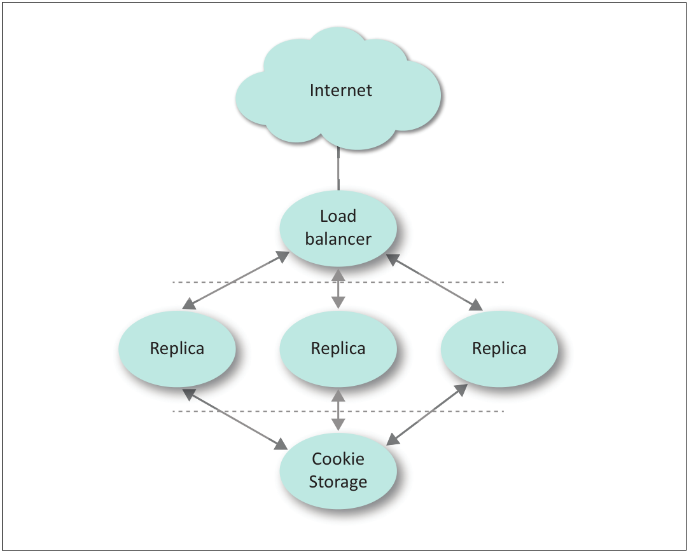

# Chapter 18

## Service Resiliency and Performance Patterns

Source: [The.Practice.of.System.and.Network.Administration-Vol.I-2017-18.pdf](./The.Practice.of.System.and.Network.Administration-Vol.I-2017-18.pdf), PDF pages 1–14.

The case studies and first-person accounts below reflect the source authors’ experience, as published in 2017.

This document includes a number of design patterns related to improving the resiliency of a system or its performance. These two issues are often related.

Products and services are often designed with some kind of internal redundancy to make the service more resilient or to enable it to scale to larger capacity. These techniques follow certain patterns. You will see them in many systems. This document’s goal is to introduce you to the most common patterns so that you will be familiar with them when you see them in products you may be designing, purchasing, or administrating.

First we discuss how extra hardware is used to provide resiliency. In this pattern, if one piece of hardware fails, there will be other hardware that can take its place. When there are two systems acting this way, the result is often called a master/slave relationship because one system is authoritative and in control.

Another design pattern involves having many systems that all provide the same kind of service. These are called replicas. In this case, each system receives and processes a fraction of the incoming workload. Clients send requests to a device called a load balancer, which then forwards a fraction of the requests to each replica.

While these patterns solve many problems, new issues arise. For example, how we share information, or state, between these machines is not as simple as it sounds.

Lastly, no one likes a slow service. This document ends with advice about making sure systems meet the performance expectations for the service. The first step is to understand how many simultaneous users (or workload in general) a system can handle. We can do a dataflow analysis to understand the theoretical limits of a system and load testing to test or prove our assumptions. We then explain how network latency can affect total system performance in real systems.

This document introduces performance engineering and scaling rather than covering them exhaustively. The companion volume, *The Practice of Cloud System Administration*, includes a broad overview of techniques. *The Art of Scalability: Scalable Web Architecture, Processes, and Organizations for the Modern Enterprise* by Abbott and Fisher (2010) contains in-depth explanations and techniques.

### 18.1 Redundancy Design Patterns

Redundancy can provide greater performance or better reliability. Sometimes it can provide both. This section discusses common redundancy patterns. Then it covers how they can be used to provide either more performance or better reliability.

#### 18.1.1 Masters and Slaves

The first category of patterns involves two equivalent sets of hardware. One is called the master and the other is called the spare or slave. The master provides services and the slave is, in general, idle but ready to take over if needed.

The master is in control and the slave follows orders. If there is data, or state, stored on these machines, the master holds the authoritative version of the data. If the slave holds the data as well, it is a copy, and often slightly out-of-date. Master/slave arrangements are generally created to improve a system’s ability to survive or recover in case hardware fails.

While this sounds simple, implementing master/slave relationships is quite complex and there are many variations of how it can be done. Here are some of the most common patterns:

- **Master plus cold spare:** In this configuration the service runs on the master machine. The cold spare is a redundant set of hardware that is powered off, but can be powered on and configured to replace the master in the event that the master fails. The time it takes to bring up the cold spare could be hours or days, especially if one must restore data from the most recent backups. This pattern used to be very common when some downtime was permitted and the technology to provide a seamless failover was either nonexistent or too costly.
- **Master plus hot spare:** In this configuration the service runs on the master. The hot spare is a separate machine that receives updates such that if the master failed, it could take over the master’s role with little or no data loss. Usually the master updates the hot spare in real time. Switching to the spare is a manual process.
- **Master/slave:** When switching to the hot spare is automatic, we call this a master/slave configuration. The slave does nothing but receive updates and waits for the master to die, in which case it takes over. It may assume the master’s IP

address so that clients see no outage, or simply retry a request and continue. When the failed machine comes back to life, it typically becomes the slave.
- **Master/read-only slave:** In this configuration the slave can handle some requests but not others. Typically it handles read requests—that is, requests that do not change the stored data or state. For example, an application would send database updates (writes) to the master but database reads to either the master or the slave. This improves performance since it reduces the amount of work being done by the master. The disadvantage of this pattern is that the slave may have data that is slightly out-of-date. An application may become confused if it performs an update and immediately sends a read request to the slave.
- **Master/master:** In this case both sets of hardware are able to perform both read and write operations. This is also known as a **load sharing** configuration. If either master fails, the other runs as normal. When the broken machine returns to life, it must sync up with the existing master before it begins providing service again. Coordinating such activity is very difficult. For example, if the failure occurs on the network between the two masters, both masters will think the other died and accept updates. As a consequence, their databases will diverge. When the network connection returns, both masters will be confused to find a master that already exists, with very different data. This is known as a **split brain** situation. Often the only way to resolve this conflict is for a human to pick one master and force the other one down. Because of the complexity of a master/master system, such software tends to be very expensive.

#### 18.1.2 Load Balancers Plus Replicas

Another way of providing redundancy is to use a **load balancer plus replica** configuration. In this pattern, all clients send their requests to the load balancer. The load balancer is a host that simply forwards the request to one of many replicas. Each replica is configured with the same software and provides the same service. Thus, the workload is distributed over the many replicas. Each replica processes a fraction of the workload. If a replica dies, the load balancer stops forwarding requests to it. If a new replica is added, the load balancer adds it to the mix.

A typical example is a web server. Each replica has the same set of web pages and application software. The load balancer can forward any request to any replica.

Another benefit of such redundancy is that it makes upgrades easier. You can perform a **rolling upgrade**. One at a time, each replica is disconnected, upgraded, tested, and brought back into service. The outage of the single host does not stop the entire service, but just reduces the total capacity of the system.

#### 18.1.3 Replicas and Shared State

Since each replica needs to act the same way, the replicas cannot store any information that would make them unique. For example, if the service permits someone to upload a photo for his or her profile page, the photo cannot simply be stored on that replica. If it did, future requests that go to other replicas would not have that photo or be able to display it.

Thus, if a web-based service stores or changes information, the replicas usually store this information elsewhere, usually on a database server. The information that may change is called **state**. Replicas are stateless, meaning that they store no state. Databases are stateful, meaning that they store information that changes.

Many applications require a small amount of state to be shared. This is often shared in an in-memory database such as Memcached or Redis. These databases are extremely fast for storing small amounts of data that is temporary in nature.

The companion volume, *The Practice of Cloud System Administration*, goes into greater detail about load balancers and replicas.

##### HTTP Cookies Are Web State

When logging into a web site, a user enters a username and password. After that, how does the web site know it is the same user? Does the web browser send that username and password with all future HTTP requests? Not at all.

Suppose Alice enters her username and password to log into a web site. This gets sent as form-data to the HTTP server. If the password is valid, the HTTP server replies with a web page or message that informs Alice of her successful login. That reply also includes a unique cookie such as LOGIN=1723832343207. Alice’s web browser will include that cookie with all future HTTP requests to that domain until it expires. When the server sees this cookie, it knows that the user is logged in and can determine which user it is. It can, therefore, generate web pages that are specific to Alice. In theory, the cookie is generated randomly and difficult to guess, which provides some measure of security.

When the cookie is initially created, it must be stored on the server so that later the application can use the cookie value to find which user is associated with it. Initially web sites stored this information on a local disk. This pattern worked because it was fast and easy—but broke when the load balancer plus replica design pattern was invented. In that pattern, each replica created its own cookie list. If the next HTTP request went to a different replica, that replica wouldn’t recognize the cookie value and the user would receive the web page for logged-out users.

*Figure 18.1: Web application with replicas and cookie storage*

The solution is to store the cookie list somewhere that all replicas can access, as depicted in Figure 18.1. Initially sites used SQL databases since they were what was available. However, SQL databases can be slow. Since nearly every web page requires a cookie lookup, this slowed down the entire site, and put a huge burden on the SQL servers. Eventually sites switched to in-memory databases such as Memcached or Redis.

#### 18.1.4 Performance or Resilience?

Performance is about making the system process work faster, or scaling to process more work. Resilience is about improving the system’s ability to work around failures. It is also called survivability.

As we’ve seen, redundancy is sometimes used to improve performance and sometimes used to improve resilience. When used to improve performance, the work is distributed across the added components. When used to improve resilience, the added components take over if another component fails.

People often make the mistake of assuming that redundancy makes a system more reliable *and* faster. Do not make this assumption. Sometimes the extra reliability will come at a performance cost. Moreover, an incorrectly scaled solution with replicas may be no more reliable than a single-server solution.

For example, a database using the master/master pattern may be slower than a single server. The masters may share the load for read operations, but writes will require additional overhead to perform synchronization and other housekeeping. If a large percentage of the operations performed are writes, the system will be more reliable, but slower.

A web service using the load balancer plus replicas may not be resilient to failures. Suppose there are three replicas, each running at 100 percent utilization. If one fails, the remaining two replicas will receive the workload that had been processed by the failed replica. Each replica is now receiving 150 percent of the requests it was designed to handle, which usually will cause the replicas to become overloaded and crash or have other problems.

A system that has enough capacity to be fully functional with one component removed is called *N* + 1. If two components can fail, it is called *N* + 2, and so on. If an *N* + 1 system fails, the system is now *N* + 0. When the failing component is repaired, the system returns to *N* + 1.

Any design with redundancy should indicate whether the redundancy is used to increase performance capacity or to improve resilience. Otherwise, there will be confusion. If some members of the team think the redundancy is for resilience but the system is actually running at *N* + 0, someone might decide to take one replica down to do maintenance. At that point the system will be overloaded.

If we know that the redundancy is intended to improve survivability, then the system should be monitored to detect whether the system is *N* + 1 or better, and alert us if the system has become (or will soon become) *N* + 0. With a master/slave system this is easy to monitor. If one component goes down, we know we are at *N* + 0 and should work to rectify the problem. This is more difficult with *N* + *M* systems, because to know the value of *M*, we must know how much capacity each machine adds to the system. This is usually determined by load testing. That said, you should at least monitor how many replicas are down so that they can be repaired before the system is less than *N* + 0.

### 18.2 Performance and Scaling

No one likes a slow service, even if it has every imaginable feature. From a customer’s perspective, two things are important in any service: Does it work, and is it fast? *Work* covers such areas as reliability, functionality, and the user interface. When designing a service, you also need to pay attention to its performance characteristics, even though many other difficult technical challenges need to be overcome. If you solve all those difficult problems but the service is slow, the people using it will not consider it to be a success.

Performance expectations increase as networks, graphics, and processors get faster. Performance that is acceptable now may not be viewed so favorably a year from now. Bear that in mind when designing the system. Often a small added cost to over-provision a system can avoid a large upgrade in the future.

To build a service that performs well, you need to understand how it works and perhaps look at ways of splitting it effectively across multiple machines. From the outset, you also need to consider how to scale the performance of the system as usage and expectations rise above what the initial system can do.

With **load testing**, you generate an artificial load on a service and see how it reacts. For example, you might generate 100 hits per second on a web server, and measure the latency, or the average time to complete a single request. Then you might generate 200 hits per second, and see how the behavior is affected. You would continue to increase the number of hits until you see how much load the service can take before the response time becomes unacceptable.

Your testing may show that the system runs well with a few simultaneous users, but how many resources—RAM, I/O, and so on—will be consumed when the service goes into production and is being used by hundreds or thousands of users simultaneously? Your vendor should be able to help with these estimates, but conduct your own tests, if possible. Don’t expect perfect accuracy from a vendor’s predictions of how your organization will use its product.

##### Bad Capacity Planning, Bad First Impression

Always purchase servers with enough extra capacity to handle peak utilization, as well as a growing number of customers. A new electronic voucher system deployed at one site was immediately overwhelmed by the number of users accessing it simultaneously. Customers trying to use the system found it impossibly slow and unreliable and soon switched back to the old paper-based method. This situation gave a bad first impression of the service. A memo was sent out stating that a root-cause analysis was being performed and that the system needed more RAM, which would arrive shortly. Even when the new RAM arrived, however, uptake was slow due to the bad first impression. Users preferred to stick with what they knew worked.

This new system had been projected to save millions of dollars per year, yet management had skimped on purchasing enough RAM for the system.

The finance group had hoped that the new system would be wildly popular and the basis for numerous future applications, yet the performance was specified for an initial small capacity rather than leaving some room for growth. This new service had been given a lot of internal publicity, so the finance group shouldn’t have been surprised that so many people would be trying the service on the very first day, rather than having a slowly increasing number of customers. Finally, the finance group had decided to flash-cut the new service rather than gradually introduce it to more divisions of the company over time. (Flash cuts are something we discuss more, and advocate against, in [Flash-Cuts: Doing It All at Once](SERVICE.CONVERSIONS.md#217-flash-cuts-doing-it-all-at-once).)

The finance group learned a lot about introducing new electronic services from this experience. Most important, the group learned that with customers, the old adage “Once bitten, twice shy” holds true. It is very difficult to get customers to accept a service that has failed once already.

Performance of the service for remote sites may also be an issue because of low-bandwidth and high-latency connections (we give advice about latency later in this document). Some applications enable you to place servers in different locations, and to use a global load balancer to direct traffic to the closest instance. For applications that are not designed that way, you may need to become very creative in providing reasonable remote performance if the service has a lot of network traffic. In some cases, quality of service (QoS) or intelligent queuing mechanisms can be sufficient to make the performance acceptable. In others, you may need to look at ways of reducing the network traffic.

#### 18.2.1 Dataflow Analysis for Scaling

If you understand the individual components of a typical transaction in a service, you can scale the service with much greater precision and efficiency. Strata’s experiences building scalable Internet services for ISPs and ASPs led her to create a dataflow model for individual transactions and combine them into spreadsheets to get an overall dataflow picture.

A dataflow model is simply a list of transactions and their dependencies, with as much information as can be acquired about resource usage for each transaction. That information might include the amount of memory used on the server hosting the transaction, the size and number of packets used in a transaction, the number of open sockets used to service a transaction, and so on.

In modeling an individual service transaction with dataflow, all the pieces of the transaction necessary to make it happen are included—even such pieces as Internet name lookups via DNS—to get a true picture of the transaction. Even things technically outside your control, such as the behavior of the root-level name servers in DNS, can affect what you’re trying to model. If a transaction bottleneck occurred in the name-lookup phase, for instance, you could internally run a caching name server, thus saving some time doing external lookups. Sites that keep and analyze web service logs or other external access logs routinely do this, as it speeds up logging. For even faster logging, sites may simply record the external host by IP address and do the name lookups in a post-processing phase for analysis.

A nice thing about a service is that it is generally transaction based. Even file sharing consists of multiple transactions as blocks are read and written across the network. The key part of dataflow modeling to remember is that service transactions almost always depend on infrastructure transactions. It’s fairly common to investigate a scaling problem with a service and discover that the service itself has encountered a bottleneck somewhere in the infrastructure.

Once the dataflow model is accurately depicting the service, you can address performance and scaling problems by seeing which part of the dataflow model is the weakest point, and then monitoring each piece, under real or simulated conditions, and seeing how it acts or how it fails. For example, if your database can handle up to 100 queries per second, and if you know that every access to your web site’s home page requires three database queries, you can predict that the web site will work only if there are no more than 33 hits per second. However, you also now know that if you can improve the performance of the database to be 200 QPS— possibly by replicating it on a second server and dividing the queries between the two—the web site can handle twice as many hits per second, assuming that no other bottleneck is involved.

Resources on the server can also be an issue. Suppose that a server provides email access via IMAP. You might know, from direct observation or from vendor documentation, that each client connected to the server requires about 300K of RAM. Looking at the logs, you can get an idea of the usage patterns of the server: the number of users who are on simultaneously during certain parts of the day versus the total number of server users.

Knowing how many people are using the service is only part of the process. To analyze resources, you also should consider whether the IMAP server process loads an index file of some type, or even the whole mailbox, into memory. If so, you need to know the average size of the data that will be loaded. The data size can be calculated as a strict average of all the customers’ index files. The average can be taken as a mean or median, based on where in the size curve most index files occur. Another viable solution is to add up only the index files used during peak usage times and perform the mean or median average calculations on that sum. Pick what seems to be the most realistic case for your application. The monitoring system can be used to validate your predictions. It might turn up unexpected findings, such as that the average mailbox size grows faster than expected. This growth rate might affect index size and thus performance.

Finally, step back and do this kind of analysis for all the steps in the dataflow. If a customer desktop makes an internal name-lookup query to find the mail server rather than caching information on where to find it, that fact should be included in your dataflow analysis as load on the name server. Maybe the customer is using a webmail application, in which case the customer will be using resources on a web server, whose software in turn makes an IMAP connection to the mail server. In this case, there are probably at least two name lookups per transaction, since the customer desktop will look up the webmail server, and the webmail server will look up the IMAP server. If the webmail server does local authentication and passes credentials to the IMAP server, there would be a third name lookup, to the directory server, and then a directory transaction.

Dataflow modeling works at all levels of scale. You can successfully design a server upgrade for a 30-person department or a multimedia services cluster for 3 million simultaneous users. It might take some traffic analysis on a sample setup, as well as vendor information, system traces, and so on, to get exact figures of the type you’d want for the huge-scale planning.

##### An Example of Dataflow Analysis

Strata once managed a large number of desktops accessing a set of file servers on a network. A complaint about files being slow to open was investigated, but the network was not clogged, nor were there unusual numbers of retransmits or lags in the file server statistics on the hosts serving files. Further investigation revealed that all the desktops were using the same directory server to get the server-to-file mapping when opening a file and that the directory server itself was overloaded.

No one had realized that although the directory server could easily handle the number of users whose desktops mapped to it, each user was generating dozens, if not hundreds, of file-open requests to compile large jobs. When the requests per user figures were calculated and the number of simultaneous users estimated, it was then easy to see that an additional directory server was required for good performance.

#### 18.2.2 Bandwidth Versus Latency

The term **bandwidth** refers to how much data can be transmitted in a second; **latency** is the delay before the data is received by the other end. A high-latency link, no matter what the bandwidth, will have a long round-trip time: the time for a packet to travel and the reply to return. Some applications, such as non-interactive (streaming) video, are unaffected by high latency. Others are affected greatly by this factor.

Suppose that a particular task requires five database queries. The client sends a request and waits for the reply. This is done four more times. On an Ethernet network, where latency is low, these five queries will happen about as quickly as the database server can process them and return the result. The complete task might take a second. But what if the same server is in Mumbai and the client is running on a machine in New York City? Suppose that it takes half a second for information to travel from New York City to Mumbai. Data can travel only as fast as the speed of light, and usually travels much more slowly due to delays added by routers, repeaters, and other devices along the network path. Now the task will take six seconds (one-half second for each request and each reply) plus the same one second the database takes to do its work. That’s a lot slower than the original Ethernet time. It may not sound like a lot, but to an interactive user, it is noticeable and annoying. Now consider that when this kind of task is done thousands or millions of times each day, the many tiny delays add up to a significant amount of time.

Suppose that the link to Mumbai is a T1 connection (1.5 Mbps). Would upgrading the link to a T3 connection (45 Mbps) solve the problem? No. A T3 link adds bandwidth but does not change the speed of light. Such an upgrade will not improve the situation (unless there are additional queuing delays because the link is saturated).

One solution might be to launch all five queries at the same time and wait for the replies to come back as each of them completes. If each query is independent of the others, this is an easy solution. Better yet is when five queries can be replaced by a single high-level operation that the server can perform itself. For example, if the code performed a series of SQL queries and then summed the result, we could send one long query that gathered the five pieces of information and summed the result at the server. With this strategy, we reduce the number of round trips from five to one.

Mathematically speaking, the problem is as follows: The total time to completion (*T*) is the sum of the time each request takes to complete. The time it takes to complete each request is made up of three components: sending the request (*S*), computing the result (*C*), and receiving the reply (*R*). This is depicted mathematically as

*T* = (*S*1 + *C*1 + *R*1) + (*S*2 + *C*2 + *R*2) + · · · + (*S**n* + *C**n* + *R**n*)

In a low-latency environment, *S**n* +*R**n* is nearly zero. Thus, programmers may forget that it exists, or worse, think incorrectly that the formula is

*T* = *C*1 + *C*2 + · · · + *C**n* Programs written under the assumption that latency is zero or near-zero will benchmark very well on a local Ethernet network, but perform terribly once put into production on a global high-latency wide area network (WAN). This can make the product too slow to be usable. Most network providers do not sell latency, just bandwidth. Therefore their salesperson’s only solution is to sell the customer more bandwidth, and as we have just shown, more bandwidth won’t fix a latency problem. We have seen many naive sites unsuccessfully try to fix this kind of problem by purchasing more bandwidth.

There are a number of ways we can change the algorithm to work around latency issues:

- **Move work to the other side.** As in the earlier example, combine work done in small steps into one larger request performed by the server in one round trip.
- **Send requests in parallel.** If the requests are independent of one another, they can all be sent at the same time, and we can wait for the replies to arrive in any order.
- **Create windowed requests.** If sending all the requests in parallel would overload the server or the network between the two, a more sophisticated algorithm can limit the flow to *n* outstanding requests at any given time. This *n* is called the maximum window.
- **Query lists instead of individual items.** Change the protocol to accept a list of data instead of requiring one request per datum. For example, one graphic system required clients to verify that the fonts it had locally were also available on the server one font at a time. This added minutes to the startup time when used on high-latency links. The protocol was changed so that the client could send the list of fonts and receive a list of status results.

Applications such as streaming video and audio are not as concerned with latency because the video or audio packets are being sent in only one direction. The delay is unnoticed once the broadcast begins. However, for interactive media, such as voice or video chatting, the latency is noticed as a long pause after one person stops speaking and before the other person starts.

Even if an algorithm sends only one request and waits for one reply, how those messages are sent can make all the difference.

##### Case Study: Minimizing Packets in High-Latency Networks

A global pharmaceutical company based in New Jersey had a terrible performance problem with a database application. Analysis found that a single 4,000-byte SQL request sent over a transatlantic link was being sent in 50 individual 80-byte packets. Each packet was sent only when the previous one was acknowledged. It took 5 minutes for someone to log in.

The developers had been demanding additional transatlantic bandwidth, which would have taken months to order, been very expensive, and proved disappointing when it didn’t solve the problem. When the system administrators reconfigured the database connector to send fewer larger packets, the performance problem went away.

### 18.3 Summary

This document introduced a number of design patterns and scaling techniques with which all SAs should be familiar. You will see them when evaluating products, designing services, and administering services.

Master/slave is a pattern where one system provides service and an equal system takes over if the first one fails. Load sharing between many redundant systems (replicas) is done via a load balancer that directs proportional amounts of traffic to each replica.

Each additional replica adds a certain amount of capacity or horsepower to the service. If any replica is down, the load balancer divides its work among the remaining systems. This helps work around failures and also makes it possible to do maintenance or upgrades. However, this scheme requires spare capacity on the remaining replicas equal to the capacity lost from the failed one. One should know how much spare capacity is required to withstand one or more failures. A system that can tolerate one failure is called *N* + 1. The utilization should be monitored and alerts should trigger when the spare capacity is dangerously low.

Sharing state between replicas is difficult. In a web-based service, if a user logs in while connected to one replica, the other replicas need to know that the user is logged in. Otherwise, each request may or may not respond appropriately. Usually the replica that the user logs into sends a cookie to the HTTP client. The replica must communicate this cookie’s information to the other replicas. This shared state is usually put in a high-speed database that all replicas access.

An overloaded system can be slow or fail. Determining how much load a system can handle while still providing an acceptable response time can be done a few different ways. Dataflow analysis involves modeling the system to understand how many transactions subsystems will perform for each transaction. Load testing involves sending requests and measuring the resulting response time.

Latency, or the time information takes to travel, is often an issue when a system that talks to a subsystem at great distance, or a web browser talks to a distant server. Some designs tolerate high latency better than others.

### Exercises

1. When would two systems be configured as a master/slave pair? 2. In your environment, what are some examples of master/slave, master/master, and load balancing? 3. What is a load balancer? When do replicas need to share state? 4. Compare load testing to dataflow analysis. 5. How would you load test a service you run? 6. What is the difference between latency and bandwidth? If a system is slow because of a high-latency link, why can’t a faster network connection improve the situation? 7. Measure the latency between your home computer and various work servers. 8. Explain to a non-SA the difference between latency and bandwidth. 9. How can you mitigate a performance problem caused by high latency? 10. Log into a web site and view the cookies stored in your web browser as a result. On another computer, verify that you are not logged into that web site, and then copy those cookies to this other computer. Are you logged in? Why or why not? What does this mean about how cookies should be stored and transmitted? 11. Suppose we save money by having the slave in a master/slave pattern be a slower, less expensive machine. When the failed master came back to life, we could switch back to it instead of letting the slower machine remain as the master. What would be the benefits and disadvantages of this?
