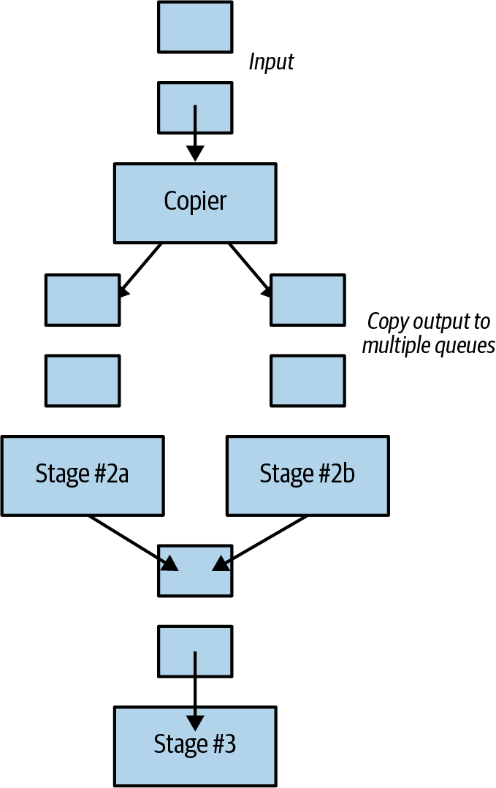
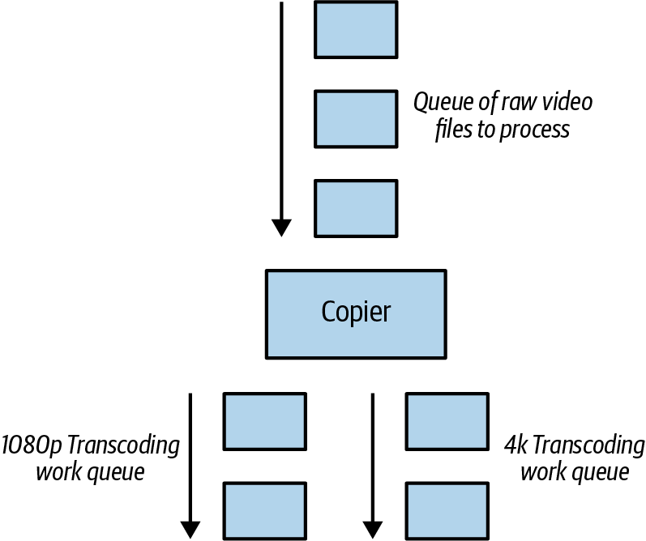
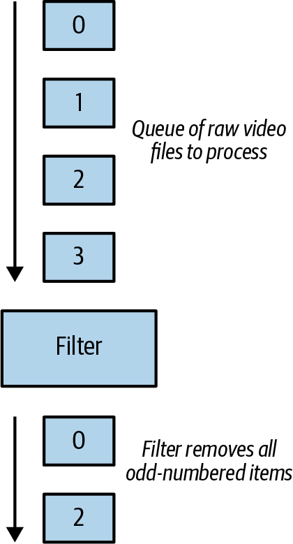
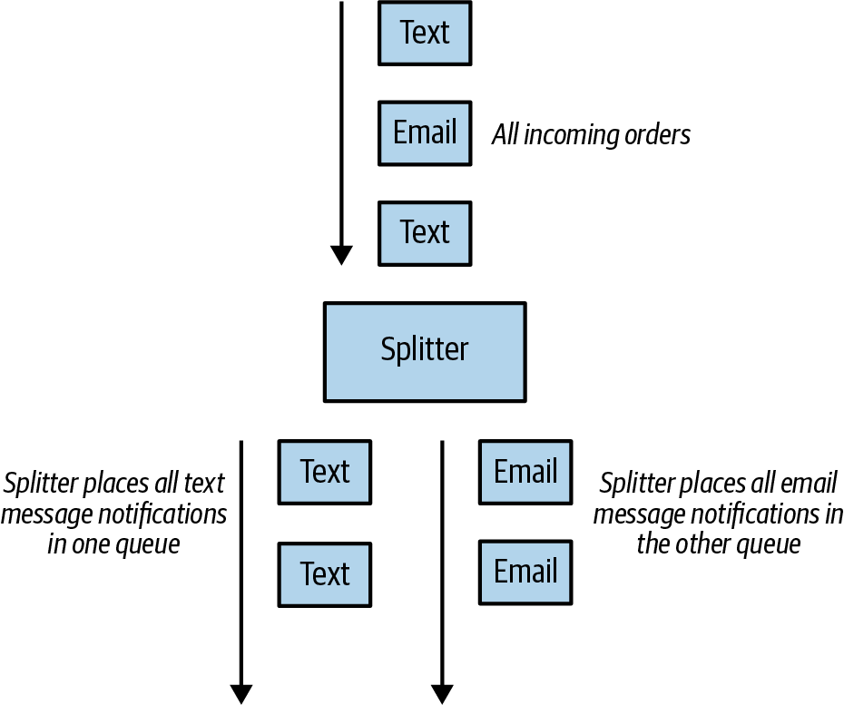
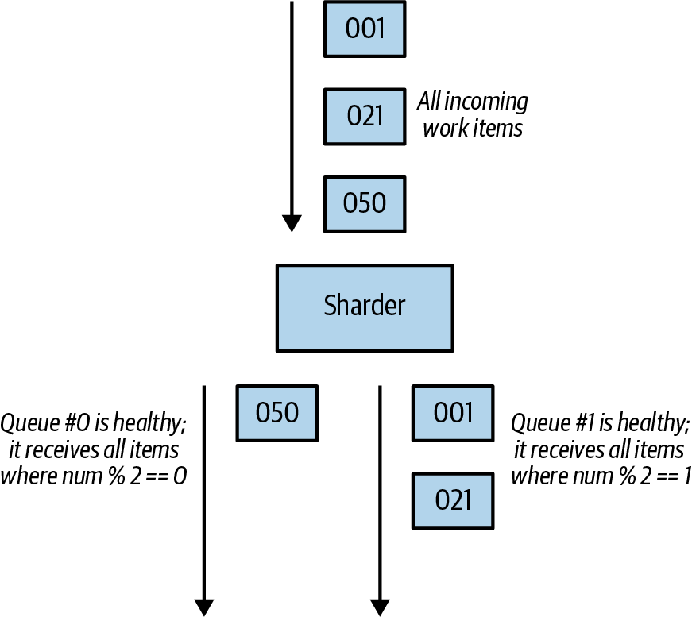
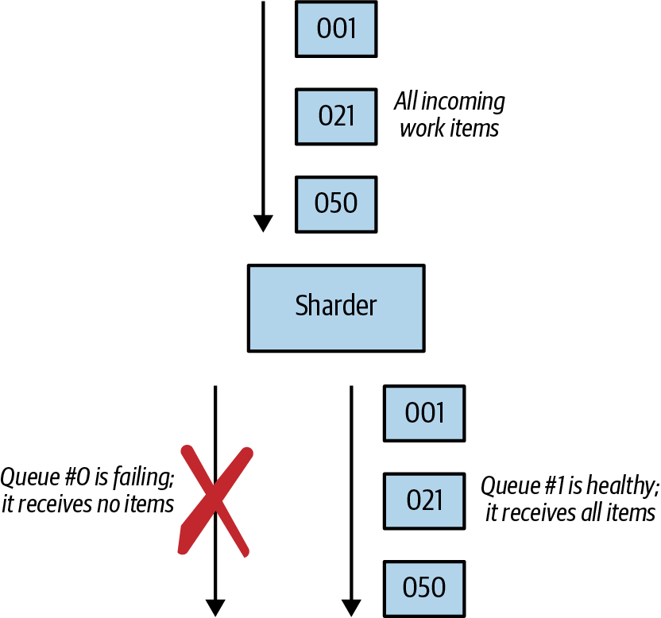
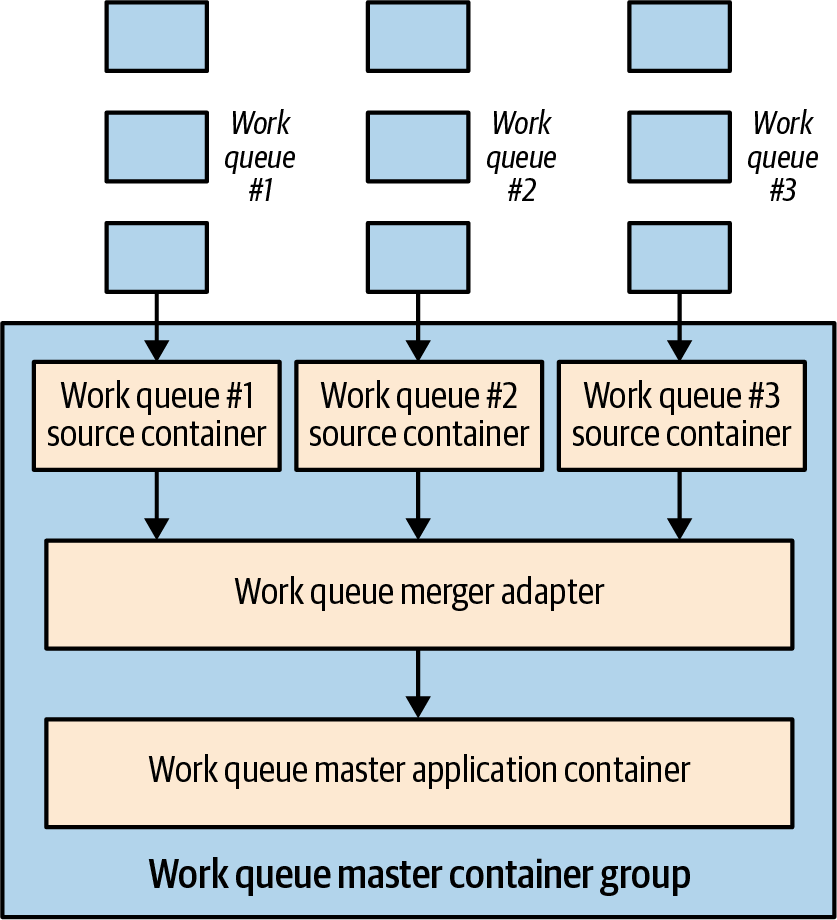
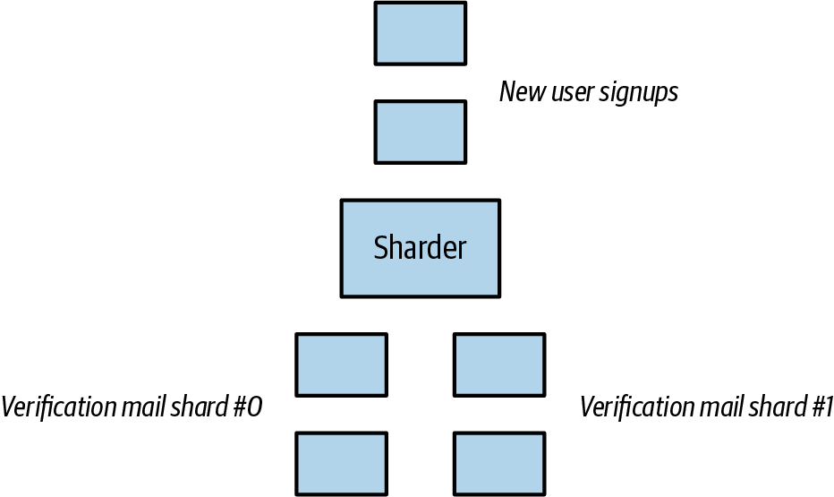
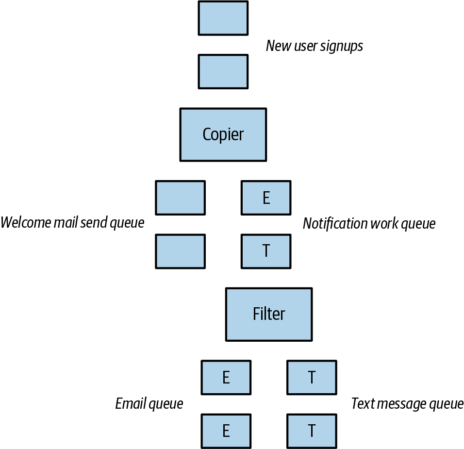

# Event-Driven Batch Processing

First-person accounts and opinions in this document reflect the original source authors’ perspective.

In [Work Queue Systems](WORK.QUEUE.SYSTEMS.md), we saw a generic framework for work queue processing, as well as a number of example applications of simple work queue processing. Work queues are great for enabling individual transformations of one input to one output. However, there are a number of batch applications where you want to perform more than a single action, or you may need to generate multiple different outputs from a single data input. In these cases, you start to link work queues together so that the output of one work queue becomes the input to one or more other work queues, and so on. This forms a series of processing steps that respond to events, with the events being the completion of the preceding step in the work queue that came before it.

These sort of event-driven processing systems are often called *workflow* systems, since there is a flow of work through a directed, acyclic graph that describes the various stages and their coordination. A basic illustration of such a system is shown in Figure 12-1.

The most straightforward application of this type of system simply chains the output of one queue to the input of the next queue. But as systems become more complicated, there are a series of different patterns that emerge for linking a series of work queues together. Understanding and designing in terms of these patterns is important for comprehending how the system is working. The operation of an event-driven batch processor is similar to event-driven FaaS. Consequently, without an overall blueprint for how the different event queues relate to each other, it can be hard to fully understand how the system is operating. Furthermore, though the initial design of a work queue can be straightforward, correctly handling errors and other unexpected conditions rapidly makes a simple work queue much more complicated.



*Figure 12-1. This workflow combines copying work into multiple queues (Stage 2a, 2b), parallel processing of those queues, and combining the result back into a single queue (Stage 3)*

## Patterns of Event-Driven Processing

Beyond the simple work queue described in [Work Queue Systems](WORK.QUEUE.SYSTEMS.md), there are a number of patterns for linking work queues together. The simplest pattern—one where the output of a single queue becomes the input to a second queue—is straightforward enough that we won’t cover it here. We will describe patterns that involve the coordination of multiple different queues or the modification of the output of one or more work queues.

### Copier

The first pattern for coordinating work queues is a copier. The job of a copier is to take a single stream of work items and duplicate it out into two or more identical streams. This pattern is useful when there are multiple different pieces of work to be done on the same work item. An example of this might be rendering a video. When rendering a video, there are a variety of different formats that are useful, depending on where the video is intended to be shown. There might be a 4K high-resolution format for playing off of a hard drive, a 1080-pixel rendering for digital streaming, a low-resolution format for streaming to mobile users on slow networks, and an animated GIF thumbnail for displaying in a movie-picking user interface. All of these work items can be modeled as separate work queues for each render, but the input to each work item is identical. An illustration of the copier pattern applied to transcoding is shown in Figure 12-2.



*Figure 12-2. The copier batch pattern for transcoding*

The copy pattern can also be used to trade additional computational power for increased reliability or performance. Imagine that you have a worker processing work that usually takes one second to run, but occasionally takes one minute (60x slowdown). If you process every work item twice and take whichever result completes first, you are much less likely to be impacted by this slowdown. Similarly, if your worker crashes 1% of the time, you can go from a two-nines (99% reliable) system to a four-nines (99.99% reliable) simply by processing every item twice. Obviously, in both cases, doing the engineering work to improve the system is a better long-term solution. But sometimes as a temporary workaround, or in situations where the engineering work isn’t possible, it’s useful to be able to just throw resources at the problem.

### Filter

The second pattern for event-driven batch processing is a filter. The role of a filter is to reduce a stream of work items to a smaller stream of work items by filtering out work items that don’t meet particular criteria. As an example of this, consider setting up a batch workflow that handles new users signing up for a service. Some set of those users will have ticked the checkbox that indicates that they wish to be contacted via email for promotions and other information. In such a workflow, you can filter the set of newly signed-up users to only be those who have explicitly opted into being contacted.

Ideally you would compose a filter work queue source as an ambassador that wraps up an existing work queue source. The original source container provides the complete list of items to be worked on, and the filter container then adjusts that list based on the filter criteria and only returns those filtered results to the work queue infrastructure. An illustration of this use of the adapter pattern is shown in Figure 12-3.



*Figure 12-3. An example of a filter pattern that removes all odd-numbered work items*

### Splitter

Sometimes you don’t want to just filter things out by dropping them on the floor, but rather you have two different kinds of input present in your set of work items, and you want to divide them into two separate work queues without dropping any of them. For this task, you want to use a splitter. The role of a splitter is to evaluate some criteria—just like a filter—but instead of eliminating input, the splitter sends different inputs to different queues based on that criteria.

An example of an application of the splitter pattern is processing online orders where people can receive shipping notifications either by email or text message. Given a work queue of items that have been shipped, the splitter divides it into two different queues: one that is responsible for sending emails and another devoted to sending text messages. A splitter can also be a copier if it sends the same output to multiple queues, such as when a user selects both text messages and email notifications in the previous example. It is interesting to note that a splitter can actually also be implemented by a copier and two different filters. But the splitter pattern is a more compact representation that captures the job of the splitter more succinctly. This is a little like the fact that an XOR (exclusive or) logic gate can actually be implemented with OR/NOT/AND gates, but it is convenient to think of it as an XOR. An example of using the splitter pattern to send shipping notifications to users is shown in Figure 12-4.



*Figure 12-4. An example of the batch splitter pattern splitting shipping notifications into two different queues*

### Sharder

A slightly more generic form of splitter is a sharder. As in [Sharded Services](SHARDED.SERVICES.md), the role of a sharder in a workflow is to divide up a single queue into an evenly divided collection of work items based upon some sort of *sharding function*. There are several different reasons why you might consider sharding your workflow. One of the first is for reliability. If you shard your work queue, then the failure of a single workflow due to a bad update, infrastructure failure, or other problem only affects a fraction of your service.

For example, imagine that you push a bad update to your worker container, which causes your workers to crash and your queue to stop processing work items. If you only have a single work queue that is processing items, then you will have a complete outage for your service with all users affected. If, instead, you have sharded your work queue into four different shards, you have the opportunity to do a staged rollout of your new worker container. Assuming you catch the failure in the first phase of the staged rollout, sharding your queue into four different shards means that only one-quarter of your users would be affected.

An additional reason to shard your work queue is to more evenly distribute work across different resources. If you don’t really care which region or data center is used to process a particular set of work items, you can use a sharder to evenly spread work across multiple data centers to even out utilization of all data centers/regions. As with updates, spreading your work queue across multiple failure regions also has the benefit of providing reliability against data center or region failures. An illustration of a sharded queue when everything is working correctly is shown in Figure 12-5.



*Figure 12-5. An example of the sharding pattern in a healthy operation*

When the number of healthy shards is reduced due to failures, the sharding algorithm dynamically adjusts to send work to the remaining healthy work queues, even if only a single queue remains.

This is illustrated in Figure 12-6.



*Figure 12-6. When one work queue is unhealthy, the remaining work spills over to a different queue*

### Merger

The last pattern for event-driven or workflow batch systems is a *merger*. A merger is the opposite of a copier; the job of a merger is to take two different work queues and turn them into a single work queue. Suppose, for example, that you have a large number of different source repositories all adding new commits at the same time. You want to take each of these commits and perform a build-and-test for it. It is not scalable to create a separate build infrastructure for each source repository. We can model each of the different source repositories as a separate work queue source that provides a set of commits. We can transform all of these different work queue inputs into a single merged set of inputs using a merger adapter. This merged stream of commits is then the single source to the build system that performs the actual build. The merger is another great example of the adapter pattern, though in this case, the adapter is actually adapting multiple running source containers into a single merged source.

This multiadapter pattern is shown in Figure 12-7.



*Figure 12-7. Using multiple levels of containers to adapt multiple independent work queues into a single shared queue*

## Hands On: Building an Event-Driven Flow for New User Signup

A concrete example of a workflow helps show how these patterns can be put together to form a complete operating system. The problem this example will consider is a new user signup flow.

Imagine that our user acquisition funnel has two stages. The first is user verification. After a new user signs up, the user then has to receive an email notification to validate their email. Once the user validates their email, they are sent a confirmation email. Then they are optionally registered for email, text message, both, or neither for notifications.

The first step in the event-driven workflow is the generation of the verification email. To achieve this reliably, we will use the shard pattern to shard users across multiple different geographic failure zones. This ensures that we will continue to process new user signups, even in the presence of partial failures. Each work queue shard sends a verification email to the end user. At this point, this substage of the workflow is complete. This first stage of the flow is illustrated in Figure 12-8.



*Figure 12-8. The first stage of the workflow for user signup*

The workflow begins again when we receive a verification email from the end user. These emails become new events in a separate (but clearly related) workflow that sends welcome emails and sets up notifications. The first stage of this workflow is an example of the copier pattern, where the user is copied into two work queues. The first work queue is responsible for sending the welcome email, and the second work queue is responsible for setting up user notifications.

Once the work items have been duplicated between the queues, the email-sending queue simply takes care of sending an email message, and the workflow exits. But remember that because of the use of the copier pattern, there is still an additional copy of the event active in our workflow. This copier triggers an additional work queue to handle notification settings. This work queue feeds into an example of the filter pattern, which splits the work queue into separate email and text message notification queues. These specific queues register the user for email, text, or both notifications.

The remainder of this workflow is shown in Figure 12-9.



*Figure 12-9. The user notification and welcome email work queue*

## Publisher/Subscriber Infrastructure

We have seen a variety of abstract patterns for linking together different event-driven batch processing patterns. But when it comes time to actually build such a system, we need to figure out how to manage the stream of data that passes through the event-driven workflow. The simplest thing to do would be to simply write each element in the work queue to a particular directory on a local filesystem, and then have each stage monitor that directory for input. But of course doing this with a local filesystem limits our workflow to operating on a single node. We can introduce a network filesystem to distribute files to multiple nodes, but this introduces increasing complexity both in our code and in the deployment of the batch workflow.

Instead, a popular approach to building a workflow like this is to use a publisher/ subscriber (pub/sub) API or service. A pub/sub API allows a user to define a collection of queues (sometimes called topics). One or more *publishers* publishes messages to these queues. Likewise, one or more *subscribers* is listening to these queues for new messages. When a message is published, it is reliably stored by the queue and subsequently delivered to subscribers in a reliable manner.

At this point, most public clouds feature a pub/sub API such as Azure’s EventGrid or Amazon’s Simple Queue Service. Additionally, the open source Kafka project provides a very popular pub/sub implementation that you can run on your own hardware as well as on cloud virtual machines. For the remainder of this overview of pub/sub APIs, we’ll use Kafka for our examples, but they are relatively simple to port to alternate pub/sub APIs.

## Hands On: Deploying Kafka

There are obviously many ways to deploy Kafka, and one of the easiest ways is to run it as a container using a Kubernetes cluster and the Helm package manager.

Helm is a package manager for Kubernetes that makes it easy to deploy and manage prepackaged off-the-shelf applications like Kafka. If you don’t already have the helm command-line tool installed, you can install it from the Helm website.

Once the helm tool is on your machine, you need to initialize it. Initializing Helm deploys a cluster-side component named tiller to your cluster and installs some templates to your local filesystem:

```text
helm init
```

Now that Helm is initialized, you can install Kafka using this command:

```text
helm repo add incubator http://storage.googleapis.com/kubernetes-charts-incubator
helm install --name kafka-service incubator/kafka
```

> Helm templates have different levels of production hardening and support. stable templates are the most strictly vetted and supported, whereas incubator templates like Kafka are more experimental and have less production mileage. Regardless, incubator templates are useful for quick proof of concepts as well as a place to start from when implementing a production deployment of a Kubernetes-based service.


*Figure 12-10. Callout illustration accompanying the discussion on PDF page 11*

Once you have Kafka up and running, you can create a topic to publish to. Generally in batch processing, you’re going to use a topic to represent the output of one module in your workflow. This output is likely to be the input for another module in the workflow.

For example, if you are using the Sharder pattern described previously, you would have a topic for each of the output shards. If you called your output Photos and you chose to have three shards, then you would have three topics: Photos-1, Photos-2, and Photos-3. Your sharder module would output messages to the appropriate topic after applying the sharding function.

Here’s how you create a topic. First, create a container in the cluster so that you can access Kafka:

```text
for x in 0 1 2; do
  kubectl run kafka --image=solsson/kafka:0.11.0.0 --rm --attach --command -- \
    ./bin/kafka-topics.sh --create --zookeeper kafka-service-zookeeper:2181 \
      --replication-factor 3 --partitions 10 --topic photos-$x
done
```

Note that there are two interesting parameters in addition to the topic name and the ZooKeeper service. They are --replication-factor and --partitions. The replication factor is how many different machines messages in the topic will be replicated to. This is the redundancy that is available in case things crash. A value of 3 or 5 is recommended. The second parameter is the number of partitions for the topic. The number of partitions represents the maximum distribution of the topic onto multiple machines for purposes of load balancing. In this case, since there are 10 partitions, there can be at most 10 different replicas of the topic for load balancing.

Now that we have created a topic, we can send messages to that topic:

```text
kubectl run kafka-producer --image=solsson/kafka:0.11.0.0 --rm -it --command -- \
    ./bin/kafka-console-producer.sh --broker-list kafka-service-kafka:9092 \
    --topic photos-1
```

Once that command is up and connected, you should see the Kafka prompt, and you can then send messages to the topic(s). To receive messages, you can run:

```text
kubectl run kafka-consumer --image=solsson/kafka:0.11.0.0 --rm -it --command -- \
    ./bin/kafka-console-consumer.sh --bootstrap-server kafka-service-kafka:9092\
    --topic photos-1 \
        --from-beginning
```

Of course, running these command lines only gives you a taste of how to communicate via Kafka messages. To build a real-world event-driven batch processing system, you would likely use a proper programming language and Kafka SDK to access the service. But on the other hand, never underestimate the power of a good bash script!

This section has shown how installing Kafka into your Kubernetes cluster can dramatically simplify the task of building a work queue-based system.

## Resiliency and Performance in Work Queues

So far in this document, we have designed workflows to optimize the design of the work queue to match the problem being addressed by the work queue. This is an important part of engineering. The clearer the design of the system matches the task, the easier it is to understand, update, and extend. However, an additional critical part of engineering is anticipating and designing systems for both the performance and reliability requirements of the users.

So far, in all of the designs we have assumed that all of the work in the system is roughly identical and each piece of work is equally reliable. Unfortunately, in the real world, neither one of these assumptions is typically true. Unless your system is very, very unusual, it contains a mix of different work. Different videos, different emails, different builds—work queues are constantly dealing with similar but different individual pieces of work.

### Work Stealing

The net result of this is that some pieces of work take longer than other pieces of work. Sometimes this is inherent (that movie is just larger), but often it is because of design decisions in our code which are better or worse fits for a specific work item. We may have optimized our code for lots of files and few directories, and the work item might be the opposite: deep directory trees with relatively few files. Oftentimes the latency of individual work items might not matter; if they generally land on different queues via something like sharding, the overall average times generally work out. But unfortunately, sometimes this average performance doesn’t work out, and all of the slow items end up on one queue. When this happens, the inputs to the queue pile up and latency increases, much like a slow checkout lane in a grocery store. Just like in the grocery store, the best option is to move from the slow lane to a lane with a shorter line. This algorithm is called “work stealing.”

The basic algorithm for work stealing says that for any worker, as long as that worker has work on their queue, the work on the queue is performed as you would expect. When there is no work on a worker’s queue, instead of sleeping until more work arrives, the worker takes work off of the back of the longest queue of any other worker. In this way, the maximum length of any work queue is kept to a minimum since workers with shorter work queues remove work from workers with longer queues. Work is taken from the back of the queue because that removal can be done safely without worrying about whether the work may be performed by multiple workers.

### Errors, Priority, and Retry

The other problems that can occur in a work queue system come when there are errors processing the work itself. The first problem that can happen is if your worker crashes in the middle of processing the work. In the worst case, the work that was being removed from the queue is lost. Fortunately, most queue systems have semantics where the message being processed is initially removed from the queue for processing. This initial removal hides the message from other workers, but it doesn’t actually remove it from the queue. When the work has been processed, a second “completed” message is sent to the queue, which permanently removes the work from the queue. Typically a message queue has a timeout after which, if the work has not been “completed,” the work item is returned to the head of the queue for other workers to pick it up.

Unfortunately, recovering from this error results in an additional complication. What if the first worker is merely running slowly, not crashed? Now we have two workers processing the same work item. The easiest way to deal with this situation is to make each work item idempotent. That way the additional processing is wasted computation, but it does not cause any additional errors. If it isn’t possible to make your work idempotent, there are various distributed locking methods discussed in [Ownership Election](OWNERSHIP.ELECTION.md) that can be used. The important takeaway is that when writing a worker, you must assume that multiple workers could be operating on the same work item.

Assuming idempotent work, we’re now safe from workers crashing, right? Sadly, it’s not that easy. Imagine if the crashing worker is not due to random bugs in the worker’s code, but something about the work item itself. Suppose there is a “poison” work item which crashes a worker 100% of the time. In such a situation, where one worker is recovering from the crash, the poison work is picked up by another worker, which itself crashes, causing another worker to pick up the poison and so on and so forth until all of your workers are crashing. Even if you are lucky and your workers recover quickly, poison work can cause you to lose a significant percentage of your worker capacity and slow down your work queue significantly.

Much as with error handling, the first solution to poison work is to keep track of the number of times that a particular piece of work has been removed from the message queue. We can then use exponential backoff to increase the timeout for the poison message larger and larger until we remove it from processing entirely. Generally, exponential backoff will solve the problem of poison work.

Unfortunately, requeuing work for processing introduces additional problems. To understand why, consider the case where workers are crashing for reasons unrelated to the work. Perhaps a downstream dependency is returning bad data and causing the crash. In this situation, the work queue effectively stalls, and more and more work piles up in the queue. Since no workers can make progress, even work stealing described previously won’t help. Suppose the situation resolves itself and the workers can start making progress, like a traffic jam long after an accident; all of the work that has piled up in the queue means that new requests are still experiencing significant latency. This is often made especially bad in user-facing situations where the old work items are often no longer relevant, but the new work has value *if* it can be completed in time.

To address this problem of a backlog, it is often useful to actually have two queues of work items. The first queue is used for all work items which have never had an attempt made at processing. The second queue is the “retry” queue, which is used for any message which has had at least one (unsuccessful) attempt at processing. Using this dual queue approach, in the above situation, there will be a lot of work piled up in the retry queue waiting for processing, but new work is no longer standing at the back of the line of retries. It has an equal chance of being processed along with the retry work. This two-queue approach is an example of a general priority queue approach, where different work queues have different priority and work is taken off the higher priority queue until it is empty, and then the next highest priority queue, etc. This can ensure that performance goes to where it is needed most to achieve latency goals.

## Summary

This document has introduced the idea of a workflow. Workflows combine multiple work queues together into an orchestration of work to achieve some more complex objective. Multiple patterns for building workflows, from copying, to filtering, sharding, and merging were introduced. Finally, the important considerations of both performance and reliability in the face of slow work and worker crashes was examined. Using these patterns and error handling approaches, any complex work can be broken into an easily reasoned-about and constructed workflow for processing data reliably and efficiently.
