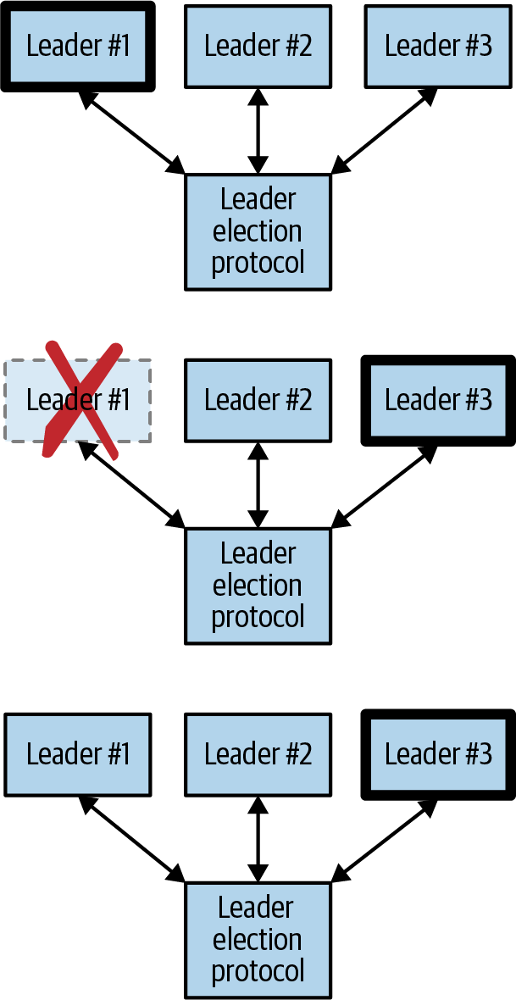
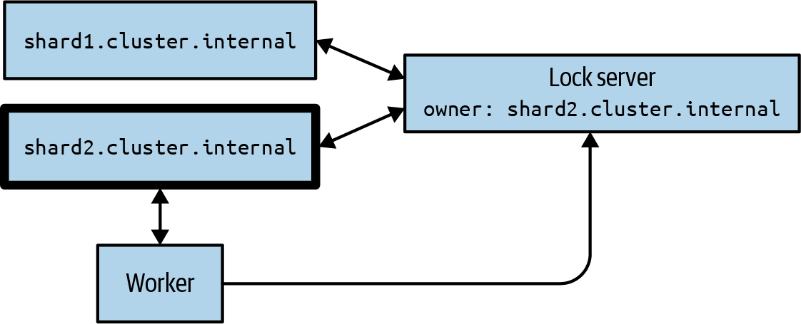

# Ownership Election

Source: [Designing.Distributed.Systems-2025-10.pdf](./Designing.Distributed.Systems-2025-10.pdf), PDF pages 1–13.

First-person accounts and opinions in this document reflect the original source authors’ perspective.

The previous patterns that we have seen have been about distributing requests in order to scale requests per second, the state being served, or the time to process a request. This document on multinode serving patterns is about how you scale assignment. In many different systems, there is a notion of *ownership* where a specific process owns a specific task. We have previously seen this in the context of sharded and hot-sharded systems where specific instances owned specific sections of the sharded key space.

In the context of a single process on a single server, you have likely already learned how to manage concurrency using primitives like *locks* or *mutexes* that are present in modern programming languages. A lock establishes ownership within the context of a single application running on a single machine because it uses storage in the memory of that machine and primitives in the processor and operating system to establish exclusive access. Even in the context of a single machine, concurrency can be challenging to implement, and mistakes in concurrency are at the root of some of the most challenging bugs you may encounter.

Unfortunately, restricting ownership to a single application limits scalability, since the task can’t be replicated, and reliability, since if the task fails, it is unavailable for a period of time. If you want to build a large-scale reliable system that requires ownership, you need to build distributed locks. Distributed locks introduce additional complexity since you cannot rely on shared memory or processors between different containers in your distributed system.

A general diagram of distributed ownership is shown in Figure 10-1. In the diagram, there are three replicas that could be the owner or leader. Initially, the first replica is the leader. Then that replica fails, and replica number three then becomes the leader. Finally, replica number one recovers and returns to the group, but replica three remains as the leader/owner.



*Figure 10-1. A leader election protocol in operation: initially the first leader is selected, but when it fails, the third leader takes over*

Often, establishing distributed ownership is both the most complicated and most important part of designing a reliable distributed system.

## Determining If You Even Need Leader Election

The simplest form of ownership is to just have a single replica of the service. Since there is only one instance running at a time, that instance implicitly owns everything without any need for election. This has advantages of simplifying your application and deployment, but it has disadvantages in terms of downtime and reliability.

However, for many applications, the simplicity of this singleton pattern may be worth the reliability trade-off. Let’s look at this further.

Assuming that you run your singleton in a container orchestration system like Kubernetes, you have the following guarantees:

- If the container crashes, it will automatically be restarted.

- If the container hangs, and you implement a health check, it will automatically be restarted.

- If the machine fails, the container will be moved to a different machine.

Because of these guarantees, a singleton of a service running in a container orchestrator has pretty good uptime. To take the definition of “pretty good” a little further, let’s examine what happens in each of these failure modes. If the container process fails or the container hangs, your application will be restarted in a few seconds. Assuming your container crashes once a day, this is roughly three to four nines of uptime (2 seconds of downtime / day ~= 99.99% uptime). If your container crashes less often, it’s even better than that. If your machine fails, it takes a while for Kubernetes to decide that the machine has failed and move your workload over to a different machine; let’s assume that takes around 5 minutes. Given that, if every machine in your cluster fails every day, then your service will have two nines of uptime. And honestly, if every machine in your cluster fails every day, then you have way worse problems than the uptime of your leader-elected service.

It’s worth considering, of course, that there are more reasons for downtime than just failures. When you are rolling out new software, it takes time to download and start the new version. With a singleton, you cannot have both old and new versions running at the same time, so you will need to take down the old version for the duration of the upgrade, which may be several minutes if your image is large. Consequently, if you deploy daily and it takes two minutes to upgrade your software, you will only be able to run a two nines service, and if you deploy hourly, it won’t even be a single nine service. Of course, there are ways that you can speed up your deployment by pre-pulling the new image onto the machine before you run the update. This can reduce the time it takes to deploy a new version to a few seconds, but the trade-off is added complexity, which was what we were trying to avoid in the first place.

Regardless, there are many applications (e.g., background asynchronous processing) where such an SLA is an acceptable trade-off for application simplicity. One of the key components of designing a distributed system is deciding when the “distributed” part is actually unnecessarily complex. But there are certainly situations where high availability (four+ nines) is a critical component of the application, and in such systems, you need to run multiple replicas of the service, where only one replica is the designated owner. The design of these types of systems is described in the sections that follow.

The significant downside of just using a singleton is that for the period that the leader is down, your entire application will be unable to process requests. While you may be able to achieve a reasonable uptime measured across a day, for the seconds or minutes that you might be down, your service is completely down. For a system which is interactive, like a game, retail, or banking system, being completely down even for a short period of time will likely lead to significant customer dissatisfaction.

## The Basics of Leader Election

Imagine that there is a service *Foo* with three replicas: *Foo-1*, *Foo-2*, and *Foo-3*. There is also some object *Bar* that must only be “owned” by one of the replicas (e.g., *Foo-1*) at a time. Often this replica is called the *leader*, hence the term *leader election* used to describe the process of how this leader is selected as well as how a new leader is selected if that leader fails.

There are two ways to implement this leader election. This first is to implement a distributed consensus algorithm like Paxos or RAFT, but the complexity of these algorithms make them beyond the scope of this repository and not worthwhile to implement. Implementing one of these algorithms is akin to implementing locks on top of assembly code compare-and-swap instructions. It’s an interesting exercise for an undergraduate computer science course, but it is not something that is generally worth doing in practice.

Fortunately, there are a large number of distributed key-value stores that have implemented such consensus algorithms for you. At a general level, these systems provide a replicated, reliable data store and the primitives necessary to build more complicated locking and election abstractions on top. Examples of these distributed stores include etcd, ZooKeeper, and Consul. The basic primitives that these systems provide is the ability to perform a compare-and-swap operation for a particular key. Compare-and-swap atomically writes a new value if the existing value matches the expected value. If the value doesn’t match, it returns false. If the value doesn’t exist and currentValue is not null, it returns an error. If you haven’t seen compare-and-swap before, it is basically an atomic operation that looks like this:

```text
lock := sync.Mutex{}
store := map[string]string{}
func compareAndSwap(key, nextValue, currentValue string) (bool, error) {
  lock.Lock()
  defer lock.Unlock()
  _, containsKey := store[key]
  if !containsKey {
    if len(currentValue) == 0 {
      store[key] = nextValue
      return true, nil
    }
    return false, fmt.Errorf(
      "Expected value %s for key %s, but found empty", currentValue, key)
  }
  if store[key] == currentValue {
    store[key] = nextValue
    return true, nil
  }
  return false, nil
}
```

In addition to compare-and-swap, the key-value stores allow you to set a time-to-live (TTL) for a key. Once the TTL expires, the key is set back to empty.

Put together, these functions are sufficient to implement a variety of distributed synchronization primitives.

### Hands On: Deploying etcd

etcd is a distributed lock server originally developed by CoreOS and now donated to the Cloud Native Computing Foundation (CNCF) and maintained by the community. It is robust and proven in production at high scale, and is used by a variety of projects, including Kubernetes.

The easiest way to run etcd is to run it locally. The project makes available binaries for Linux, MacOS X, and Windows. You can download those binaries from GitHub; version 3.5.16 was the latest at the time of writing, but you may want to check for later versions.

Once you have downloaded the archive for the release, you can unpack it, and you will find three executable binaries, etcd, etcdctl, and etcdutl, as well as some documentation. For the purposes of this exercise, you can just run etcd locally by running the command etcd; this will start etcd running on localhost (127.0.0.1).

Obviously, running etcd locally is not a very robust or permanent solution. If you would rather, you can run etcd inside a Kubernetes cluster using the open source pacakge manager Helm. If you don’t already have Helm installed, you can do so from the Helm website.

Once you have the helm tool installed in your environment, you can install the etcd operator using helm, as follows:

```text
# Initialize helm
helm init
# Install etcd using helm
helm install my-release oci://registry-1.docker.io/bitnamicharts/etcd
```

Once the etcd chart is installed, you can use kubectl get pods to see the replicas in your etcd cluster.

### Implementing Locks

The simplest form of synchronization is the mutual exclusion lock (a.k.a. mutex). Anyone who has done concurrent programming on a single machine is familiar with locks, and the same concept can be applied to distributed replicas. Instead of local memory and assembly instructions, these distributed locks can be implemented in terms of the distributed key-value stores described previously.

As with locks in memory, the first step is to acquire the lock:

```text
func (Lock l) simpleLock() boolean {
  // compare and swap "1" for "0"
  locked, _ = compareAndSwap(l.lockName, "1", "0")
  return locked
}
```

But of course, it’s possible that the lock doesn’t already exist, because we are the first to claim it, so we need to handle that case, too:

```text
func (Lock l) simpleLock() boolean {
  // compare and swap "1" for "0"
  locked, error = compareAndSwap(l.lockName, "1", "0")
  // lock doesn't exist, try to write "1" with a previous value of
  // non-existent
  if error != nil {
    locked, _ = compareAndSwap(l.lockName, "1", nil)
  }
  return locked
}
```

Traditional lock implementations block until the lock is acquired, so we actually want something like this:

```text
func (Lock l) lock() {
  while (!l.simpleLock()) {
    sleep(2)
  }
}
```

This implementation, though simple, has the problem that you will always wait at least a second after the lock is released before you acquire the lock. Fortunately, many key-value stores let you watch for changes instead of polling, so you can implement:

```text
func (Lock l) lock() {
  while (!l.simpleLock()) {
    waitForChanges(l.lockName)
  }
}
```

Given this locking function, we can also implement unlock:

```text
func (Lock l) unlock() {
  compareAndSwap(l.lockName, "0", "1")
}
```

You might now think that we are done, but remember that we are building this for a distributed system. A process could fail in the middle of holding the lock, and at that point there is no one left to release it. In such a situation, our system will become stuck. To resolve this, we take advantage of the TTL functionality of the key-value store. We change our simpleLock function so that it always writes with a TTL, so if we don’t unlock within a given time, the lock will automatically unlock:

```text
func (Lock l) simpleLock() boolean {
  // compare and swap "1" for "0"
  locked, error = compareAndSwap(l.lockName, "1", "0", l.ttl)
  // lock doesn't exist, try to write "1" with a previous value of
  // non-existent
  if error != nil {
    locked, _ = compareAndSwap(l.lockName, "1", nil, l.ttl)
  }
  return locked
}
```

> When using distributed locks, it is critical to ensure that any processing you do doesn’t last longer than the TTL of the lock. One good practice is to set a watchdog timer when you acquire the lock. The watchdog contains an assertion that will crash your program if the TTL of the lock expires before you have called unlock. If you don’t do this, you may perform computation when you have lost the lock.


*Figure 10-3. Callout illustration accompanying the discussion on PDF page 7*

By adding TTL to our locks, we have actually introduced a bug into our unlock function. Consider the following scenario:

1. Process-1 obtains the lock with TTL *t*.

2. Process-1 runs really slowly for some reason, for longer than *t*.

3. The lock expires.

4. Process-2 acquires the lock, since Process-1 has lost it due to TTL.

5. Process-1 finishes and calls *unlock*.

6. Process-3 acquires the lock.

At this point, Process-1 believes that it has unlocked the lock that it held at the beginning; it doesn’t understand that it has actually lost the lock due to TTL, and in fact unlocked the lock held by Process-2. Then Process-3 comes along and also grabs the lock. Now both Process-2 and Process-3 believe they own the lock, which means that your system likely has unexpected failures or data corruption.

Fortunately, the key-value store provides a *resource version* for every write that is performed. Whenever a new write is performed, the resource version changes. We can use this resource version as a precondition for any subsequent write to ensure ordering. Our lock function stores the resource version and uses it in compareAndSwap to ensure that not only is the value as expected, but the resource version is the same as when the lock operation occurred. This changes our simple Lock function to look like this:

```text
func (Lock l) simpleLock() boolean {
  // compare and swap "1" for "0"
  locked, l.version, error = compareAndSwap(l.lockName, "1", "0", l.ttl)
  // lock doesn't exist, try to write "1" with a previous value of
  // non-existent
  if error != null {
    locked, l.version, _ = compareAndSwap(l.lockName, "1", null, l.ttl)
  }
  return locked
}
```

And the unlock function then looks like this:

```text
func (Lock l) unlock() {
  compareAndSwap(l.lockName, "0", "1", l.version)
}
```

This ensures that the lock is only unlocked if the TTL has not expired. The lock cannot be unlocked accidentally if someone else has acquired it after the TTL expired. In such a case, the new owner of the lock has to have written a value into the storage system which results in a new resource version, and our attempt to unlock using the old resource version will fail.

### Hands On: Implementing Locks in etcd

To implement locks in etcd, you can use a key as the name of the lock and pre-condition writes to ensure that only one lock holder is allowed at a time. For simplicity, we’ll use the etcdctl command line to lock and unlock the lock. In reality, of course, you would want to use a programming language; there are etcd clients for most popular programming languages.

Let’s start by creating a lock named my-lock:

```text
kubectl exec my-etcd-cluster-0000 -- sh -c \
  "ETCD_API=3 etcdctl --endpoints=${ETCD_ENDPOINTS} set my-lock unlocked"
```

This creates a key in etcd named my-lock and sets the initial value to unlocked.

Now let’s suppose that Alice and Bob both want to take ownership of my-lock. Alice and Bob both try to write their name to the lock, using a precondition that the value of the lock is unlocked.

Alice first runs:

```text
kubectl exec my-etcd-cluster-0000 -- sh -c \
  "ETCD_API=3 etcdctl --endpoints=${ETCD_ENDPOINTS} \
      set --swap-with-value unlocked my-lock alice"
```

And obtains the lock. Now Bob attempts to obtain the lock:

```text
kubectl exec my-etcd-cluster-0000 -- sh -c \
  "ETCD_API=3 etcdctl --endpoints=${ETCD_ENDPOINTS} \
      set --swap-with-value unlocked my-lock bob"
Error:  101: Compare failed ([unlocked != alice]) [6]
```

You can see that Bob’s attempt to claim the lock has failed, since Alice currently owns the lock.

To unlock the lock, Alice writes unlocked with a precondition value of alice:

```text
kubectl exec my-etcd-cluster-0000 -- sh -c \
  "ETCD_API=3 etcdctl --endpoints=${ETCD_ENDPOINTS} \
      set --swap-with-value alice my-lock unlocked"
```

### Implementing Ownership

While locks are great for establishing temporary ownership of some critical component, sometimes you want to take ownership for the duration of the time that the component is running. For example, in a highly available deployment of Kubernetes, there are multiple replicas of the scheduler but only one replica is actively making scheduling decisions. Further, once it becomes the active scheduler, it remains the active scheduler until that process fails for some reason.

Obviously, one way to do this would be to extend the TTL for the lock to a very long period (say a week or longer), but this has the significant downside that if the current lock owner fails, a new lock owner wouldn’t be chosen until the TTL expired a week later.

Instead, we need to create a *renewable lock*, which can be periodically renewed by the owner so that the lock can be retained for an arbitrary period of time.

We can extend the existing Lock that we defined previously to create a *renewable lock*, which enables the lock holder to renew the lock:

```text
func (Lock l) renew() boolean {
  locked, _ = compareAndSwap(l.lockName, "1", "1", l.version, ttl)
  return locked
}
```

Of course, you probably want to do this repeatedly in a separate thread so that you hold onto the lock indefinitely. Notice that the lock is renewed every ttl/2 seconds; that way there is significantly less risk that the lock will accidentally expire due to timing subtleties:

```text
for {
  if !l.renew() {
    handleLockLost()
  }
  sleep(ttl/2)
}
```

Of course, you need to implement the handleLockLost() function so that it terminates all activity that required the lock in the first place. In a container orchestration system, the easiest way to do this may simply be to terminate the application and let the orchestrator restart it. This is safe, because some other replica has grabbed the lock in the interim, and when the restarted application comes back online it will become a secondary listener waiting for the lock to become free.

### Hands On: Implementing Leases in etcd

To see how we implement leases using etcd, we will return to our earlier locking example and add the --ttl=<seconds> flag to our lock create and update calls. The ttl flag defines a time after which the lock that we create is deleted. Because the lock disappears after the ttl expires, instead of creating with the value of *unlocked*, we will assume that the absence of the lock means that it is unlocked. To do this, we use the mk command instead of the set command. etcdctl mk only succeeds if the key does *not* currently exist.

Thus, to lock a leased lock, Alice executes:

```text
kubectl exec my-etcd-cluster-0000 -- \
    sh -c "ETCD_API=3 etcdctl --endpoints=${ETCD_ENDPOINTS} \
        --ttl=10 mk my-lock alice"
```

This creates a leased lock with a duration of 10 seconds.

For Alice to continue to hold the lock, she needs to execute:

```text
kubectl exec my-etcd-cluster-0000 -- \
    sh -c "ETCD_API=3 etcdctl --endpoints=${ETCD_ENDPOINTS} \
        set --ttl=10 --swap-with-value alice my-lock alice"
```

It may seem odd that Alice is continually rewriting her own name into the lock, but this is the way the lock lease is extended beyond the 10-second TTL.

If, for some reason, the TTL expires, then the lock update will fail, and Alice will go back to creating the lock using the etcd mk command, or Bob may also use the mk command to obtain the lock for himself. Bob will likewise need to set and update the lock every 10 seconds to maintain ownership.

## Handling Concurrent Data Manipulation

Even with all of the locking mechanisms we have described, it is still possible for two replicas to simultaneously believe they hold the lock for a very brief period of time. To understand how this can happen, imagine that the original lock holder becomes so overwhelmed that its processor stops running for minutes at a time. This can happen on extremely overscheduled machines. In such a case, the lock will time out and some other replica will own the lock. Now the processor frees up the replica that was the original lock holder. Obviously, the handleLockLost() function will quickly be called, but there will be a brief period where the replica still believes it holds the lock. Although such an event is fairly unlikely, systems need to be built to be robust to such occurrences. The first step to take is to double-check that the lock is still held, using a function like this:

```text
func (Lock l) isLocked() boolean {
  return l.locked && l.lockTime + 0.75 * l.ttl > now()
}
```

If this function executes prior to any code that needs to be protected by a lock, then the probability of two leaders being active is significantly reduced, but—it is important to note—it is not completely eliminated. The lock timeout could always occur between the time that the lock was checked and the guarded code was executed. To protect against these scenarios, the system that is being called from the replica needs to validate that the replica sending a request is actually still the leader. To do this, the hostname of the replica holding the lock is stored in the key-value store in addition to the state of the lock. That way, others can double-check that a replica asserting that it is the leader is in fact the leader.

This system diagram is shown in Figure 10-2. In the image, shard2 is the owner of the lock, and when a request is sent to the worker, the worker double-checks with the lock server and validates that shard2 is actually the current owner.



*Figure 10-2. A worker double-checking to validate that the requester who sent a message is actually the current owner of the shard*

In the second case, shard2 has lost ownership of the lock, but it has not yet realized this, so it continues to send requests to the worker node. This time, when the worker node receives a request from shard2, it double-checks with the lock service and realizes that shard2 is no longer the lock owner, and thus the requests are rejected.

To add one final further complicating wrinkle, it’s always possible that ownership could be obtained, lost, and then re-obtained by the system, which could actually cause a request to succeed when it should actually be rejected. To understand how this is possible, consider the following sequence of events:

1. shard1 obtains ownership to become leader.

2. shard1 sends a request R1 as leader at time T1.

3. The network hiccups and delivery of R1 is delayed.

4. shard1 fails TTL because of the network and loses lock to shard2.

5. shard2 becomes leader and sends a request R2 at time T2.

6. Request R2 is received and processed.

7. shard2 crashes and loses ownership back to shard1.

8. Request R1 finally arrives, and shard1 is the current leader, so it is accepted, but this is bad because R2 has already been processed.

Such sequences of events seem byzantine, but in reality, in any large system they occur with disturbing frequency. Fortunately, this is similar to the case described previously, which we resolved with the resource version in etcd. We can do the same thing here. In addition to storing the name of the current owner in etcd, we also send the resource version along with each request. So in the previous example, R1 becomes (R1, Version1). Now when the request is received, the double-check validates both the current owner *and* the resource version of the request. If either match fails, the request is rejected. This patches up this example.

Ultimately, in designing a distributed ownership system, you have to choose between at-most once processing, which is possible, but requires you to possibly lose availability for a period of time. Or you can have at least once processing, which can provide higher availability, but will occasionally result in double processing of some request. Depending on the type of system you are building, duplicate processing may simply waste some resources (e.g., compute time on a GPU); in which case, if it is infrequent, it is likely acceptable. However, some systems may involve actual transactions (e.g., transferring money between accounts) where you would rather lose availability but preserve consistency. Understanding these trade-offs is a critical part of distributed system design.

## Summary

In this document we have explored one of the most complicated parts of distributed system design, distributed ownership and locks. While parallel concurrent processing is a key part of building reliable, scalable systems, the concurrency also introduces challenges in systems where ownership of specific work is important. Distributed ownership or locks enable pieces of your distributed system to maintain exclusive access to a particular part of the data store or compute operations. Implementing locks involves interacting with consensus-based distributed storage, like etcd or ZooKeeper, with very specific coding patterns. In many languages, code for distributed locks have already been implemented. Since writing this code yourself is a challenge, if there’s already a library for your programming language, it’s a best practice to rely on pre-existing production-grade code. Finally, some simple systems don’t need locks and can get away with using Singletons and in-process concurrency. Such systems trade availability for simplicity.
